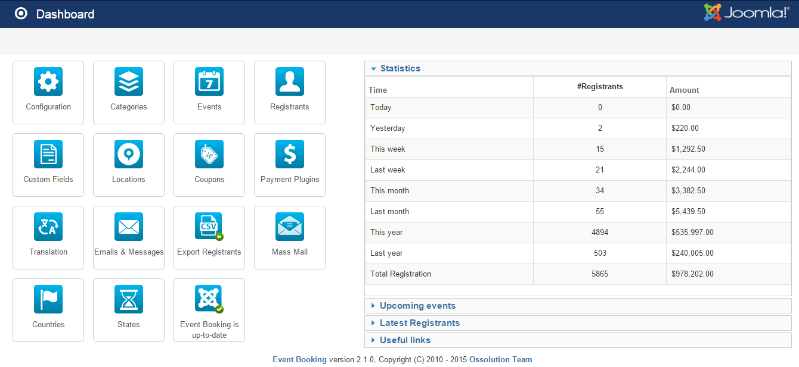
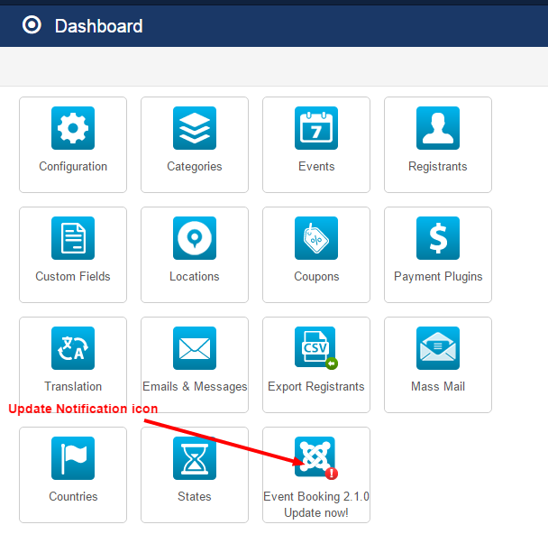
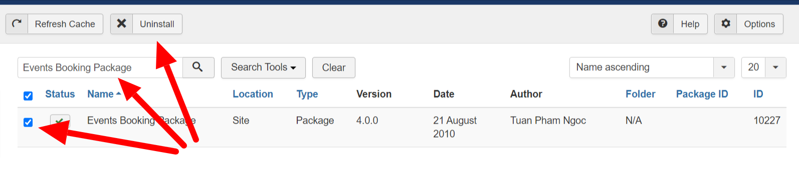

## Installation
When you purchase **Events Booking**, you receive an email with a ZIP file named **event_booking_unzip_first.zip**. Extract it to find the **Language Packages** folder and the **com_eventbooking.zip** installation package.

### Install the component, modules and plugins

The **com_eventbooking.zip** package includes the component, modules, and plugins.

1. Log in to the administrator area of your site using a super administrator account.
2. Go to **System => Extensions => Install**.
3. Browse for the file **com_eventbooking.zip**.
4. Click **Upload & Install**.

After installation, Events Booking opens the dashboard so you can start configuring the extension.

### Install the CB Registration History plugin
This optional plugin requires the **Community Builder** extension. Install it only if your site uses Community Builder. Events Booking itself works independently of Community Builder.

1. Download the plugin [plug_cb_ebregistrationhistory.zip](plug_cb_ebregistrationhistory.zip) 
2. Log in to the administrator area of your site.
3. Go to **Components => Community Builder => Plugins management**.
4. Click **install plugin**.
5. Browse for the **plug_cb_ebregistrationhistory.zip**
6. Click **Upload and Install**.

## Check for new version

To check whether an update is available, go to **Events Booking => Dashboard** and look for the update notification icon in the lower-right corner.

1. If you have the latest version, the icon shows **Events Booking is up-to-date**.
2. If an update is available, you’ll see a message such as **Events Booking 5.0.3 Update now!**. Log in at [https://joomdonation.com](https://joomdonation.com), open [My Downloads](https://joomdonation.com/my-downloads.html), and download the latest version. Follow the manual update instructions below to install it.

### Update
Use **Joomla Update** to install new versions of **Events Booking** from your site’s administrator area.

1. Go to [https://joomdonation.com/download-ids.html](https://joomdonation.com/download-ids.html) and get the **Download ID** for your account.
2. Go to **Events Booking => Configuration** and enter the **Download ID** in the **Download ID** setting.

Joomla will notify you about new versions of **Events Booking** in the administrator area and on the Events Booking dashboard. Click the update link to install the new version.

Generate a unique **Download ID** for each website. You can use the same **Download ID** for all our products installed on that website.

### Update Manually
If you need to update manually, log in to your account on our website and open **My Downloads** at [https://joomdonation.com/my-downloads.html](https://joomdonation.com/my-downloads.html). Download the latest version and install it using the same steps as for a new installation.

## Uninstall
Follow these steps to uninstall **Events Booking**.

1. Log in to the administrator area of your site using a super admin account
2. Go to **System** => **Manage** => **Extensions**.
3. Search for **Events Booking Package**.
4. Select the checkbox next to the package
5. In the toolbar, click **Actions** => **Uninstall** to remove the Events Booking package.

This removes the Events Booking component, modules, and plugins.

>>>>> When you uninstall **Events Booking**, the database tables related to the extension won't be uninstalled. By doing that, when you re-install the extension in the future, all the old data will be kept and still be available. If you want to completely removing it, please access to your site database via phpmyadmin, look at all the tables with prefix **_eb_** and drop these tables.

## Move data from one site to a new site
To move **Events Booking** data to another site, follow these steps.
1. Export all **Events Booking** related database tables from old site via phpmyadmin (table with **_eb_** prefix)
2. If the new site uses a different database table prefix, open the exported SQL file in a text editor and use Find and Replace to update the prefix.
3. Import the tables into the new site’s database using phpMyAdmin.
4. Install the latest version of Events Booking on the new site to update the database schema. If the site already runs the latest version, go to Tools -> Fix Database Schema.

## Upgrade To Joomla 4/Joomla 5

1. Install latest version of Events Booking your Joomla 3 website. The latest Joomla 3 compatible version is 4.9.4, please submit a support ticket asking us to send you that old version.
2. Then update your site directly to Joomla 4. The latest version of Events Booking works well with both Joomla 3 and Joomla 4.
3. If you build the Joomla 4 website from scratch for some reason, you can follow the instructions in **[Move data from one site to a new site](https://docs.joomdonation.com/eventsbooking/getting-started/installation#move-data-from-one-site-to-a-new-site)** above to move data from Joomla 3 website to Joomla 4 website.