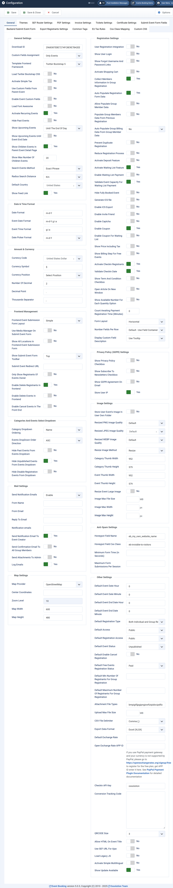

**Events Booking** creates a default configuration during installation. Review the settings and adjust them to suit your site.

Go to **Events Booking => Configuration** to review or change the settings.

>>>>> Hover over a setting’s name to see what it does.

The sections below cover the main settings. Contact support if you have questions about other settings.

## Template Frontend Framework

Choose these settings based on the frontend framework your site template uses.

1. **Load Twitter Bootstrap CSS**: This should be set to **No** unless your site template is built on a frontend framework not supported by Events Booking (currently **Twitter Bootstrap 3**, **Twitter Bootstrap 4**, **Twitter Bootstrap 5** and **UIKIT3** are supported).
2. **Template Frontend Framework**: The default is **Twitter Bootstrap 5**, which most Joomla 4 and Joomla 5 templates use. If your site template uses Twitter Bootstrap 3, Twitter Bootstrap 4, or UIKIT3, select the corresponding value.
- If your site template is built on Twitter Bootstrap 3, set it to **Twitter Bootstrap 3**.
- If your site template uses Twitter Bootstrap 4, set it to **Twitter Bootstrap 4**.
- If your site template uses Twitter Bootstrap 5, set it to **Twitter Bootstrap 5**.
- If your site template uses UIKIT3 (for example, a YOOtheme template), set it to **UIKIT3**.

### Use Twitter Bootstrap 3
Use this setting if your site template uses **Twitter Bootstrap 3**.

- Set **Load Twitter Bootstrap CSS** config option to **No**
- Set **Template Frontend Framework** config option to **Twitter Bootstrap 3**

### Use Twitter Bootstrap 4
Use this setting if your site template uses **Twitter Bootstrap 4**.

- Set **Load Twitter Bootstrap CSS** config option to **No**
- Set **Template Frontend Framework** config option to **Twitter Bootstrap 4**

### Use Twitter Bootstrap 5
Use this setting if your site template uses Twitter Bootstrap 5.

- Set **Load Twitter Bootstrap CSS** config option to **No**
- Set **Template Frontend Framework** config option to **Twitter Bootstrap 5**

### Use UIKIT 3
Use this setting if your site template uses UIkit 3, as YOOtheme templates typically do.

- Set **Load Twitter Bootstrap CSS** config option to **No**
- Set **Template Frontend Framework** config option to **UIKIT 3**

## Date Time Format
To use your country’s date and time formats, go to Events Booking -> Configuration and review the following settings in the **Date & Time Format** section.

- **Date Format** : Control the format of date displayed in the extension, for example Registration Date of registration record
- **Event Date Format**: Control the format of datetime data displayed in the extension, for example Event Date, Event End Date, Registration Start Date....
- **Time Format**: Control format of event time displayed in calendar (Monthly Calendar or Full Calendar menu item type)
- **Date Picker Format**: Set the format for date fields on the registration form.

See [DateTime Format Paramers](https://www.php.net/manual/en/datetime.format.php#refsect1-datetime.format-parameters) for a list of supported parameters in these config options.

>>>>> To switch from a 12-hour clock to a 24-hour clock, change **Event Date Format** from **m-d-Y g:i a** to **m-d-Y H:i** and **Time Format** from **g:i a** to **H:i**.

## General

1. **Assign Custom Fields to category instead of to events**: By default, you assign custom fields to individual events. Set this to **Yes** to assign a custom field to a category and use the same fields for all events in that category.
2. **From Name**: Enter the sender name for emails to administrators and registrants. If you leave it blank, Events Booking uses the **From Name** in your site’s Global Configuration.
3. **From Email**: Enter the sender address for emails to administrators and registrants. If you leave it blank, Events Booking uses the **From email** in your site’s Global Configuration.
4. **Notification emails**: Enter the addresses that should receive a notification when someone registers for an event. Separate multiple addresses with commas. For example: **paypal@joomdonation.com,acounting@joomdonation.com**.
5. **Enable captcha protection**: If you want to use Captcha on Events Booking to prevent spam, you need to set this config option to **Yes**. As **Membership Pro** uses Joomla core captcha, beside setting this config option to Yes, you need to config Joomla core re-captcha plugin, too. Please see [https://docs.joomla.org/How_do_you_use_Recaptcha_in_Joomla%3F](https://docs.joomla.org/How_do_you_use_Recaptcha_in_Joomla%3F) for instructions.
6. **Enable Coupon Feature**: Set this to **Yes** to let registrants enter a coupon code on the registration form for a discount.
7. **User registration integration**: Set to **Yes** to let registrants enter a username and password to create a Joomla account while registering for an event.
8. **Activate Shopping Cart**: Set to **Yes** to let registrants sign up for several events in one checkout. The shopping cart replaces the **Individual + Group registration option**.
9. **Activate Deposit Feature**: Set this to **Yes** to configure a fixed or percentage deposit for each event. Registrants can pay in full when they register or pay the deposit up front and settle the balance when they attend.
10. **Prevent duplicate registration**: If set to Yes, a user won't be allowed to register for the same event twice.
11. **Activate recurring events**: Set this to **Yes** to create daily, weekly, monthly, or yearly recurring events. The feature is disabled by default.

## Invoice Settings

1. **Activate Invoice Feature**: Set to **Yes** to send PDF invoices to registrants after they register and pay for a paid event.
2. **Send invoice to registrants**: Set to Yes to attach a PDF invoice to the registration confirmation email. If you set it to No, registrants can download the invoice from the **registration history** page. Set this option to Yes if you use the invoice feature.
3. **Send copy of invoice to administrators**: Set to **Yes** to receive a copy of the PDF invoice sent to registrants.
4. **Invoice Start Number**: Enter the number you want to use for the first invoice. The default is 1.
5. **Invoice Format**: Events Booking creates a basic invoice layout during installation. Review the layout and adapt it to your needs, including replacing the invoice logo.
6. **Invoice format (cart activated)**: If you use shopping cart feature, please change invoice layout in this setting instead of **Invoice Format** config option
