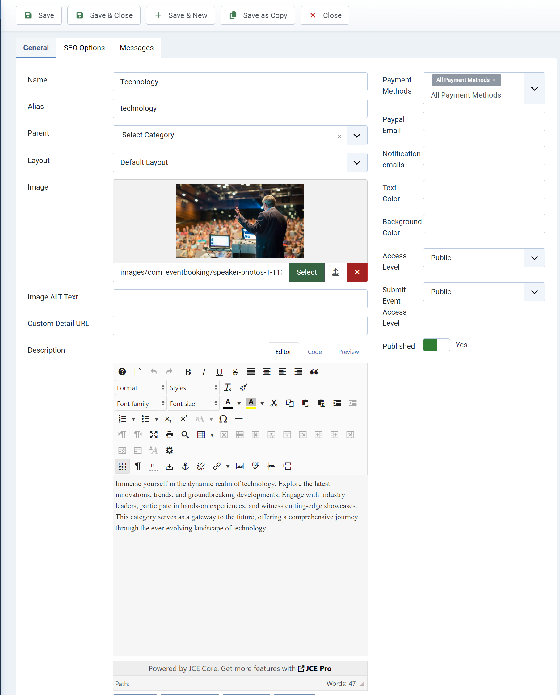
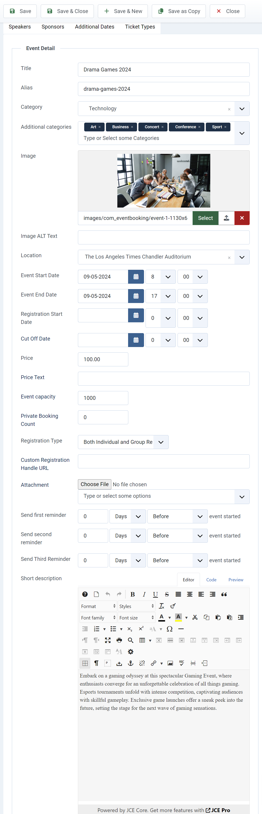
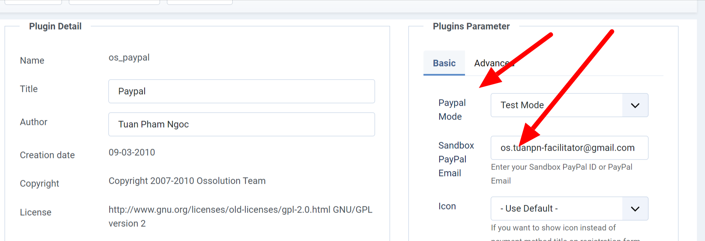
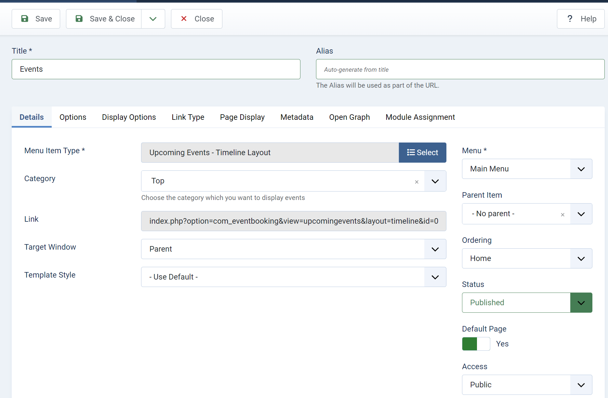
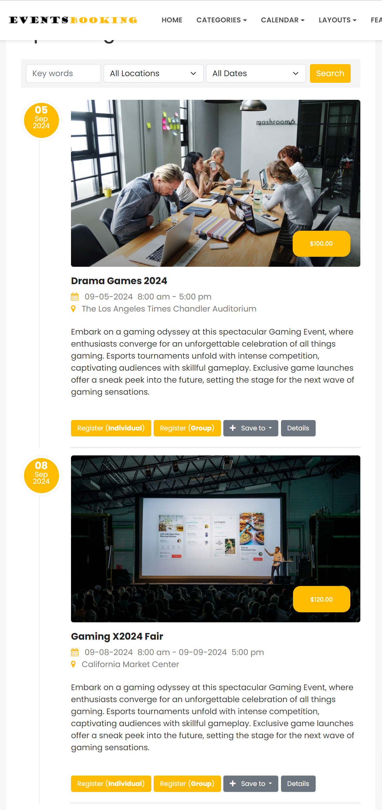
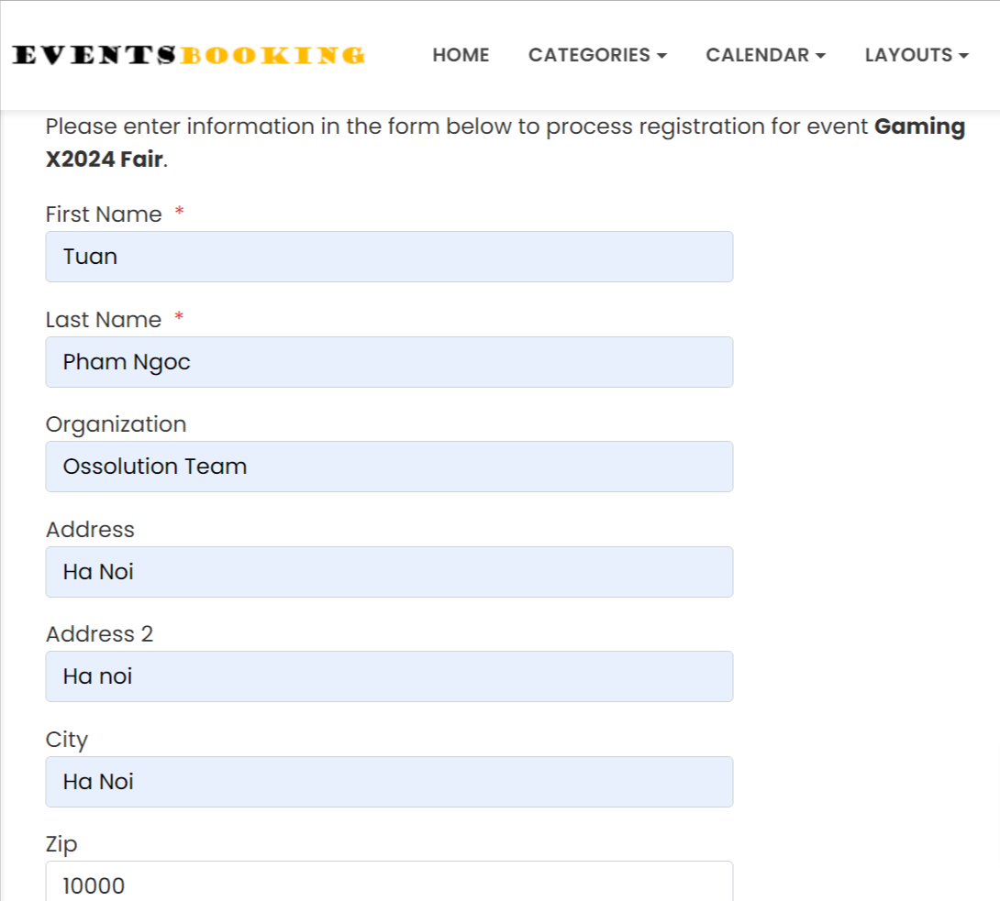
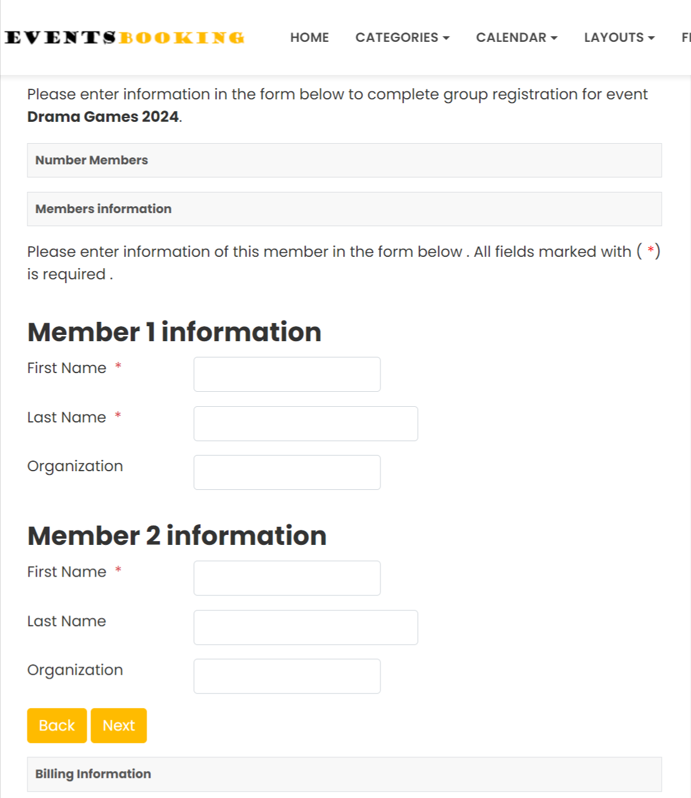

These steps show you how to start accepting event registrations on your site.

**1. Setup Categories**

Open Events Booking in the administrator area and go to Setup -> Categories. Click **New** in the toolbar to create at least one category. Enter a Name and Description and add an image if you have one. The other information is optional.

**2. Setup Events**

Open Events Booking in the administrator area and go to Events -> Events. Click New in the toolbar to create at least one event. Start with the basic event details below.

- Title
- Category
- Optional Image
- Event Date
- Short Description (will be displayed on events list page)
- Description (will be displayed on event details page)

**3. Configure Payment Plugin**

For a paid event, configure a payment plugin so users can pay when they register. In Events Booking, go to **Setup -> Payment Plugins** to see the included plugins. Unpublish any plugins you want to hide from users during registration.

If you use PayPal, edit the os_paypal payment plugin. Enter your PayPal account, select Sandbox or Live mode, and save the plugin. You can also publish the os_offline payment plugin.

**4. Display Your Events**

Create a menu item so visitors can browse events, see event details, and register. Events Booking can also display events in a module.

1. Open the administrator area of your site
2. Go to Menus -> Main Menu. Click New in the toolbar to create a menu item.
3. In Menu Item Type, click Select to open the list of menu item types.
4. In the popup, expand Events Booking and select **Upcoming Events - Timeline Layout**.
5. Enter a title, keep the default values for the other parameters, and save the menu item.

5. **Users Browse And Register For Evens**

Visitors can open the Events menu item on your site to browse upcoming events. They can click Register (individual) to register one person or Register (Group) to register multiple people. They then complete the form and pay if the event requires payment.

Once payment is complete, the administrator and registrants receive a registration confirmation email. If enabled, the email can also include a PDF invoice or ticket.

