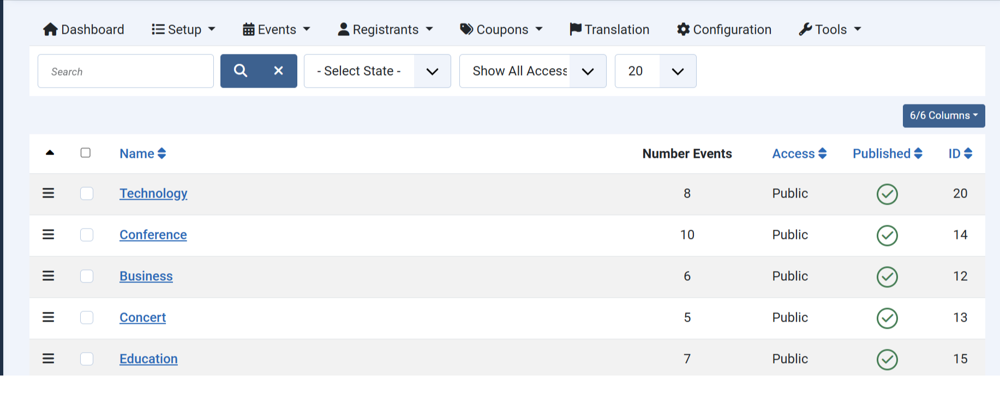
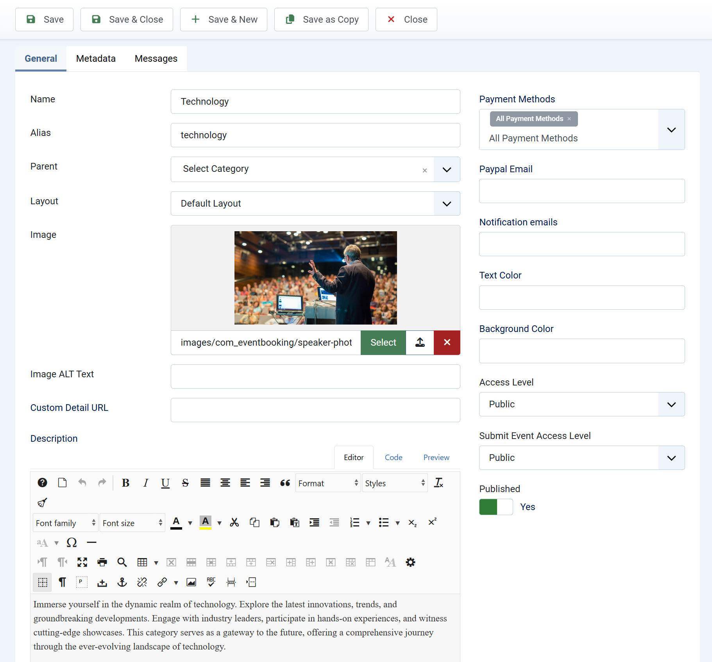

Categories help you organize your event calendar so visitors can easily browse related events and find those they want to register for. For example, you might group events into **Conferences**, **Workshops**, and **Training Courses**, or organize them by topic.

In **Events Booking**, you can create categories and subcategories at any depth. Categories can also provide shared settings, such as payment methods and registration messages, so you do not have to configure the same options for every event.

Open the Categories management page in either of these two ways.

1. Go to **Components -> Events Booking -> Categories**.
2. From any Events Booking page, go to **Setup -> Categories**.

## Add or Edit a Category

Click **New** in the toolbar to create a category, or click an existing category's name to edit it.

To create a basic category:

1. Enter a **Name**, such as **Workshops**. You can leave **Alias** blank to generate it automatically.
2. Leave **Parent** set to **- No Parent -** for a top-level category, or choose a parent to create a subcategory.
3. Set **Access Level** to **Public** if everyone should be able to see the category, and set **Published** to **Yes**.
4. Click **Save & Close**.

You can leave the optional settings at their defaults and return to them later. The following sections explain each setting.

### General Information

The **General** tab contains the category's main settings. For settings that can be configured at several levels, Events Booking uses this priority: **event settings first, then main category settings, and finally global settings**. The field descriptions below explain the applicable defaults.

When an event belongs to more than one category, its **main category** supplies the default tax rate, payment methods, PayPal email, notification emails, and messages described below.

| Property | Description |
| ------ | ----------- |
| Name | Enter the category name visitors see. This field is required. |
| Alias | The alias is used in URLs for the category and its events. If you leave it blank, Events Booking generates an alias from the category name. |
| Parent | Choose a parent category to create a subcategory, or select **- No Parent -** to create a top-level category. |
| Layout | Choose how to display events on the category page. Available options are **Default Layout**, **Table Layout**, **Timeline Layout**, **Columns Layout**, **Grid Layout**, and **List Layout**. |
| Image | Choose the category image. Its display depends on the frontend layout and display settings. |
| Image ALT Text | Enter alternative text describing the category image for screen readers and for use when the image cannot be displayed. |
| Custom Detail URL | Enter a custom URL for the category page if you need one, such as when you build the page with a page builder. Otherwise, leave this field blank. |
| Description | Enter the category description. Its display depends on the frontend layout and display settings. |
| Tax Rate | Enter a percentage, such as **10** for 10% tax. This field is available only when **Activate Simple Tax** is set to **Yes** in Configuration. Events use the main category's rate unless their own tax rate is greater than 0. See [Tax Rules](/basic-setup/tax-rules) for details. |
| Payment Methods | Choose the published payment methods available for events in this category. Payment methods selected for an individual event take precedence. Select **All Payment Methods**, or leave the selection empty, to allow all published payment methods when the event does not specify its own. |
| PayPal Email | For the **PayPal** payment plugin, enter the PayPal account email address that should receive payments for events in this category. An email entered for an individual event takes precedence. Leave this field blank to use the payment plugin's account when the event does not specify one. |
| Notification Emails | Enter the email addresses that should receive registration notifications for events in this category. Separate multiple addresses with commas. Addresses entered for an individual event take precedence. Leave this field blank to use the global **Notification Emails** setting when the event does not specify its own. |
| Text Color | Choose the text color used for events in this category on the calendar. |
| Background Color | Choose the background color used for events in this category on the calendar. |
| Access Level | Choose who can see this category. Select **Public** for a category everyone can see. |
| Submit Event Access Level | Choose the access level required to submit events to this category from the frontend. Users must also have permission to submit events. |
| Language | Choose the category's language, or select **All** for all languages. This field is available only on multilingual sites. |
| Published | Choose whether the category is published and available on the frontend. |

### Fields

The **Fields** tab appears only when category custom fields have been configured for your site. Use it to enter the additional information required by those fields. The available fields depend on your site's customization.

### Metadata

Use the **Metadata** tab to customize the category page's title, heading, and metadata.

| Property | Description |
| ------ | ----------- |
| Browser Page Title | Enter a custom title for the browser tab. Leave this field blank to use the default page title. |
| Page Heading | Enter a custom heading for the category page. The category name is used when this field is blank and no heading is supplied by the menu item. The heading's visibility depends on the page's display settings. |
| Meta Description | Enter a short description of the category page. Search engines may use it as the description in search results. |
| Keywords | Enter an optional comma-separated list of keywords or phrases to include in the page's HTML metadata. |
| Robots | Choose **Use Global**, **index, follow**, **noindex, follow**, **index, nofollow**, or **noindex, nofollow**. These values tell search engines whether to index the page and follow its links. Leave **Use Global** selected to use the inherited setting. |

### Messages

Use the **Messages** tab to customize registration messages and emails for events in this category. Leave a field blank to use its global value from **Events Booking -> Emails & Messages**. For each message, Events Booking uses the first available value in this order:

1. The message configured for the event.
2. The message configured for the event's main category.
3. The global message configured in **Events Booking -> Emails & Messages**.

| Property | Description |
| ------ | ----------- |
| Registration Form Message (Individual) | The message displayed above the individual registration form. You can use **[EVENT_TITLE]** to include the event title. |
| Registration Form Message (Group) | The message displayed above the group registration form. You can use **[EVENT_TITLE]** to include the event title. |
| Admin Email Body | The body of the registration notification email sent to administrators. |
| User Email Subject | The subject of the registration confirmation email sent to the registrant. |
| User Email Body | The body of the registration confirmation email sent to the registrant. |
| User Email Body (Offline Payment) | The confirmation email body used when the registrant chooses an offline payment method. |
| Group Member Email Body | The email body sent to individual group members when group member emails are enabled. |
| Thank You Message | The message displayed after registration is completed. |
| Thank You Message (Offline) | The message displayed after registration using an offline payment method. |
| Registration Approved Email Body | The email body sent when a registration is approved. |
| First Reminder Email Subject / First Reminder Email Body | The subject and body of the first reminder email. |
| Second Reminder Email Subject / Second Reminder Email Body | The subject and body of the second reminder email. |
| Third Reminder Email Subject / Third Reminder Email Body | The subject and body of the third reminder email. |

Additional subject and body fields for the fourth, fifth, and sixth reminders appear when those reminders are supported by your installation. Customizing reminder messages does not enable or schedule reminders. See [Setup Reminder](/basic-setup/auto-reminder) to configure when they are sent.

Use the placeholders supported by each message to insert registration or event details. For example, **[REGISTRATION_DETAIL]** inserts registration details in registration emails, and **[MEMBER_DETAIL]** inserts a group member's details in the group member email. See [Emails & Messages](/basic-setup/emails-messages) for more information.

### Category Custom Settings

The **Category Custom Settings** tab appears only when a custom settings layout has been added to your site. Its settings depend on that customization.

### Translation

On multilingual sites, use the **Translation** tab to enter translations for each additional language configured in Events Booking. You can translate the category's **Name**, **Alias**, **Custom Detail URL**, **Browser Page Title**, **Page Heading**, **Keywords**, **Meta Description**, and **Description**.

When **Activate Simple Multilingual** is set to **No** in Configuration, this tab also includes translations for the registration form messages, admin and user email bodies, group member email body, thank you messages, and registration approved email body.

See [Multilingual](/advanced-features/multilingual) for the full setup instructions.

## Assign a Category to an Event

After saving the category, go to **Events Booking -> Events** and open the event's add/edit form.

1. In **Category**, select the event's main category. For example, choose **Workshops** for a practical training session.
2. If the event should also appear in other categories, select them in **Additional Categories**. This field appears when additional category selection is enabled in your site's backend event form settings.
3. Click **Save & Close**.

The main category supplies the category defaults described above. Additional categories let visitors find the same event under other relevant topics; they do not supply those defaults.

Only published categories are available for selection. How categories and their events appear on the frontend depends on your menu items, modules, layouts, and display settings.

## Manage Existing Categories

### Find and Edit Categories

Use the search box and the publication status or access level filters to find a category. Click its name to edit it. The **Number Events** column links to the Events management page filtered by that category, which is useful when reviewing its assigned events.

### Publish or Unpublish

Click a category's status icon in the **Published** column to change its status. To update several categories together, select their checkboxes and click **Publish** or **Unpublish** in the toolbar.

Unpublishing removes a category from the published category lists and from category selection when editing events. It does not change the publication status of its events or subcategories. Review those records separately if you also want to unpublish them.

### Change Category Order

Sort the list by the ordering column at the far left, then drag a category's ordering handle to its new position. Categories can be reordered within the same parent. To move a category under a different parent, edit its **Parent** setting.

The saved order is used where the frontend is configured to display categories by ordering. Menu items, modules, and category dropdowns can use their own sorting settings.

### Change Access Levels Together

To apply the same access level to several categories, select their checkboxes and click **Batch**. Choose the access level and process the batch. This updates **Access Level** for the selected categories.

### Delete Categories

Before deleting a category, review its assigned events and subcategories. Update affected events to use another main category or remove the category from **Additional Categories**, as appropriate. Move any subcategories to another parent, or make them top-level categories.

Select the category's checkbox, click **Delete**, and confirm the deletion. Deletion permanently removes the category. It does not delete its events or subcategories, or automatically reassign them to another category.
