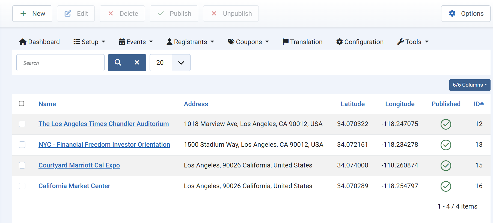
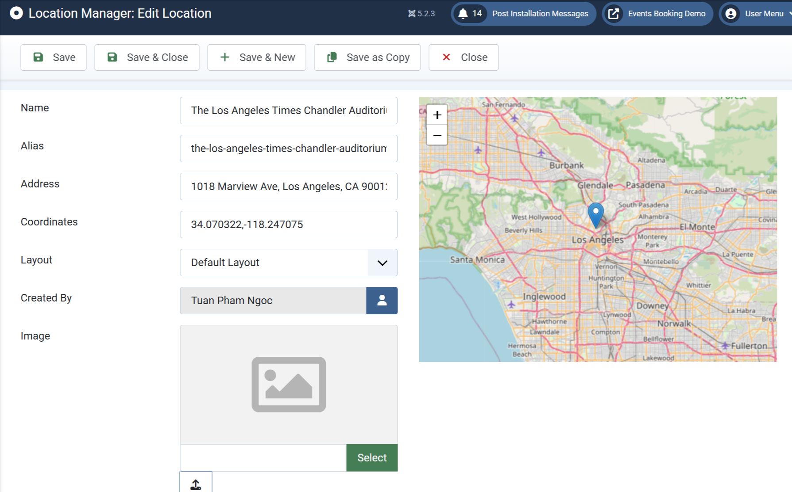

Locations are the venues where your events take place, such as conference centers, training rooms, or sports facilities. Adding venue details helps visitors see where an event will be held and find it on a map before registering or attending.

In **Events Booking**, you can create a location once and select it for any events held at that venue. You can include an address, map coordinates, an image, and a description. Depending on your display settings, visitors can view venue information from event listings and event details pages, and browse other events at the same location. Maps use either Google Maps or OpenStreetMap, as configured for your site.

Open **Locations Management** in either of these two ways.

1. Go to **Components** -> **Events Booking** -> **Locations**.
2. From any Events Booking page, go to **Setup** -> **Locations**.

## Add or Edit a Location

Click **New** in the toolbar to create a location, or click an existing location's name to edit it.

To create a basic location:

1. Enter a **Name**, such as **City Conference Center**. You can leave **Alias** blank to generate it automatically.
2. Enter the venue's **Address**, then choose a search suggestion or use **Get Location From Address** with Google Maps to fill in **Coordinates**.
3. Check the marker's position on the map and adjust it if necessary. See **Set the Map Position** below for details.
4. Set **Published** to **Yes** and click **Save & Close**.

You can add an image, description, and other optional details later. The following sections explain each setting.

### General Information

| Property | Description |
| ------ | ----------- |
| Name | Enter the venue name visitors see, such as **City Conference Center**. This field is required. |
| GSD Venue Mapping | Enter the venue name to use with the Google Structured Data extension by Tassos. This field appears only when its Events Booking integration plugin is enabled. In Google Structured Data, map this field to **Venue** under **Location**. |
| Alias | The alias is used in the URL for the page that lists events at this location. If you leave it blank, Events Booking generates an alias from the location name. |
| Address | Enter the venue's address. Choose a matching search suggestion to position the map marker and fill in the coordinates, or use **Get Location From Address** when Google Maps is selected. See the map instructions below. |
| City | Enter the venue's city. This field appears when an instance of the Events Booking Cities module is published. It provides the city used to group events in that module. |
| State | Enter the venue's state or province. This field appears when an instance of the Events Booking States module is published. It provides the state used to group events in that module. |
| Zip | Enter the venue's ZIP or postal code. This field appears only when postal code entry for locations has been enabled for your site. |
| Coordinates | Enter the latitude and longitude, in that order, separated by a comma, such as **10.7769,106.7009**. These values determine the venue's position on the map. Address searches and dragging the map marker can fill in this field for you. |
| Layout | Choose how to display the list of events at this location. Available options are **Default Layout**, **Table Layout**, and **Timeline Layout**. |
| Created By | The Joomla user recorded as the creator of the location. New locations are assigned to the current user when saved. |
| Image | Choose an image of the venue. It can be displayed with the location description and in event details, depending on your display settings. |
| Published | Choose whether the location is published. |
| Description | Enter information about the venue, such as access instructions, parking, or facilities. This can be displayed on the location page and in event details, depending on your display settings. |
| Language | Choose the location's language, or select **All** for all languages. This field appears only on multilingual sites. |

### Set the Map Position

The map provider is selected globally in **Events Booking -> Configuration -> General -> Map Settings**, using **Map Provider**. If you select **Google Map**, enter your **Google Map API Key** in the same section.

#### Google Maps

1. Enter the venue address in **Address**.
2. Choose a matching address from the suggestions, or click **Get Location From Address** to find it on the map.
3. Check the marker's position. Drag it to the correct position if necessary. When the address lookup succeeds, dragging the marker updates both **Address** and **Coordinates**.

#### OpenStreetMap

1. Enter at least three characters in **Address**, then choose a matching search suggestion.
2. Check the marker's position. Selecting a suggestion fills in **Coordinates** and any available **City**, **State**, and **Zip** values for fields shown on the form.
3. Drag the marker if necessary. This updates **Coordinates** and looks up the address for the new position. Review the address and any other values filled in before saving.

You can also enter **Coordinates** manually if you already know the venue's latitude and longitude. Check that the address and coordinates refer to the same venue.

### Translation

On multilingual sites, the form includes **General** and **Translation** tabs when additional languages are configured in Events Booking. Use the **Translation** tab to translate the location's **Name**, **Alias**, and **Description** for each additional language.

See [Multilingual](/advanced-features/multilingual) for the full setup instructions.

## Assign a Location to an Event

After saving the location, go to **Events Booking -> Events** and open the event's add/edit form.

1. Select the venue in **Location**. This field appears when location selection is enabled in your site's backend event form settings.
2. Click **Save & Close**.

Only published locations are available for selection. You can use the same location for multiple events, keeping the venue information in one place. Changes to that location's details apply wherever those events display its venue information.

Depending on your display settings, visitors can view the venue information and map from event listings or event details pages, and browse the events held at that location.

## Manage Existing Locations

### Find and Edit Locations

Use the search box to find a location, then click its name to edit it. On multilingual sites, you can also filter the list by language. Click a sortable column heading, such as **Name** or **Address**, to change the list order.

### Publish or Unpublish

Click a location's status icon in the **Published** column to change its status. To update several locations together, select their checkboxes and click **Publish** or **Unpublish** in the toolbar.

Unpublishing removes a location from the location selection list when editing events. It does not clear the location assigned to existing events or change those events' publication status. To change an event's venue, edit its **Location** setting.

### Delete Locations

Before deleting a location, review the events that use it and update their **Location** setting to another venue, or clear the selection if the event no longer needs a location.

Select the location's checkbox, click **Delete**, and confirm the deletion. Deletion permanently removes the location. It does not delete its events or automatically assign them to a replacement venue.
