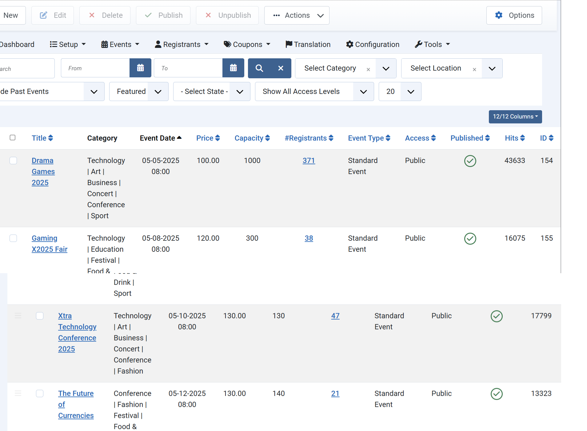
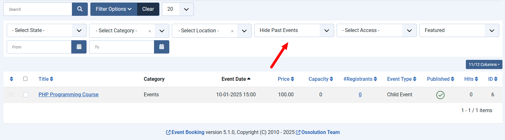

**Events** are the core of Events Booking. Once you set up events, visitors can browse them, register, and pay when required.

* Events can be **Free Events** or **Paid Events**.
* You can enable **Invidiual Registration**, **Group Registration**, or **Both**. To display an event without taking registrations, set **Registration Type** to **Disable Registration**.
* Events can have a **specific date** or appear **without a date** if you have yet to decide when they will take place. To create an undated event, set **event date** to **2099-12-31 00:00:00**.
* Events Booking handles registrations within your site by default. To handle registrations on another website, enter its registration URL in the event’s **Custom Registration Handle URL** field.

**Events Booking** has two options to **handle registration**:

1. **Individual/ Group registration** option: This is the default registration option. Depending on the event’s **Registration Type**, visitors may see the following buttons.
* **Register (Individual)** registers one person.
* **Register (Group)** registers a group. You can collect information about each group member or just the billing information of the person making the registration.
2. **Shopping cart** option: This option is off by default. To enable it, go to **Events Booking => Configuration** and set **Activate Shopping Cart** to Yes. It lets users register for several events in one checkout. With this option, you cannot collect information about each group member as you can with group registration.

Events Booking uses one registration option at a time. Choose the option that fits how you want to collect registrations.

Open the event management page in either of these two ways.

1. Go to **Components** => **Events Booking** => **Events**.
2. From any Events Booking page, go to **Setup** => **Events**.

## Display Past Events On Events Management Screen

The Events Management screen hides past events by default. To show them, change the **Hide Past Events** filter to **Event Filter**.

