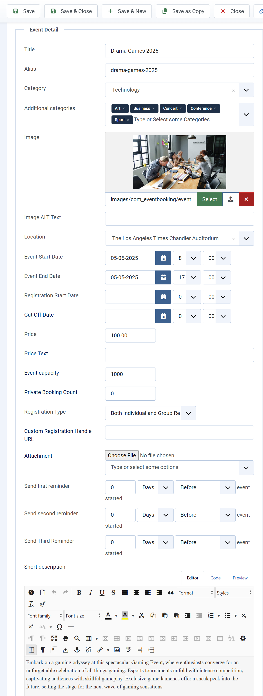
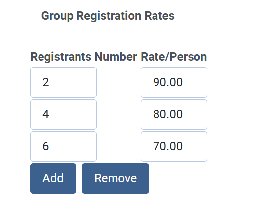
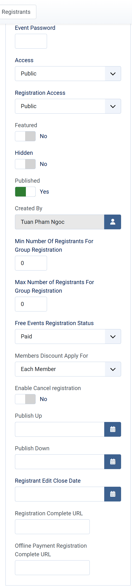
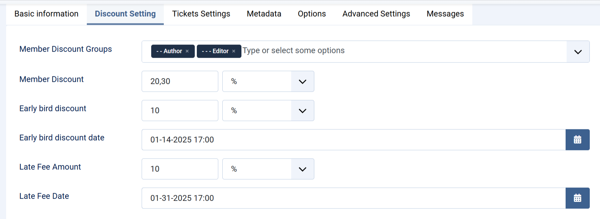
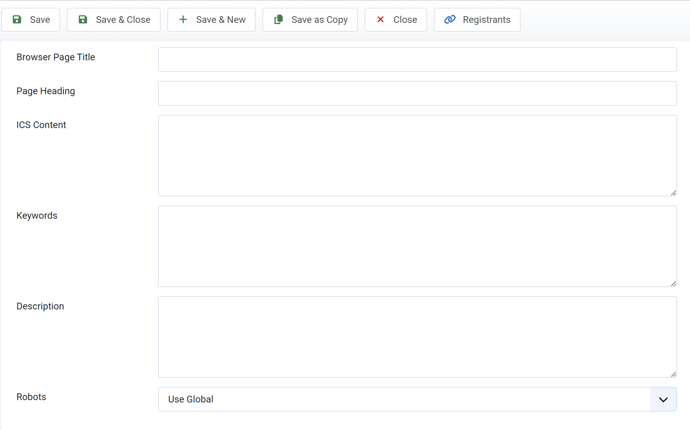
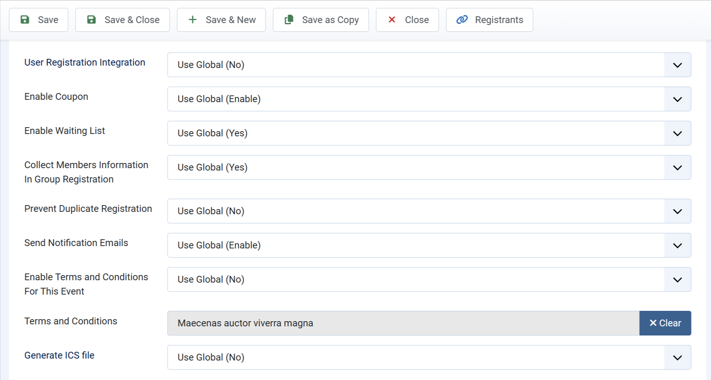
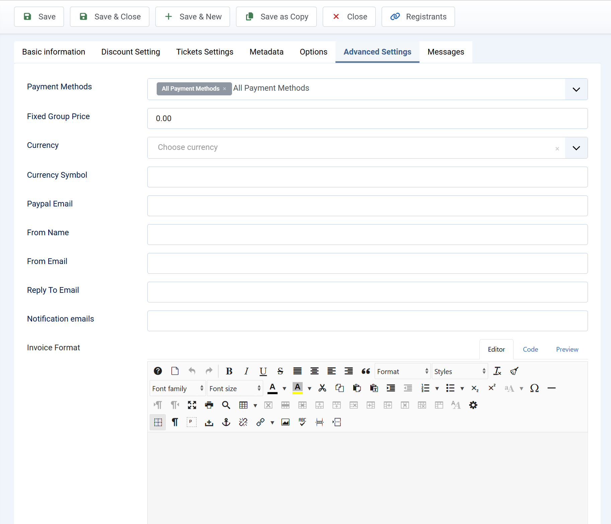
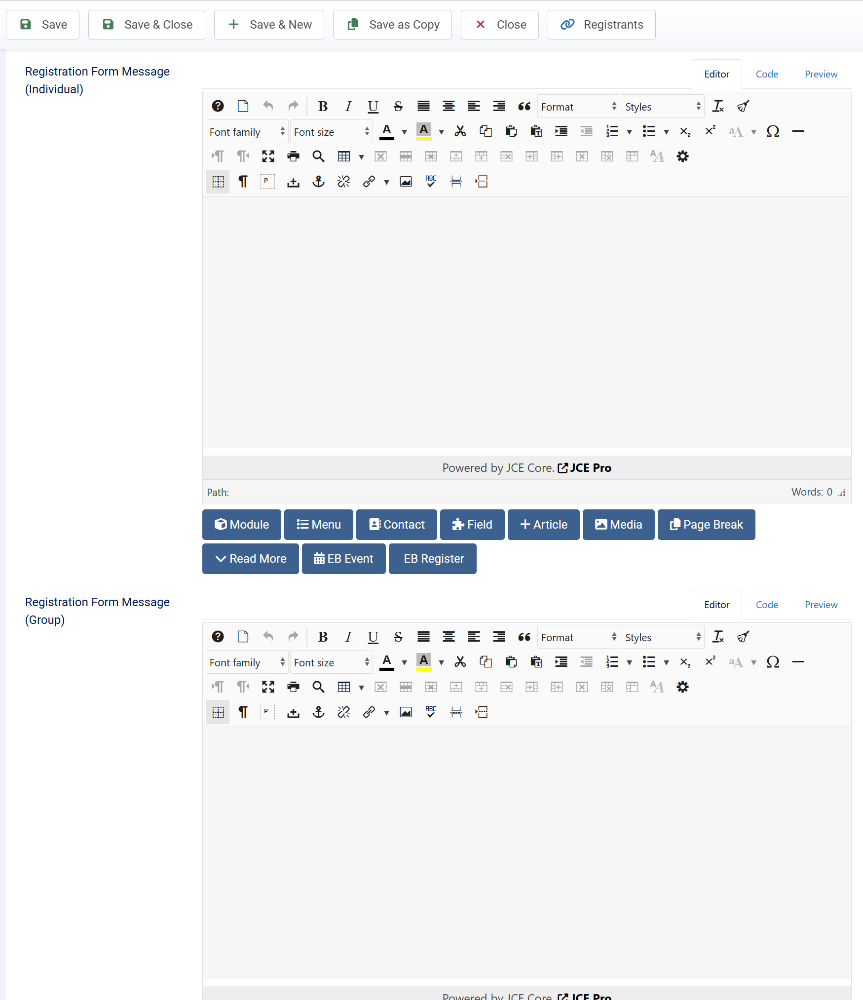

On the events management page, click New in the toolbar to open the form for a new event.

>>> To choose which tabs and fields appear on the add and edit event forms, go to **Events Booking** -> **Configuration** and open **Backend Submit Event Form**. For example, you can hide Messages or Advanced if you don’t need them.

## Basic Information
| Property | Description |
| ------| -----------|
| **Title**   | Title of the event.|
| **Alias**   | The alias is used in the URL for the event details page. Leave it blank to generate an alias from the event title.|
| **Category**   | Choose the event’s **main category**. Events Booking uses it to build part of the event details URL and, if fields are assigned by category, to decide which custom fields appear on the registration form.|
| **Additional Categories **  | Choose any additional categories for the event.|
| **Image**   | Select or upload an image for the event. Events Booking generates a thumbnail and displays the event image in event lists and on the event details page.|
| **Location**   |Choose the event location. Visitors can view it on a map and get directions through Google Maps or OpenStreetMap, depending on your map provider.|
| **Event Start Date **  | Select the start date. Registrations close after the start date unless you set a later Cut Off Date. |
| **Event End Date **  |Select an end date if the event has one. Leave this field blank to omit the end date from the frontend.|
| **Registration Start Date**   |Registration opens as soon as you publish the event by default. To delay registration, select the date when it should open.|
| **Cut Off Date**   | Select when registration closes. Usually, this date is before the event starts. To accept registrations after the event date, set Cut Off Date after Event Date.|
| **Price**   |Set the price for one registrant. If group rates are unset, group registrations cost the Price multiplied by the number of group members. Enter 0 for a free event.|
| **Capacity**   |Set the maximum number of registrants. Once the event reaches capacity, users can no longer register. Enter 0 or leave the field blank to allow unlimited registrations. |
| **Tax Rate**   |Enter the event’s tax rate. Leave the field blank to charge no tax.|
| **Registration Type**   |Choose the registration type you want to allow for this event. There are 4 options: **Both individual and Group registration**, **Only Individual registration**, **Only Group registration**, **Disable Registration**. Please note that **this setting has no effect if you enable Shopping Cart option** |
| **Custom Registration Handle URL**   | If registrations take place outside Events Booking, enter the URL of the registration page. When visitors click Register, Events Booking sends them to that URL. |
| **Attachments**   | Upload a file to send to registrants when they register. By default, registrants receive it by email. To make it downloadable from the event details page, go to **Events Booking -> Configuration**, open the Themes tab, and set **Show attachment in frontend** to **Yes**. |
| **Short Description**   |Enter the summary to display in event lists, such as the category and upcoming events pages. |
| **Description**   |Enter the full description for the event details page. If you leave it blank, Events Booking uses the short description.|

## Group Registration Rates
Use group registration rates to change the price per person based on group size. For example, an event might use the following rates.

1. **Price** : 100$
2. **Group Registration Rates**

| Registrants Number | Rate/Person |
| ------| -----------|
| 2   | 90|
| 4   | 80|
| 6   | 70|

With these rates, the price per person is as follows.
1. Groups of six or more pay $70 per person.
2. Groups of four or five pay $80 per person.
3. Groups of two or three pay $90 per person.
4. One registrant pays $100.

In this example, larger groups pay less per person.

## Misc

| Property | Description |
| ------| -----------|
| **Event Password**   | Set a password to require visitors to enter it before they can register.|
|  **Access**   | Choose who can see the event. Select Public for an event everyone can see.|
| **Registration Access** | Choose who can register, usually Public. To limit registration to users with a site account, select **Registered**.|
| **Featured** | Mark the event as featured to show it at the top of event lists by default.|
| **Hidden** | Mark the event as Hidden. Hidden events won't be displayed on events list page, so normal users won't see it, thus could not register for the event. You can create a hidden menu item to link to that featured event, then send link of that hidden event to the users you want to allow them to access and register|
|  **Min Number of Registrants For Group Registration**   | Set the minimum group size. The default is 2.|
| **Max Number of Registrants For Group**    | Set the maximum group size. The default is 10.|
| **Free Events Registration Status**    | New registrations for free events default to Paid. To start them in Pending status, set this field to Pending.|
| **Members Discount Apply For**    | Choose whether to apply the member discount to each member or to the registration as a whole.|
| **Enable Coupon**    | Choose which registration type can use coupons for this event.|
|  **Enable Cancel Registration**   | Set to **Yes** to allow registrants to cancel their registrations. Set **Cancel Before Date** to the cancellation deadline, usually a date before the event starts. |

## Discount Settings
On the add or edit event form, open the **Discount Setting** tab to configure discounts and late fees.

| Property | Description |
| ------| -----------|
| **Member Discount Groups**   | Select which user groups receive the member discount. If you leave the field blank, all users who are logged in when they register receive the discount.|
| **Discount Amount(s)**| Choose Percent or Amount. Enter one value to give all selected groups the same discount. To give groups different discounts, separate the values with commas. In the example below, members of **Author** get 20% off and members of **Editor** get 30% off.|
|**Early Bird Discount**| Offer a fixed or percentage discount to people who register before the **Early Bird Discount Date**.|
|**Late Fee Amount**| This setting allows you to charge addition fee for registrants who register for the event after a certain date (**Late Fee Date**). This will encourage users to register for the events early. For this type of fee, you can also offer fixed discount amount or discount by percent|

## Metadata
Set the event’s Browser Page Title, Page Heading, Keywords, Description, and Robots. These settings work like their counterparts in other Joomla content types, such as articles.

## Options

Use this tab to override settings from Events Booking -> Configuration for this event.

## Advanced Settings

Use this tab to override configuration settings for this event. Leave fields blank to use the global settings.

The table below describes the main settings.

| Property | Description |
| ------| -----------|
| **Payment Methods**   | Select the payment methods for this event. If you select none, all published payment methods in Payment Plugins Management are available. |
|  **Fixed Group Price**   |Enter a fixed price to charge the same total for every group registration, regardless of group size. Leave this field blank to use the regular pricing.|
|  **Paypal Email**   | Enter a PayPal email address to send this event’s PayPal payments to that account. If you leave it blank, Events Booking uses the address in the payment plugin. |
| **Notification Emails**   | Enter email addresses to receive notifications for registrations for this event. These addresses override the addresses in Configuration.|
| **Currency Code and Currency Symbol**    | Enter a currency code and symbol to use a different currency for this event. |

## Messages

Use this tab to customize messages for this event. Events Booking chooses which message to send in the following order.

- Use the message configured for the event if available.
- Otherwise, use the message configured for the event’s main category if available.
- Otherwise, use the message configured in Events Booking -> Emails & Messages.

