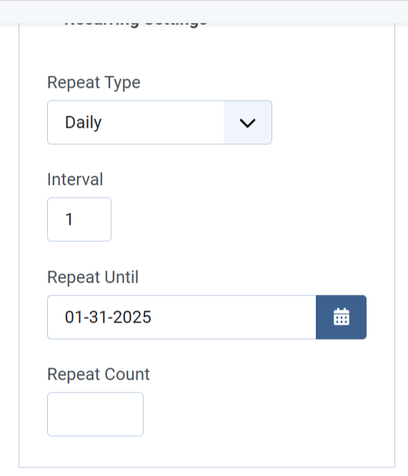
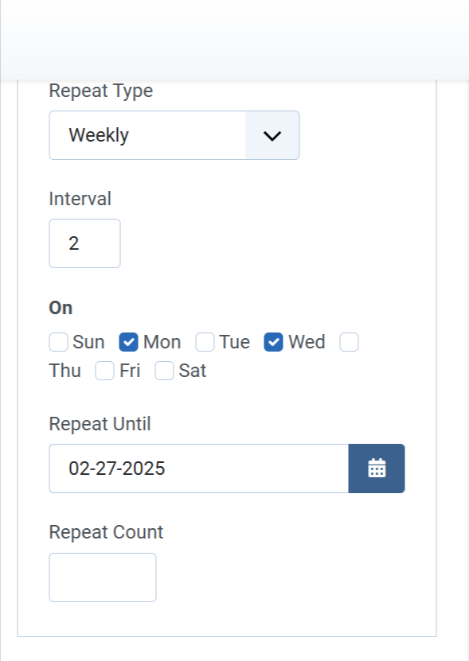
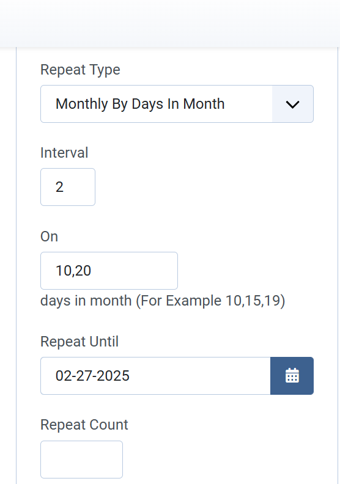
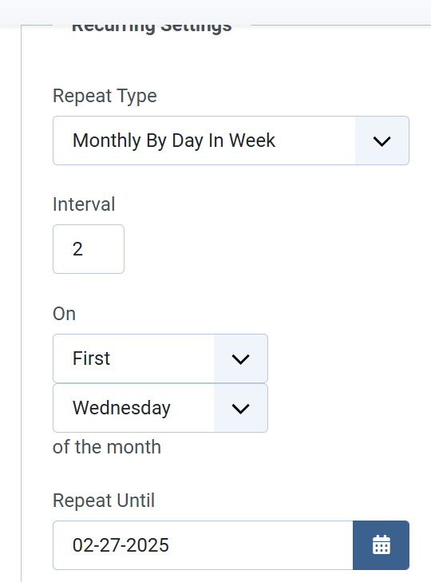
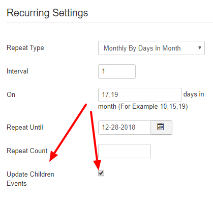

Use recurring events when the title, description, and price stay the same and only the date changes. **Events Booking** supports four recurrence types.

1. **Daily**: Events recur **every X days**.
2. **Weekly**: Events recur on **selected days of the week every X weeks**.
3. **Monthly By Days In Month**: Events recur on specific dates, such as the 15th and 17th, every X months.
4. **Monthly By Day In Week**: Events recur on a **First**, **Second**, **Third**, **Forth** or **Fifth** weekday (Sunday, Monday, Tuesday...) every X months.

Before you create a recurring event, review the following settings.

1. Go to **Events Booking -> Configuration** and set **Activate Recurring Events** to **Yes**.
2. Events Booking creates a separate event for each date in the pattern you choose (**daily, weekly, monthly**). Each event has its own start date and registrants. Recurrence stops when the start date reaches **Repeat Until** or the number of events reaches **Repeat Count**. **Set at least one of these two options.**
3. Each child event has its own settings and registrants. Editing one child event does not affect the others.

## Create Daily Recurring Events

Choose this option to repeat an event **every X days**. In addition to the fields in [create new event section](/basic-setup/events/add-new-event), set the following options.
1. **Repeat Type**: Select **Daily**.
2. **Interval**: Enter 1 to repeat daily, 2 to repeat every two days, and so on. For example, if the event starts on Monday and you enter 2, it repeats on Wednesday, Friday, Sunday, and so on.
3. As with other recurrence types, select a date for **Repeat Until** or enter an integer in **Repeat Count**.

## Create Weekly Recurring Events

Choose this option to repeat an event on selected weekdays **every X weeks**. For example, you can repeat on Mondays and Thursdays every week or every two weeks.

1. **Repeat Type**: Select **Weekly**.
2. **Interval**: Enter 1 to repeat every week, 2 to repeat every two weeks, and so on.
3. Select each weekday when the event should occur. For example, select Mon and Wed to repeat the event on Mondays and Wednesdays at the interval you set.
4. As with other recurrence types, select a date for **Repeat Until** or enter an integer in **Repeat Count**.

The example below repeats on Mondays and Wednesdays every two weeks from the event start date through **27 Feb 2025**.

## Create Monthly By Days In Month Recurring Events

Choose this option to repeat on particular dates every X months, such as the 10th and 15th of every month.

1. **Repeat Type**: Select **Monthly By Days In Month**.
2. **Interval**: Enter an integer to set how often the event repeats. Enter 1 to repeat every month, 2 to repeat every two months, and so on.
3.  In **On**, enter the dates of the month separated by commas. For example, enter **10,20** to repeat on the 10th and 20th at the interval you set.
4. As with other recurrence types, select a date for **Repeat Until** or enter an integer in **Repeat Count**.

## Create Monthly By Day In Week Recurring Events
Choose this option to repeat on a **First**, **Second**, **Third**, **Forth**, or **Fifth** weekday of the month at the interval you set.

1. **Repeat Type**: Select **Monthly By Day In Week**.
2. **Interval**: Enter an integer to set how often the event repeats. Enter 1 to repeat every month, 2 to repeat every two months, and so on.
3.  In the **On** parameter, choose (First|Second|Third|Forth|Fifth) (Sunday|Monday|Tuesday|Wednesday|Thursday|Friday|Saturday) in the two dropdowns.
4. As with other recurrence types, select a date for **Repeat Until** or enter an integer in **Repeat Count**.

The example below repeats on the first Wednesday of every second month from the event start date through 27 Feb 2025.

## Update Information Of Children Events

To apply a change such as a new title, description, or price to every child event, edit the parent event and follow these steps.

1. Go to Events Booking -> Events.
2. Find and open the parent event.
3. Select the **Update Children Events** checkbox.
4. Click Save in the toolbar.

Events Booking applies the changes from the parent to its child events. The screenshot below shows where to find **Update Children Events**.

