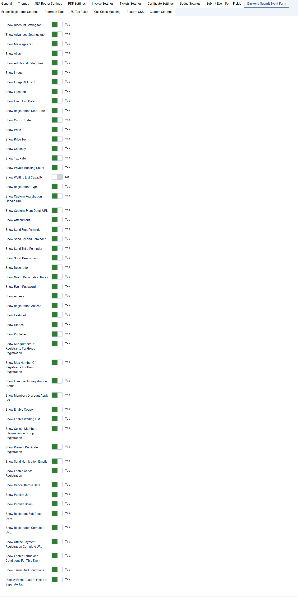

Events Booking displays all tabs and fields on the add and edit event forms by default. To simplify the form, go to Events Booking -> Configuration, open the **Backend Submit Event Form** tab, and hide the tabs and fields you don’t need.

