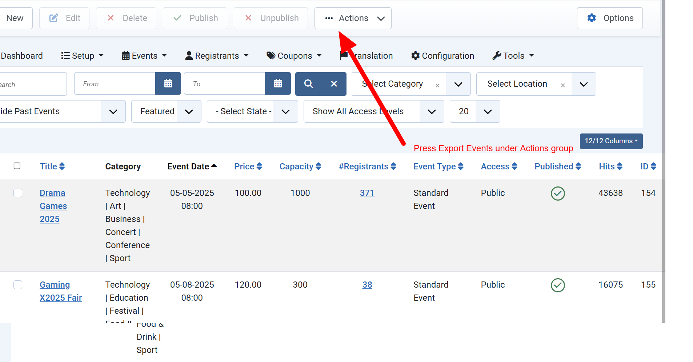

Use **Actions** => **Export Events** in the toolbar on the events management screen to export events to an Excel or CSV file. Apply any filters before clicking **Export Events**. The file contains only the events that match those filters. You can use the file in another system or edit the event data and import it back into Events Booking.

[Sample exported events](events_list_on_2018-03-20.xlsx)

