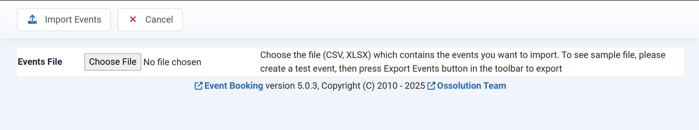

Events Booking allows you to import events from an Excel or CSV file. This can be used for two purposes:

1. **Update existing events data**: Export your events to a CSV or Excel file, make your changes, and import the file to update the existing records.
2. **Import events data** collected outside Events Booking, such as records from another system.

## Prepare events Data
To import events into Events Booking, you need to prepare events data in the format which Events Booking can understand. To do that, you can log in to administrator area of your site, access to Events Booking extension, then **Events -> Export** (https://domain.com/administrator/index.php?option=com_eventbooking&task=task=event.export - https://domain.com needs to be replaced with your site URL)

Events Booking provides an **Import Template** based on your site’s setup. See [sample_import_template.xlsx](sample_import_template.xlsx) for an example. Prepare your data in that format and consider testing the import with a few records first.

1. To update an existing event, enter its ID in the **id** column. Events Booking updates the record if it finds a matching ID and creates a new record otherwise. If you only want to import new events, leave the column blank or remove it.
2. The **location** column must contain the ID or name of an existing location. Create the locations in Events Booking -> Locations before importing the events.
3. The **image** column must contains relative path of the image from root folder of your site (For example images/com_eventbooking/business.jpg) or empty. You need to upload event images to **images/com_eventbooking folder** before importing events. The system will generate thumbnail for each event automatically.
4. In the **category** column, enter the name or, preferably, the ID of the event’s main category.
5. In the **additional_categories** column, enter the names of any additional categories. Separate multiple names with a vertical bar and a space on either side, as in **Category 1 | Category 2**.

## Import Events

After preparing the file, go to **Events => Import** from any Events Booking page. Choose the file and click **Import Events** in the toolbar. When the import finishes, Events Booking shows how many events it imported. Check a few events to make sure the data is correct.

