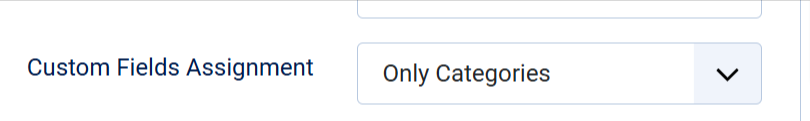
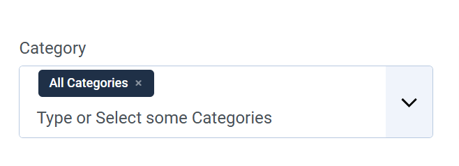
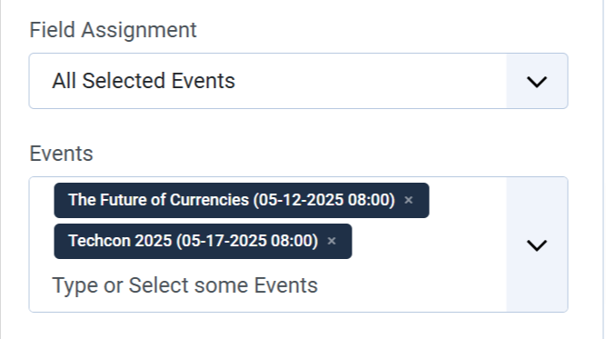
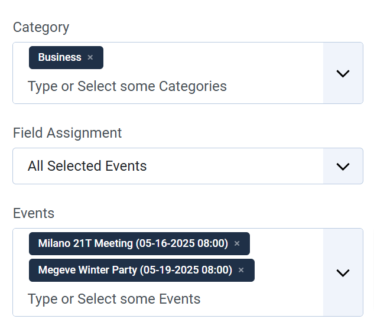

Before adding custom fields, go to Events Booking -> Configuration and use **Custom Fields Assignment** to choose how to assign fields to events.

- **Only Categories**: Assign a field to **All** categories or to selected categories. It appears on registration forms for events in those categories. Choose this option when all events in a category use the same set of fields.

- **Only Events**: Choose this option allows you to assign your custom field to **allow events**, **all selected events**, or **all except selected events**. **Choose this option if in your setup, you want that each event can have it own set of custom fields**.

- **Both**: Assign fields to categories and events. This gives you more control and takes more care to configure. It’s best suited to advanced users with more complex setups.

**Only Categories** is the simplest option, followed by **Only Events**. If you choose **Both**, see [Common Fields Assignment Use-cases](/basic-setup/custom-fields/custom-fields-assignment) for examples.