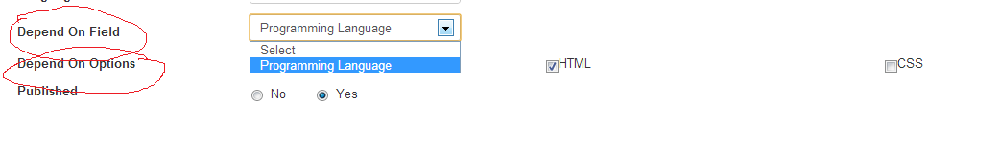
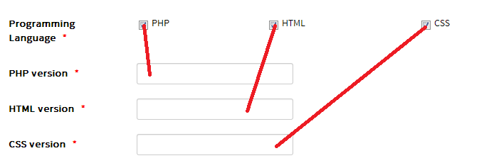

On the custom fields management screen, click **New** in the toolbar. Use the settings below to configure the new field.

### General Information
1. **Name**: The name of custom field.  Please only use the following character for field name: **a-z, A-Z, 0-9**. No space, no special characters in the field name.
2. **Title**: Enter the title registrants see on the form.
3. **Field Type**: Choose the type of field to create.
4. **Description**: For most field types, users see the description when they hover over the field title. For a **Message** field, the description appears as a message on the registration form.
5. **Required**: Select Yes to require a value or selection. Select No to make the field optional.
6. **Default Values**: Enter the value to show when the registration form first opens. For **List (Multiple Select)** and **Checkboxes** fields, enter each **default selected option** on its own line.
7. **Data Type Validation**: Usually used for a **Text** field. Select a format for the value registrants enter. Events Booking generates the corresponding **Validation Rules**.
8. **Validation Rules**: Events Booking generates these rules, typically for **Text** fields, when you select **Data Type Validation**. Events Booking uses jQuery Validation Engine to validate values entered on the registration form. See [https://github.com/posabsolute/jQuery-Validation-Engine?tab=readme-ov-file#validators](https://github.com/posabsolute/jQuery-Validation-Engine?tab=readme-ov-file#validators) for the available rules.
9. **Fee Field**: Set to **Yes** for a **custom fee field**. Events Booking uses the value the registrant enters or selects to calculate a fee in addition to the event price.
10. **Fee formula**: Use **[FIELD_VALUE]** and the operators +, -, *, and / to calculate the field’s fee. This is usually used for text boxes. To reference another custom field, use [NAME_OF_CUSTOM_FIELD_IN_UPPERCASE].

### List (single & multiple select), Radio, Checkboxes specific settings
These settings apply to single-select and multiple-select lists, Radio fields, and Checkboxes fields.

1. **Values**: Enter each option on its own line.
2. **Fee Values**: If **Fee Field** is set to **Yes**, enter a numeric fee for each option. Enter one fee per line in the same order as the options.

### Display settings

Use these settings to control how the field appears.

1. **Multiple**: For a **List** field, set to Yes to allow multiple selections or No to allow a single selection.
2. **Css Class**: Enter a CSS class to style the field.
3. **Extra**: Enter any additional HTML attributes for the field. For example, enter **readonly** to make a text field read-only.
4. **Only Show For First Group Member**: If the field appears on the group member form, set this to Yes to show it only for the first group member.
5. **Only Require For First Group Member**: If the field appears on the group member form, set this to Yes to require it for the first group member and make it optional for later members.

### Display In Setting

Use **Display In** to choose which form or step displays the custom field. If you use the **shopping cart**, keep the default value of **ALL**. If you use **Individual/ Group Registration**, choose the relevant option below.
1. **ALL**: This custom field will be displayed on all registration steps.
2. **Individual Registration Billing Form**: Show the field on the form that opens when a registrant clicks **Register (Individual)**.
3. **Group Billing**: Show the field only in the **Billing Information** step of group registration.
4. **Both Individual and Group Registration Billing Form**: Show the field on the **Individual Registration Form** and in the **Billing Information** step of group registration.
5. **Group Member Form**: Show the field in the Members information step of group registration to collect details for each member.
6. **Both Group Member form and Individual Billing Form**: Show the field on the **Individual Registration Form** and in the **Members information step** of group registration.

### Dependency Settings (Conditional Custom Fields)

Use **Conditional Custom Fields** to show additional fields only when registrants choose certain options in a List, Checkboxes, or Radio field.

1. **Depend On Field**: Choose the **master field** that controls when this field appears. The dropdown lists published **List, Checkboxes, Radio** fields. The dependent field appears only if the registrant selects one of the master field options you specify.
2. **Depend On Options**: Select the master field options that make the dependent field appear.

Consider the following example on a registration form.

1. Create a checkbox field called **Programming Languages** with three values: **PHP**, **HTML**, and **CSS**.
2. Create three text fields so registrants can enter a version for each language they select.
* **PHP Version**: Set **Depend On Field** to **Programming Languages** and select **PHP** in the options.
* **HTML Version**: Set **Depend On Field** to **Programming Languages** and select **HTML** in the options.
* **CSS Version**: Set **Depend On Field** to **Programming Languages** and select **CSS** in the options.
3. On the registration form, each language choice controls its corresponding field.
* Selecting **PHP** shows the **PHP Version** field. Clearing the checkbox hides the field.
* Selecting **HTML** shows the **HTML Version** field. Clearing the checkbox hides the field.
* Selecting **CSS** shows the **CSS Version** field. Clearing the checkbox hides the field.

The screenshots show the setup and the resulting form. If you need help setting up conditional fields, ask in the forum.

