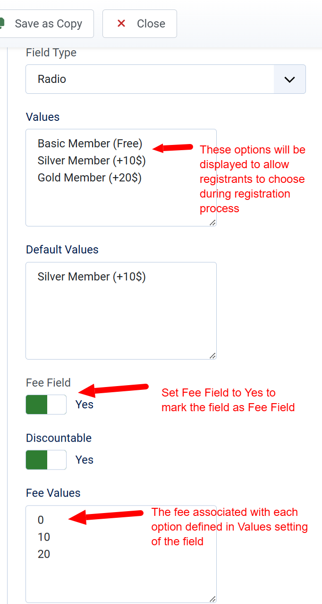
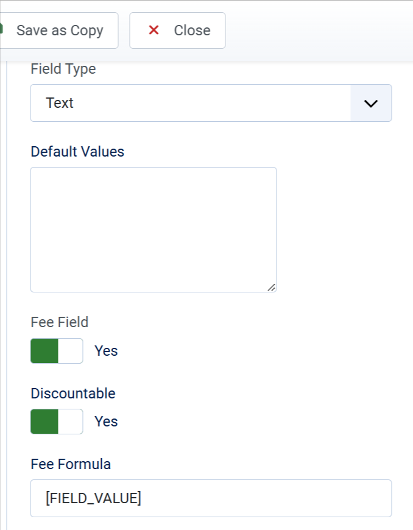

Use Custom Fee Fields to charge a fee in addition to the event price based on what registrants enter or select on the registration form. The sections below explain the rules for each field type.

1. To include a custom field in the registration fee calculation, set **Fee Field** to **Yes**.
2. Custom Fee Fields supports these field types: **List (Single + Multiple Select), Checkboxes, Radio and Textbox**.
3. On a registration form, there can be multiple custom fee fields. **TOTAL AMOUNT USER HAVE TO PAY = BASE REGISTRATION AMOUNT + SUM OF ALL FEE FIELDS**.

## Radio List + Single Dropdown Custom Field Type
Suppose you want a custom field that lets registrants choose a membership type. Create the field with these settings.

1. Values : **Basic Member (Free)**, **Silver Member (+10$)**, **Gold Member (+20$)**. Each item in one line.
2. Default Values : **Silver Member (+10$)**.
3. Fee Values : **0, 10, 20** . Each item in one line. 
4. Field Type : **Radio List**.
5. Fee Fied: must set to **Yes**

In the front-end , the system will display a radio custom field with 3 options : Basic Member (Free), Silver Member (+10$), Gold Member (+20$)

With the above settings:

1. If registrants choose **Basic Member** , they won't have to pay any additional fee.
2. If registrants choose **Silver Member** option, they will have to pay additional **10$**. 
3. If registrants choose **Gold Member** option, they will have to pay additional **20$**.

Please note the mapping 1-1 between **Values** and **Fee Values** settings of the custom field. Basic Member (Free) mapped To 0 . Silver Member (+10$) mapped to 10. Gold Member mapped to 20.

## Checkboxes + MultiSelect Custom Field Type

Set up the field the same way as a Radio custom fee field. With a **Checkboxes** or **MultiSelect** field, Events Booking adds together the fees for every option the registrant selects. The example above produces the following charges.

1. Registrants who select **Basic Member** pay no additional fee.
2. Registrants who select **Silver Member** pay an additional **$10**.
3. Registrants who select **Gold Member** pay an additional **$20**.
4. Registrants who select both **Silver Member** and **Gold Member** pay an additional **$30** ($10 for Silver Member and $20 for Gold Member).

## Textbox Custom Field Type

To let registrants make a donation in addition to paying their registration fee, create a text field called Donation with these settings.
1. **Name** : eb_donation_amount
2. **Title**: Donation Amount
3. **Field Type**: **Text**
4. **Fee Formula**: **[FIELD_VALUE]**
5. **Fee Fied**: **Yes**.

Events Booking adds the amount entered in this field to the total registration fee. For example, entering 10 adds $10, and entering 20 adds $20. The Fee Formula uses the entered amount in place of **[FIELD_VALUE]**.

## Understand Fee Formula

Fee Formula is a bit difficult to understand. However, once you get it, you will see that is is very powerful for fee calculation.
1. You can use **math operators : +, -, * , /** in the fee formula.
2. In a fee formula, **[FIELD_VALUE]** is replaced as follows.
* For a Text field, **[FIELD_VALUE]** is replaced with the value the registrant enters.
* For a single-select field (Radio or Single Select), **[FIELD_VALUE]** is replaced with the fee for the selected option.
* For a multiple-select field (Checkboxes or Multiple Select), **[FIELD_VALUE]** is replaced with the sum of the fees for the selected options.
3. To use another custom field in a fee formula, enter **[NAME_OF_CUSTOM_FIELD_IN_UPPERCASE]**. For example, if a text field named **eb_quantity** collects the number of items the registrant wants to buy, use **[EB_QUANTITY]** in a fee formula. Events Booking uses the same rules to determine the value of this tag as it does for [FIELD_VALUE].