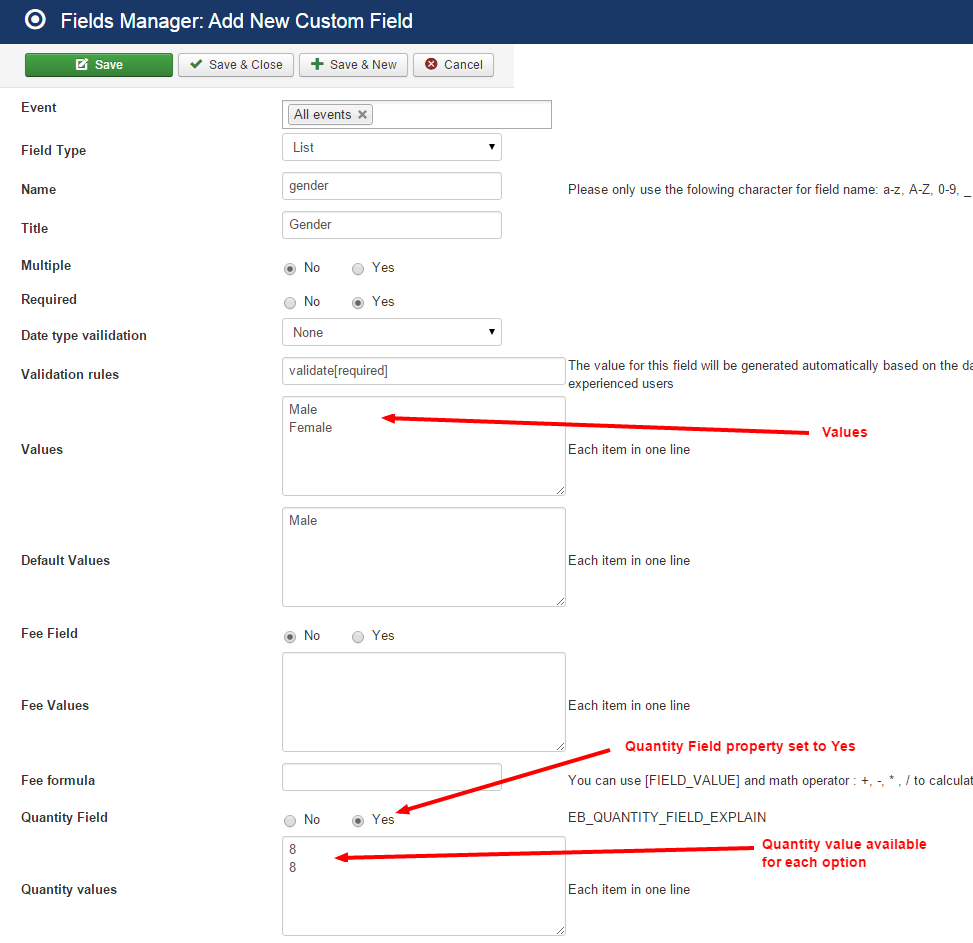

Use a quantity field to limit the **number of registrants** who can select a specific option in a Radio, Checkbox, Select, or Multiple select field.

For example, suppose your event has 16 places and you want to allow 8 Males and 8 Females to register.

Create a custom field called Gender with the following settings.

1. Field Type : **Radio**
2. Name : **eb_gender**
3. Title: **Gender**
2. Values : **Males**, **Females** (each value in one line)
3. Quantity Field: Set to **Yes**
4. Quantity Values: **8**, **8**. Each value in one line. Please note the mapping 1-1 between the options in **Values property** and the options in **Quantity Values** property of the custom field

With these settings, up to eight registrants can select each option.

Once an option reaches its limit in Quantity Values, it becomes unavailable to new registrants. If every option reaches its limit, Events Booking disables registration for the event.

