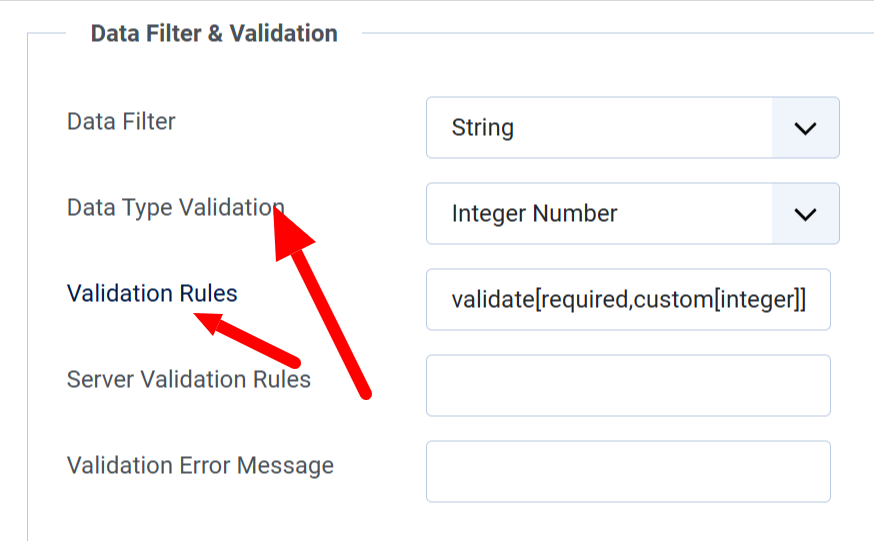

**Events Booking** uses [jQuery Validation Engine](http://posabsolute.github.io/jQuery-Validation-Engine/) for client-side validation. When you set **Validation Rules** for a field, the engine checks the value as users enter it. If the value is invalid, an error message lets them know what to correct.

To validate a field in the browser, go to **Events Booking** -> **Custom Fields**, edit the field, and enter the rules in **Validation Rules**.

- **validate[required,custom[email]]** will make the field required and must be a valid email
- **validate[required,custom[integer],min[10]]** will make the field required and the must be an integer smaller than 10

Events Booking can automatically populate **Validation Rules** based on these two custom field settings.
- **Required**: Select Yes to add **validate[required]** to **Validation Rules** automatically.
- **Data Type Validation**: Select an option to add the corresponding rules to **Validation Rules**. For example, **Min Integer** adds **validate[required,custom[integer],min[-5]]**. Replace -5 with the minimum value you want to accept.
- Separate multiple validation rules with commas. For example, **validate[required,custom[integer],min[-5]]** contains three rules.
+ **required** : The field is required
+ **custom[integer]**: Requires an integer.
+ **min[-5]**: Sets the minimum to -5. Values such as -6 and -7 fail validation.
- By default, Events Booking displays the error message for the rule that failed. To use your own message, enter it in **Validation Error Message**.

## Supported Validation Rules
Below are the list of validation rules which you can use to validate data of a custom field. For each field, you can use multiple validation rules, separate each rule by comma. See See [https://github.com/posabsolute/jQuery-Validation-Engine?tab=readme-ov-file#validators](https://github.com/posabsolute/jQuery-Validation-Engine?tab=readme-ov-file#validators) for details documentation if needed, but the below explanation should be enough

### Required
This rule rejects an empty field. Set **Required** to **Yes** to add the **required** rule to **Validation Rules**, as in **validate[required]**.

### Integer Number
Use this rule to make sure data entered into the field is an integer value. To use this rule, set **Data Type Validation** of the field to **Integer Number** or insert **custom[integer]** manually to **Validation Rules**  setting of the field. For example **validate[required,custom[integer]]**

### Number
Use this rule to make sure data entered into the field is an numeric value. To use this rule, set **Data Type Validation** of the field to **Number** or insert **custom[number]** manually to **Validation Rules**  setting of the field. For example **validate[required,custom[number]]**

### Email
Use this rule to make sure data entered into the field is an email. To use this rule, set **Data Type Validation** of the field to **Email** or insert **custom[email]** manually to **Validation Rules**  setting of the field. For example **validate[custom[email]]**

### URL
Use this rule to make sure data entered into the field is a url. To use this rule, set **Data Type Validation** of the field to **URL** or insert **custom[url]** manually to **Validation Rules**  setting of the field. For example **validate[required,custom[url]]**

### Phone
Use this rule to make sure data entered into the field is a phone number. To use this rule, set **Data Type Validation** of the field to **Phone** or insert **custom[phone]** manually to **Validation Rules**  setting of the field. For example **validate[required,custom[phone]]**

### Date
This rule validates a date against the format in **Date Picker Format**. Set **Data Type Validation** to **Date**, or add **custom[date]** to **Validation Rules** manually. For example, use **validate[required,custom[date]]**.

### Past Date
Use this rule to make sure data entered into the field is is older than a pre-entered date. To use this rule, set **Data Type Validation** of the field to **Past Date**, then look at **Validation Rules** setting, change the pre-inserted date to the date you want. For example **validate[custom[date],past[17/01/2025]]**. You can also insert the rule manually into Validation Rules, for example **past[17/01/2025]**, just please make sure the date (in this example **17/01/2025**) must match the format configured in **Date Picker Format** config option.

### Future Date
Use this rule to make sure data entered into the field is is newer than a pre-entered date. To use this rule, set **Data Type Validation** of the field to **Future Date**, then look at **Validation Rules** setting, change the pre-inserted date to the date you want. For example **validate[custom[date],future[17/01/2025]]**. You can also insert the rule manually into Validation Rules, for example **future[17/01/2025]**, just please make sure the date (in this example **17/01/2025**) must match the format configured in **Date Picker Format** config option.

### Version 4 IP Address
Use this rule to make sure data entered into the field is a v4 IP Address. To use this rule, set **Data Type Validation** of the field to **Ipv4** or insert **custom[ipv4]** manually to **Validation Rules**  setting of the field. For example **validate[required,custom[ipv4]]**

### Version 6 IP Address
Use this rule to make sure data entered into the field is a v6 IP Address. To use this rule, set **Data Type Validation** of the field to **Ip64** or insert **custom[ipv6]** manually to **Validation Rules**  setting of the field. For example **validate[required,custom[ipv6]]**

### Min Number Characters
Use this rule to make sure data entered into the field has minimum number of characters. To use this rule, set **Data Type Validation** of the field to **Min Number Characters**, then look at **Validation Rules** setting, change the pre-inserted size to the size you want. For example **validate[required,minSize[6]]**. You can also insert the rule manually into Validation Rules, for example **minSize[6]**.

### Max Number Characters
Use this rule to make sure data entered into the field has at least certain number of characters. To use this rule, set **Data Type Validation** of the field to **Max Number Characters**, then look at **Validation Rules** setting, change the pre-inserted size to the size you want. For example **validate[required,maxSize[6]]**. You can also insert the rule manually into Validation Rules, for example **maxSize[6]**.

### Min Integer
Use this rule to make sure data entered into the field must be greater than or equal certain integer value. To use this rule, set **Data Type Validation** of the field to **Min Integer**, then look at **Validation Rules** setting, change the pre-inserted number to the size you want. For example **validate[required,min[6]]**. You can also insert the rule manually into Validation Rules, for example **min[6]**.

### Max Integer
Use this rule to make sure data entered into the field must be smaller than or equal certain value. To use this rule, set **Data Type Validation** of the field to **Max Integer**, then look at **Validation Rules** setting, change the pre-inserted number to the size you want. For example **validate[required,max[6]]**. You can also insert the rule manually into Validation Rules, for example **max[6]**.

### Min Selected Checkboxes
Use this rule to make sure users need to select minimum number of options in a Checkboxes custom field. To use this rule, set **Data Type Validation** of the field to **Min Selected Checkboxes**, then look at **Validation Rules** setting, change the pre-inserted number to the size you want. For example **validate[minCheckbox[2]]**. You can also insert the rule manually into Validation Rules, for example **minCheckbox[2]**.

### Max Selected Checkboxes
Use this rule to make sure users need to select minimum number of options in a Checkboxes custom field. To use this rule, set **Data Type Validation** of the field to **Max Selected Checkboxes**, then look at **Validation Rules** setting, change the pre-inserted number to the size you want. For example **validate[maxCheckbox[2]]**. You can also insert the rule manually into Validation Rules, for example **maxCheckbox[2]**.

### Only Number and Space characters
Use this rule to make sure data entered into the field is contains only number and space characters. To use this rule, set **Data Type Validation** of the field to **Only Number and Space characters** or insert **custom[onlyNumberSp]** manually to **Validation Rules**  setting of the field. For example **validate[required,custom[onlyNumberSp]]**

### Only Letter and Space characters
Use this rule to make sure data entered into the field is contains only number and space characters. To use this rule, set **Data Type Validation** of the field to **Only Letter and Space characters** or insert **custom[onlyLetterSp]** manually to **Validation Rules**  setting of the field. For example **validate[required,custom[onlyLetterSp]]**

### Only Letter and Number characters, No Space
Use this rule to make sure data entered into the field is contains only number and space characters. To use this rule, set **Data Type Validation** of the field to **Only Letter and Number characters, No Space** or insert **custom[onlyLetterNumber]** manually to **Validation Rules**  setting of the field. For example **validate[required,custom[onlyLetterNumber]]**

### Equals
Use this rule to require a value that matches another field. For example, create a field named confirm_email and ask registrants to re-enter their email address. Set **Validation Rules** on confirm_email to **equals[email]** to require both entries to match. Replace email with the name of the field you want to compare.

