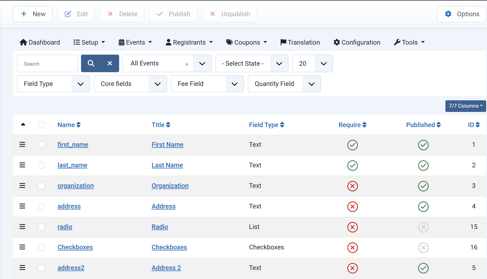

Use **custom fields** to collect information from people when they register for an event.

Events Booking creates the following **core fields** during installation: **First Name**, **Last Name**, **Organization**, **Address**, **Address2**, **City**, **State**, **Zip**, **Country**, **Phone**, **Fax**, **Email**, and **Comment**.

Open the custom fields management page in any of these three ways.

1. Go to **Components** -> **Events Booking** -> **Custom Fields**.
2. Open the Events Booking Dashboard, then click the **Custom Fields** icon.
3. From any Events Booking page, go to **Setup** -> **Custom Fields**.

Use the custom fields management page for these common tasks.
1. **Change title of the field**. Edit the field, change its title, and save.
2. **Show / Hide** existing fields on the registration form. **Publish / Unpublish** the relevant fields.
2. **Make some fields become required / optional**. Edit the field and set **Require** to **Yes / No** as needed.
3. **Add new custom fields**. Click New in the toolbar.
4. **Change ordering of the custom fields**. Drag and drop the fields into the order you want, as you would in Joomla.

Use these guides to choose the right field type, control which events display a field, and validate what registrants enter.

- [Supported Field Types](/basic-setup/custom-fields/field-types)
- [Field Assignment Options](/basic-setup/custom-fields/field-assignment-options) — Choose whether to assign fields by category, event, or both.
- [Add New Custom Field](/basic-setup/custom-fields/add-new-custom-field)
- [Custom Fields Assignment](/basic-setup/custom-fields/custom-fields-assignment) — Set up common combinations of category and event assignments.
- [Custom Fee Fields](/basic-setup/custom-fields/custom-fee-fields) — Adjust registration prices based on field values.
- [Custom Field Quantity](/basic-setup/custom-fields/custom-field-quantity) — Limit how many times registrants can select a field option.
- [Validate Field Data - Client Side](/basic-setup/custom-fields/validate-field-data-client-side)
- [Validate Field Data - Server Side](/basic-setup/custom-fields/validate-field-data-server-side)
- [Input Mask](/basic-setup/custom-fields/input-mask) — Guide registrants to enter a value in the expected format.
