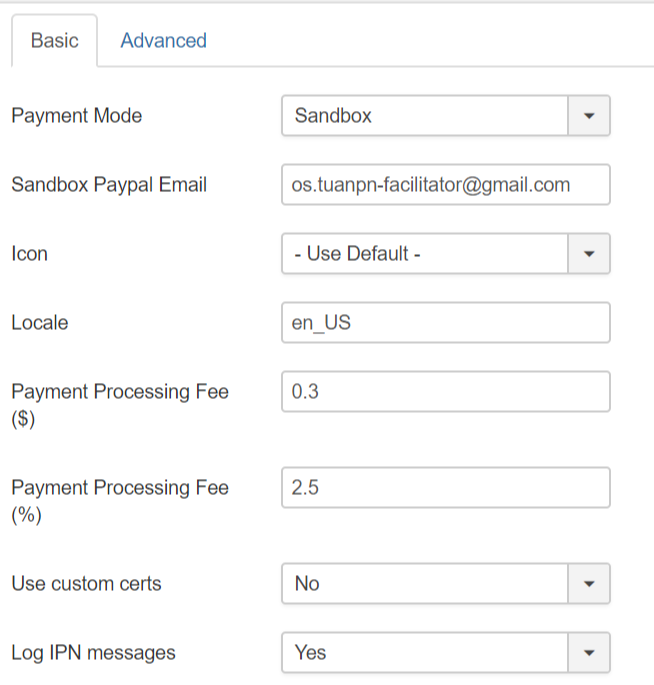
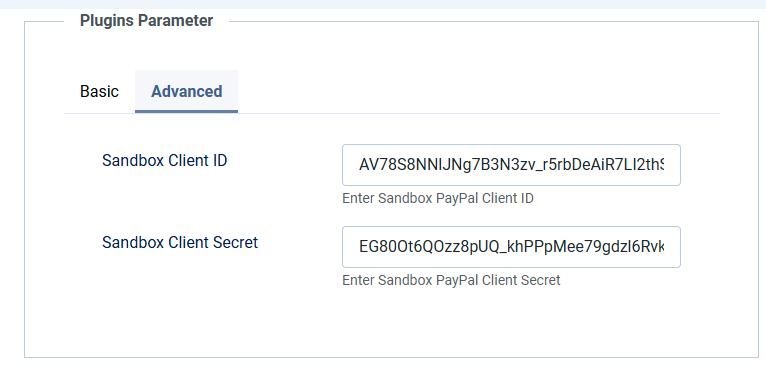
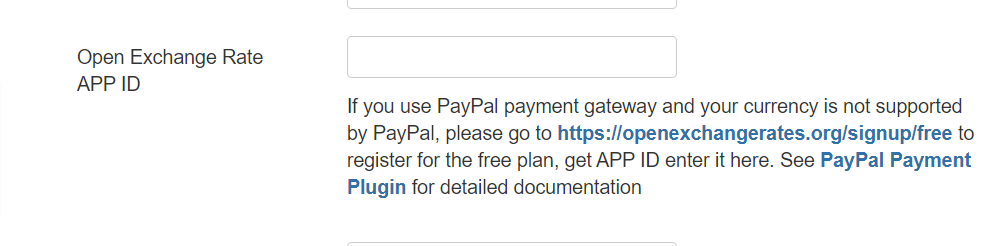

On the Payment Plugins management screen, open **os_paypal** and configure the following settings.
1. **Payment Mode**: Set to **Sandbox** (for testing payment) or **Live Mode** (for real payment).
2. **Paypal Email**: Enter the Paypal Email associated with your PayPal account.
3. **Icon**: If you want to display an icon instead of title of payment method, choose the icon you want to use from the dropdown
4. **Payment Processing Fee ($)**: If you want registrants to pay for payment processing fee (a fixed fee amount), enter that fee into this parameter.
5. **Payment Processing Fee (%)**: If you want registrants to pay for payment processing fee (a percent fee amount), enter that fee into this parameter.

## Advanced Settings
If you have a business PayPal account, you can follow the instructions at [https://developer.paypal.com/api/rest/#link-getclientidandclientsecret](https://developer.paypal.com/api/rest/#link-getclientidandclientsecret) , get **Client ID**, **Client Secret** of from PayPal account, enter it into os_paypal payment plugin parameters (Advanced tab) to allow admin to refund for a registration record from the administrator area of the site.

## Enable PayPal IPN
In some special cases, PayPal IPN might be disabled in your PayPal account. If you want to enable IPN (usually when being asked by our support staff during support), please follow instructions at [PayPal IPN Setup](https://developer.paypal.com/docs/api-basics/notifications/ipn/IPNSetup/#setting-up-ipn-notifications-on-paypal) to enable PayPal IPN for your PayPal account. PayPal will ask you for IPN URL, just enter URL of your site into that field (for example https://domain.com/index.php - replace https://domain.com with URL of your site)

## IPN Trouble Shooting Instructions
Sometimes, PayPal is not working on your site and our support team will have to ask you for help to check this issue. Usually, you will have to:

- Log in to your administrator area of your site, go to Events Booking -> Payment Plugins, click on os_paypal payment plugin to edit, set Log IPN Messages parameter to Yes
- Register for an event, make payment
- Log in to the PayPal account that receives payments and open the IPN History Page [https://www.paypal.com/cgi-bin/webscr?cmd=_display-ipns-history](https://www.paypal.com/cgi-bin/webscr?cmd=_display-ipns-history).
- Find the IPN message related to that payment, click on it to edit, make a screenshot of that IPN message details
- Send us that screenshot via support ticket
- We’ll use that information to guide you through the next checks.

## Requirements
- Your site must be on public accessible server. For example, if your site is on local computer, it won't work (because PayPal could not reach your local computer to inform Events Booking about the payment
- Your site must be online mode. If you set your site to offline mode, it won't work because PayPal could not inform Events Booking about the payment.
- In case frontend of your site is protected (by .htaccess password for example) to prevent public users to access (this usually happens during development period), PayPal won't work, too, because PayPal could not inform Events Booking about the payment.

## Use PayPal With None Supported Currency
PayPal only supports certain currencies listed here [Supported Currency](https://developer.paypal.com/docs/reports/reference/paypal-supported-currencies/) . If your site uses a currency not supported by PayPal, Events Booking needs to convert the payment amount from your currency to USD before passing to PayPal for processing payment. To do that, Events Booking relies on a service called [https://openexchangerates.org/](https://openexchangerates.org/) for currency converter. To use that service, you will need to:

1. Go to [https://openexchangerates.org/signup/free](https://openexchangerates.org/signup/free) , register for a free account
2. Check your email for the APP ID or log in and open [https://openexchangerates.org/account/app-ids](https://openexchangerates.org/account/app-ids). Enter it in the **Open Exchange Rate APP ID** setting in Events Booking.

## Extra PayPal Payment Plugins

Sometimes, you might need to install and use different PayPal payment plugins on your site (for example, when you need to have different payment processing fee in each plugin). For that, you can download and install the extra PayPal payment plugins below.

Keep in mind that if you just need to use different PayPal account for each event, you do not need to install these extra offline payment plugins. You can just edit your event, look at Advanced Settings tab and enter PayPal account you want to use to receive payment for that event from there.

[os_eb_paypal1.zip](os_eb_paypal1.zip)

[os_eb_paypal2.zip](os_eb_paypal2.zip)

[os_eb_paypal3.zip](os_eb_paypal3.zip)

[os_eb_paypal4.zip](os_eb_paypal4.zip)

[os_eb_paypal5.zip](os_eb_paypal5.zip)

