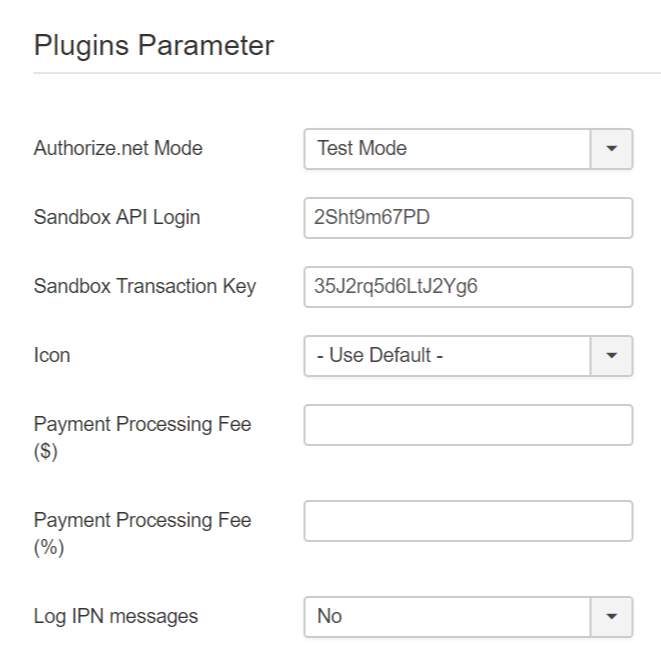

On the **Payment Plugins** management screen, open **os_authnet** and configure the following settings:

1. **Environment**: Set to **Sandbox** for test payments or **Live** for real payments.
2. Enter the credentials for the selected environment:

    | Environment | API Login Parameter | Transaction Key Parameter |
    | --- | --- | --- |
    | Sandbox | **Sandbox API Login** | **Sandbox Transaction Key** |
    | Live | **API Login** | **Transaction Key** |

    Only the credential fields for the selected environment are displayed. Use the credentials from the corresponding Authorize.net account.

3. Configure **Icon**, **Payment Processing Fee ($)**, and **Payment Processing Fee (%)** as needed. See [Common Plugin Parameters](/basic-setup/payment-plugins#common-plugin-parameters).
4. Publish the plugin and save your changes.

To use the following test credentials, set **Environment** to **Sandbox** and enter them in the sandbox fields:

1. **Sandbox API Login**: 2Sht9m67PD
2. **Sandbox Transaction Key**: 35J2rq5d6LtJ2Yg6
