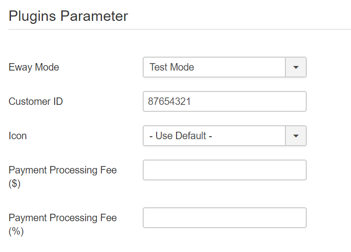

On the **Payment Plugins** management screen, open **os_eway** and configure the following settings:

1. **Environment**: Set to **Sandbox** for test payments or **Live** for real payments.
2. **Customer ID**: Enter the customer ID from your Eway account.
3. Configure **Icon**, **Payment Processing Fee ($)**, and **Payment Processing Fee (%)** as needed. See [Common Plugin Parameters](/basic-setup/payment-plugins#common-plugin-parameters).
4. Publish the plugin and save your changes.

