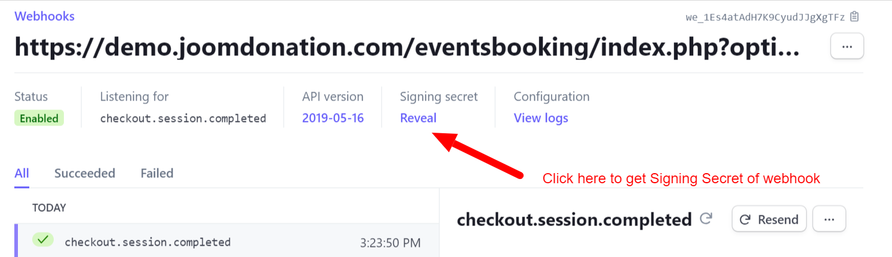

## Installation

Extract **os_eb_stripecheckout_unzip_first.zip** to get **os_eb_stripecheckout.zip**. Go to **Events Booking -> Payment Plugins** to install the plugin. See [**Install Payment Plugin**](/basic-setup/payment-plugins#install-new-payment-plugin) for the steps.

## Configuration

Stripe Checkout uses a webhook to notify Events Booking when a registrant completes checkout. You must configure the webhook so that Events Booking can confirm the registration, even if the registrant closes their browser before returning to your website.

### Enter Your API Keys

1. Go to **Events Booking -> Payment Plugins** and click **os_stripecheckout** to edit it.
2. Set **Payment Mode** to **Sandbox** for testing or **Live** to accept real payments.
3. Open the [API keys page in your Stripe Dashboard](https://dashboard.stripe.com/apikeys) in the same Stripe account and environment you will use for payments. See [Stripe's API keys guide](https://docs.stripe.com/keys) for details.
4. Copy the publishable key and secret key into the corresponding plugin parameters:

| Payment Mode | Publishable Key Parameter | Secret Key Parameter |
| --- | --- | --- |
| Sandbox | **Sandbox Public API Key** (`pk_test_...`) | **Sandbox Secret API Key** (`sk_test_...`) |
| Live | **Public API Key** (`pk_live_...`) | **Secret API Key** (`sk_live_...`) |

Save your changes, then configure the webhook below.

### Create the Webhook in Stripe

Stripe now manages webhooks as **event destinations** in **Workbench**. The steps below follow Stripe's current [webhook setup guide](https://docs.stripe.com/webhooks) and [Workbench guide](https://docs.stripe.com/workbench/event-destinations).

1. Sign in to the [Stripe Dashboard](https://dashboard.stripe.com) and select the same account and environment as your API keys. For testing, select your sandbox or test mode. For real payments, use live mode.
2. Open **Workbench -> Webhooks**, or go directly to the [Webhooks page](https://dashboard.stripe.com/webhooks).
3. Click **Create an event destination**. Depending on your Dashboard interface, this button may be labelled **Create new destination** or **Add destination**.
4. For the source of events, select **Your account** (also shown as **Events on your account**).
5. If Stripe asks for a payload format, select **Snapshot**. This plugin reads the checkout session from the event payload and requires this format. For a new endpoint, leave the API version selected by Stripe unless you have been given a specific version for your installed payment plugin. Keep the existing API version when editing a working endpoint.
6. Search for and select **checkout.session.completed**. Select only this event; it is the event handled by this plugin.
7. Click **Continue**, select **Webhook endpoint** as the destination type, then click **Continue** again.
8. In **Endpoint URL**, enter:

    ```text
    https://domain.com/index.php?option=com_eventbooking&task=payment_confirm&payment_method=os_stripecheckout
    ```

    Replace `https://domain.com/` with your website's actual HTTPS URL. If Joomla is installed in a subfolder, include it. For example:

    ```text
    https://domain.com/joomla/index.php?option=com_eventbooking&task=payment_confirm&payment_method=os_stripecheckout
    ```

9. If prompted for a destination name or description, enter something recognizable, such as **Events Booking - Stripe Checkout**.
10. Click **Create destination** to save the webhook.

The URL must be publicly accessible with a valid HTTPS certificate. Use the final website address, including the correct `www` or non-`www` domain, so that it does not redirect. Stripe must be able to reach it without a login or a security challenge.

### Save the Webhook Signing Secret

1. Open the destination you just created in **Workbench -> Webhooks**.
2. Find **Signing secret** and click **Reveal secret** (or **Reveal**).
3. Copy the complete value, which starts with `whsec_`.
4. Return to **Events Booking -> Payment Plugins -> os_stripecheckout** and paste it into the appropriate parameter:

    | Payment Mode | Plugin Parameter |
    | --- | --- |
    | Sandbox | **Sandbox Signing Secret** |
    | Live | **Signing Secret** |

5. Publish the payment plugin and save your changes.

The illustration below highlights the endpoint URL, required event, and signing secret. Your Stripe Dashboard layout may vary.



If your plugin version has only **Signing Secret**, enter the secret for the environment you are currently using and replace it when switching environments.

The signing secret belongs to this specific webhook destination and is separate from your API secret key. Test and live destinations have different secrets. When moving to live payments, create the destination in live mode and save its signing secret along with your live API keys.

### Test the Webhook

1. Set the plugin's **Payment Mode** to **Sandbox** and save its test API keys and webhook signing secret.
2. Register for a paid event on your website and select Stripe Checkout. Complete checkout with Stripe's test card **4242 4242 4242 4242**, any future expiry date, and any three-digit CVC. See [Stripe's testing guide](https://docs.stripe.com/testing) for more test cards.
3. In the matching Stripe test environment, open your webhook destination and select **Event deliveries**.
4. Find the **checkout.session.completed** event for your registration. Confirm that it shows **Delivered** with a successful HTTP response, normally **200**.
5. In **Events Booking -> Registrants**, confirm that the registration is marked as paid.

Complete this test through your website's registration form. A sample event generated by Stripe may not contain the registration reference that Events Booking needs, so successful delivery of a sample event alone does not verify registration confirmation.

### Troubleshooting

If a registration remains unpaid after checkout, open the destination's **Event deliveries** tab and select the relevant event to inspect its response.

- **No event appears:** Check the Stripe account and environment, confirm the destination is enabled, and make sure **checkout.session.completed** is selected.
- **400 response:** Check that the plugin contains the signing secret for this exact destination and environment, with no extra spaces.
- **301 or 302 response:** Update the endpoint URL to the final HTTPS address so Stripe does not encounter a redirect.
- **403 or 404 response:** Check the URL, including any Joomla subfolder, and check whether a security extension or firewall is blocking requests.
- **500 response:** Check your website's PHP error log for the underlying error.
- **Delivered, but registration remains unpaid:** Make sure the payment was created through Events Booking on this website. Delivery confirms receipt of the event; also check the registration itself.

After correcting the problem, use **Resend** on the failed event to retry delivery. For more help, see [Stripe's webhook troubleshooting guide](https://docs.stripe.com/events/manage-webhook-endpoints).
