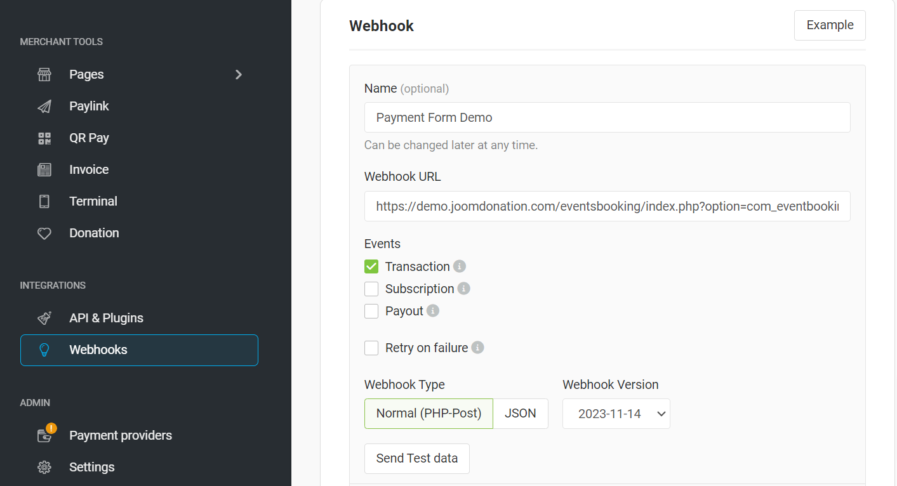

## Installation
After purchasing the plugin, go to Events Booking -> Payment Plugins and install **os_eb_payrexx.zip**. See [https://eventbookingdoc.joomservices.com/basic-setup/payment-plugins#install-new-payment-plugin](https://eventbookingdoc.joomservices.com/basic-setup/payment-plugins#install-new-payment-plugin) for the steps.

## Configuration
1. Click on the payment plugin to edit, enter payment plugin parameters, then publish it

- **Instance Name**: This is is a part of the url where you access your Payrexx installation. For example, if the URL of your payrexx installation is https://joomdonation.payrexx.com , then **joomdonation** is **Instance Name**.
- **API Key**: Log in to your Payrexx installation and go to Integrations -> API & Plugins to get your API Key.

2. Go to **Integrations -> Webhooks** and create a webhook with the following settings.

- **Webhook URL** : https://domain.com/index.php?option=com_eventbooking&task=payment_confirm&payment_method=os_payrexx

(Of course, need to replace https://domain.com/ with your site url)

- **Events**: Only select **Transactions**

- **Webhook Type**: Select **Normal (PHP-Post)**

