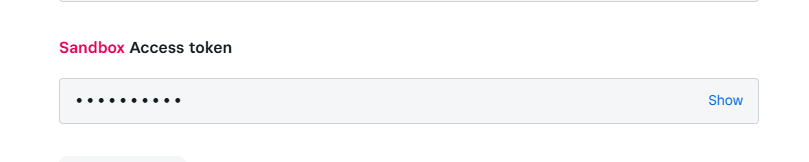
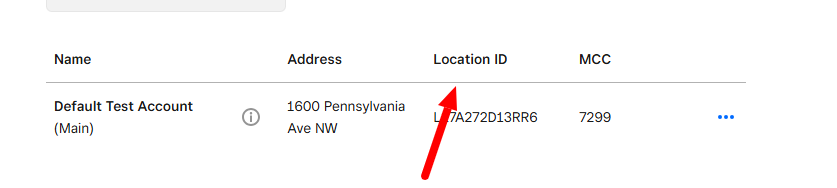
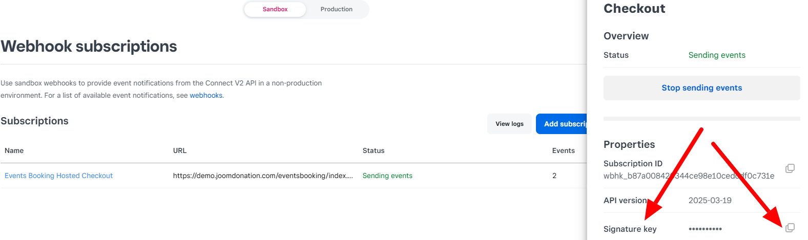

## Installation

After purchasing the plugin, go to **Events Booking** -> **Payment Plugins** and install **os_eb_squarehostedcheckout.zip**. See [**Install Payment Plugin**](/basic-setup/payment-plugins#install-new-payment-plugin) for the steps.

## Configuration

1. Create a Square app:

    - Go to the [Square Developer Console](https://developer.squareup.com/console/en/apps).
    - Create an app if you do not already have one for Events Booking on your website.
    - Click the app to open its settings.

2. Enter the payment plugin parameters:

    Go to **Events Booking -> Payment Plugins**, open **os_squarehostedcheckout**, and enter the following parameters:

    - **Access Token**: Copy the access token from your Square app.

        

    - **Location ID**: In the Square app, click **Locations** in the left menu and copy the location ID.

        

    - **Signature Key**: Get this value from the webhook you create in the next step.

    - **Order Prefix**: Optionally, enter a prefix to help make the payment note sent to Square unique.

3. Create a webhook:

    In the Square app, go to **Webhooks -> Subscriptions** in the left menu and add a webhook subscription with the following settings:

    - **Webhook URL**: Enter the following URL, replacing `https://domain.com/` with your site's URL:

        ```text
        https://domain.com/index.php?option=com_eventbooking&task=payment_confirm&payment_method=os_squarehostedcheckout
        ```

    - **Events**: Select **payment.created** and **payment.updated**.

    After creating the webhook, copy its **Signature Key** into the payment plugin's **Signature Key** parameter and save your changes.

    
