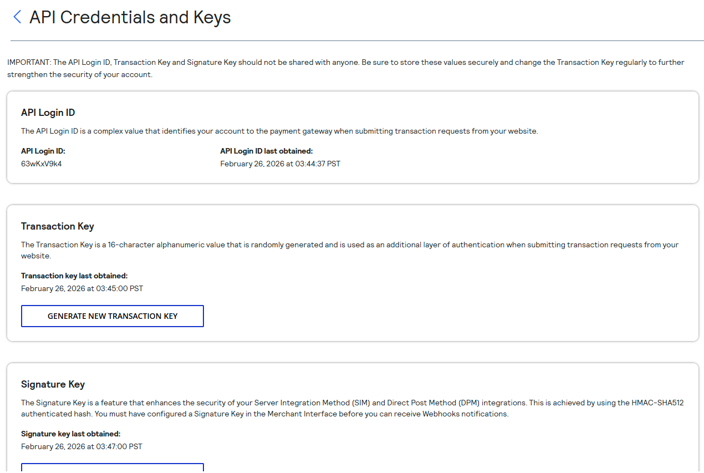
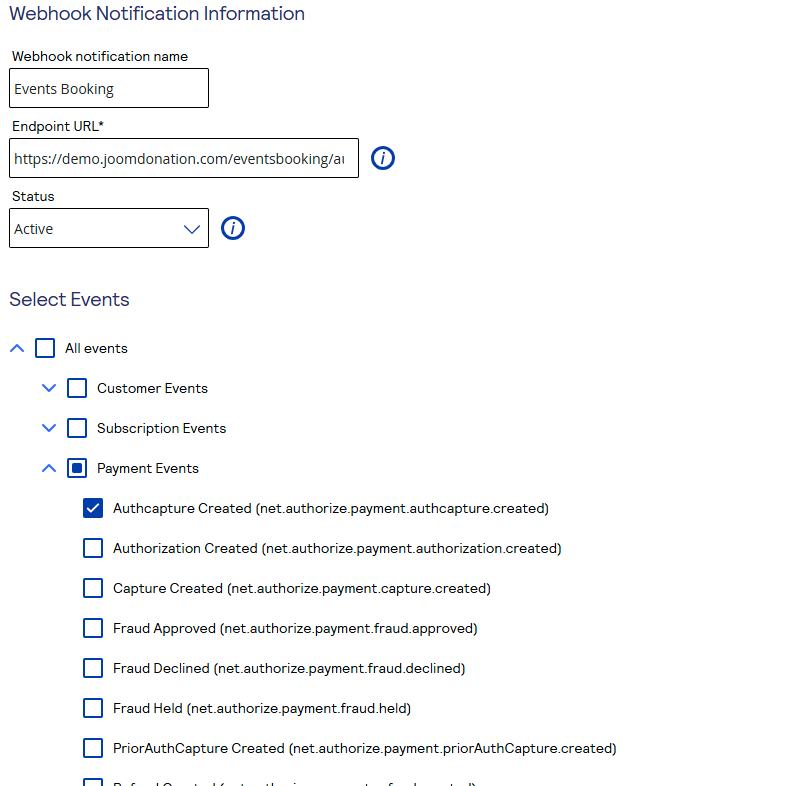

## Installation

After purchasing the plugin, extract **os_eb_authnetaccepthosted_unzip_first.zip**. It contains **os_eb_authnetaccepthosted.zip** and three PHP files.

- Go to **Events Booking -> Payment Plugins** and install **os_eb_authnetaccepthosted.zip**. See [**Install Payment Plugin**](/basic-setup/payment-plugins#install-new-payment-plugin) for installation instructions.
- Upload **authaccepthosted_eb_cancel.php**, **authaccepthosted_eb_return.php**, and **authaccepthosted_eb_webhook.php** to your site's root folder. If you use Admin Tools Pro's .htaccess Maker, make these files accessible by adding them to **Exceptions from Server Protection**, then regenerate the `.htaccess` file.

## Configuration

1. Log in to your Authorize.net account and go to **Account** -> **Account and API Settings**  -> **API Credentials and Keys**. Copy the API Login, Transaction Key, and Signature Key into the corresponding **os_authnetaccepthosted** payment plugin settings. Generate the Transaction Key and Signature Key if needed.

    

2. In **Account -> Account and API Settings -> API Credentials and Keys -> Webhooks**, create a webhook with the following settings:

    - **Webhook URL**: Enter `https://yourdomain.com/authaccepthosted_eb_webhook.php`, replacing `https://yourdomain.com` with your site's URL.
    - Select **Authcapture Created (net.authorize.payment.authcapture.created)** for the webhook event.

    

