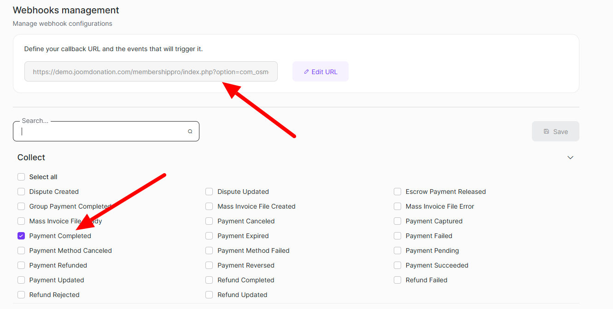

## Installation

After purchasing the plugin, you will receive a ZIP file called **os_osm_rapyd.zip**.

Go to **Events Booking -> Payment Plugins** and install **os_osm_rapyd.zip**. See [Install Payment Plugin](https://docs.joomdonation.com/eventsbooking/basic-setup/payment-plugins#install-new-payment-plugin) for installation instructions.

## Configuration

1. Log in to the Rapyd dashboard and open the [Developer menu](https://dashboard.rapyd.net/developers/api-control) in the left sidebar. Copy the **Access Key** and **Secret Key** from your Rapyd account into the payment plugin settings.

    

2. In the Developer menu, open Webhooks and create a webhook using the following URL.

    ```text
    https://domain.com/index.php?option=com_osmembership&task=payment_confirm&payment_method=os_rapyd
    ```

    Replace `https://domain.com` with your site's URL.

    In the **Collect** section, select **Payment Completed** for the webhook.

    
