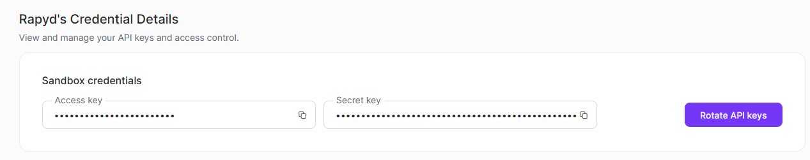

## Installation
When you purchase the payment plugin, you will receive a zip file called **os_osm_rapyd.zip**.

- Go to **Events Booking** -> **Payment Plugins** and install **os_osm_rapyd.zip** as you would any other payment plugin. See [https://docs.joomdonation.com/eventsbooking/basic-setup/payment-plugins#install-new-payment-plugin](https://docs.joomdonation.com/eventsbooking/basic-setup/payment-plugins#install-new-payment-plugin) for installation instructions.

## Configuration

1. Log in to the Rapyd dashboard and open the Developer menu in the left sidebar [https://dashboard.rapyd.net/developers/api-control](https://dashboard.rapyd.net/developers/api-control). Copy the Access Key and Secret Key from your Rapyd account into the payment plugin settings.

2. In the Developer menu, open Webhooks and create a webhook using the following URL.

https://domain.com/index.php?option=com_osmembership&task=payment_confirm&payment_method=os_rapyd

Replace https://domain.com with your site’s URL.

In the Collect section, select **Payment Completed** for the webhook.

