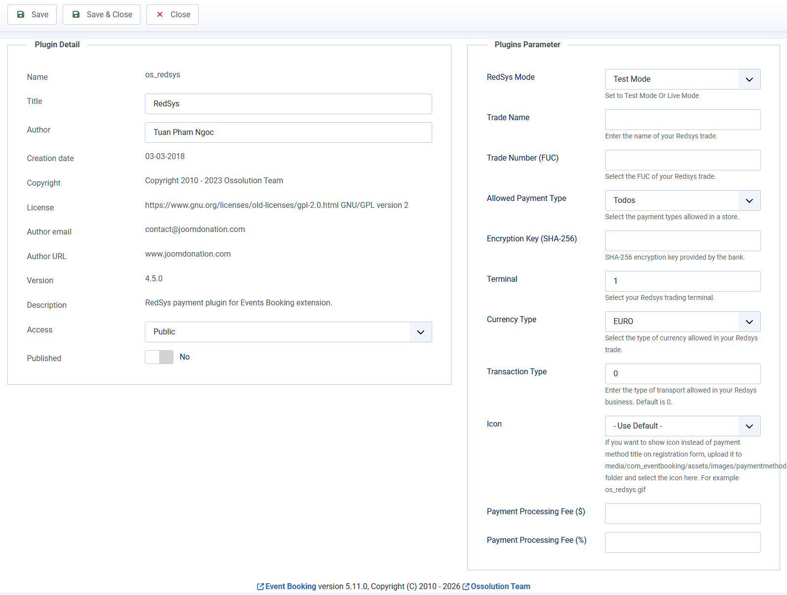

## Installation
After purchasing the plugin, go to **Events Booking** -> **Payment Plugins** and install **os_eb_redsys.zip**. See [**Install Payment Plugin**](/basic-setup/payment-plugins#install-new-payment-plugin) for the steps.

## Configuration
Click on the payment plugin to edit, enter payment plugin parameters, then publish it.

