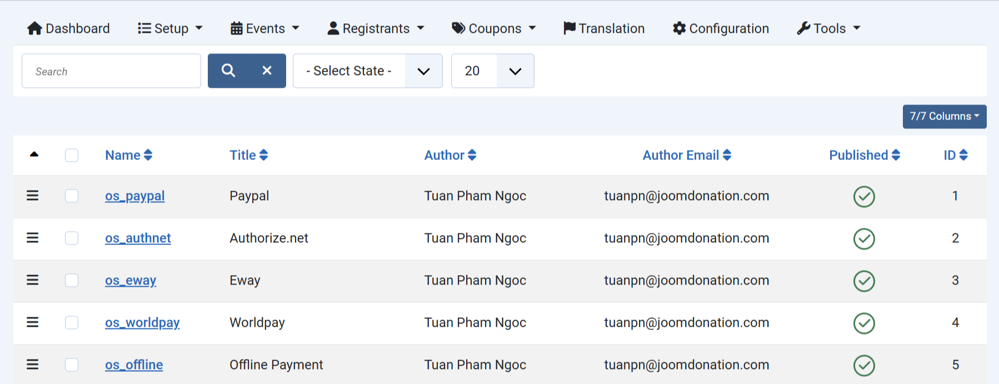
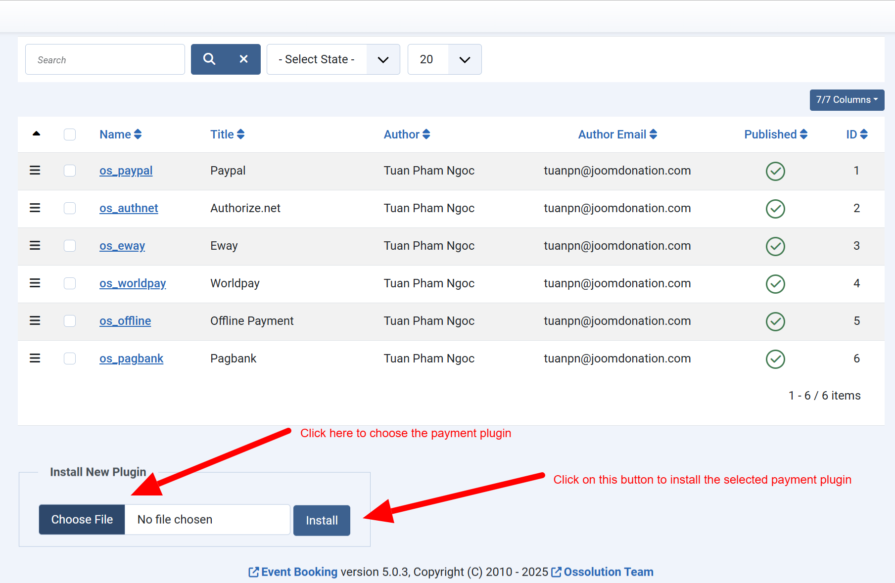

For a paid event (price > 0), registrants need to pay to complete their registration. This chapter explains how to install and configure the payment plugins used to collect those payments.

Choose which payment methods registrants can use. **Events Booking** comes with five payment plugins: **PayPal** (PayPal Payments Standard), **Authorize.net** (AIM), **Eway**, **Worldpay**, and **Offline Payment**. Additional plugins are sold separately for $24.99 each. See [Events Booking Payment Plugins](https://joomdonation.com/payment-plugins/events-booking-payment-plugins.html) for the available plugins.

Open **Payment Plugins** in either of these two ways:

1. Go to **Components -> Events Booking -> Payment Plugins**.
2. From any **Events Booking** page, go to **Setup -> Payment Plugins**.

## Common Tasks

### Common Plugin Parameters

All five included payment plugins have the following parameters:

| Parameter | Description |
| --- | --- |
| **Icon** | Choose an icon to display instead of the payment method title on the registration form. |
| **Payment Processing Fee ($)** | Enter a fixed payment processing fee to charge registrants. |
| **Payment Processing Fee (%)** | Enter a payment processing fee as a percentage. |

For PayPal, Authorize.net, Eway, and Worldpay, **Environment** selects **Sandbox** for testing or **Live** for real payments. PayPal and Authorize.net display separate credential fields for the selected environment. Offline Payment uses **Registration Status** instead; it does not have an **Environment** parameter.

### Unpublish Unused Payment Plugins

Unpublish any payment plugins you do not want to offer. You can do this in either of two ways:

1. Click on the **green (published) icon** in the **Published** column.
2. Select the checkbox next to the payment plugin, then click **Unpublish** in the toolbar.

### Change the Title of a Payment Plugin

Use a title that helps registrants recognize the payment method. For example, you can change **Authorize.net** to **Credit Card**.

Open the payment plugin, change its title, and click **Save** in the toolbar.

### Translate Payment Plugin Title

To show the plugin title in the registrant's language, follow these steps:

1. Use a language item as the payment plugin title. For example, change the title from **PayPal** to `OS_PAYPAL`.
2. Go to **Events Booking -> Translation** and click **New Item** in the toolbar. Enter the language item used for the payment method title, then save your changes.
3. Translate the language item you just created.

### Using Icons for Payment Methods

Events Booking displays payment method titles on the registration form by default. Since version 2.12.0, you can choose to display icons instead.

Open the payment plugin and choose an icon in the **Icon** field. If the icon you want is unavailable, upload it to `media/com_eventbooking/assets/images/paymentmethods`. Then select it from the list.

### Select a Payment Plugin by Default

Events Booking selects the first payment plugin on the registration form by default. To select a different one, move it to the top of the list.

## Install New Payment Plugin

If you need a payment plugin that **Events Booking** does not include, check whether it is available at [Events Booking Payment Plugins](http://joomdonation.com/payment-plugins/events-booking-payment-plugins.html). You can also develop a plugin yourself or hire someone to develop it. Once you have the plugin, install it as follows:

1. Go to **Events Booking -> Payment Plugins**.
2. Scroll to the bottom of the page.
3. Click **Choose File** to select the payment plugin package.
4. Click **Install** to install the plugin.

Follow the guide for your payment method to install or configure its plugin.

- [PayPal](/basic-setup/payment-plugins/paypal)
- [Authorize.Net](/basic-setup/payment-plugins/authorize-net)
- [Offline Payment](/basic-setup/payment-plugins/offline-payment)
- [Eway](/basic-setup/payment-plugins/eway)
- [Worldpay](/basic-setup/payment-plugins/worldpay)
- [PayPal Pro](/basic-setup/payment-plugins/paypal-pro)
- [Stripe](/basic-setup/payment-plugins/stripe)
- [Stripe Checkout](/basic-setup/payment-plugins/stripe-checkout)
- [PayPal Expanded Checkout](/basic-setup/payment-plugins/paypal-expanded-checkout)
- [Payrexx](/basic-setup/payment-plugins/payrexx)
- [Square Hosted Checkout](/basic-setup/payment-plugins/square-hosted-checkout)
- [Authorize.net Accept Hosted](/basic-setup/payment-plugins/authorize-net-accept-hosted)
- [Rapyd Hosted Checkout](/basic-setup/payment-plugins/rapyd-hosted-checkout)
- [Mollie](/basic-setup/payment-plugins/mollie)
- [Redsys](/basic-setup/payment-plugins/redsys)
