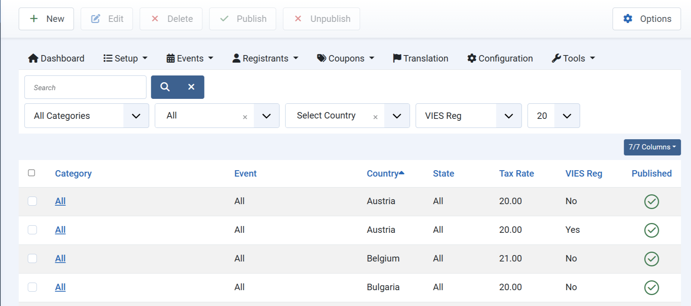
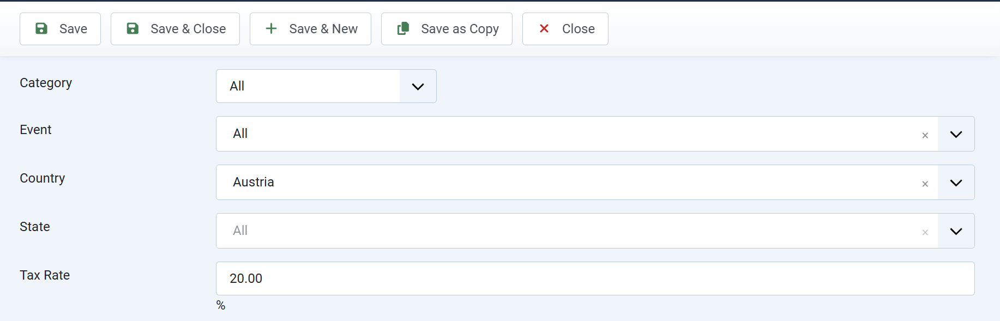

Events Booking offers two ways to set tax rates for events.

## Simple Tax Rate Option
Use this option to set the tax rate for an event or category directly. In **Events Booking** -> **Configuration**, set **Activate Simple Tax** to **Yes**. Events Booking applies tax as follows.

- If the event tax rate is greater than 0, Events Booking uses it to calculate tax on registrations for that event.
- To apply the same rate to all events in a category, set Tax Rate on the category. You can set a different rate on an individual event. The event rate takes precedence over the category rate.

## Tax Rules
You can use this tax rules to replace the Simple Tax option above if:

1. You have a single tax rate applied for all events in your system. In this case, instead of having to enter tax rate for each event (or at least each category), you can just set up a tax rule, max simpler and faster.
2. Tax rates depend on the registrant’s country or state. Use Tax Rules to configure those rates.

To use Tax Rules, set **Activate Simple Tax** to **No**, then configure the rules as described below.

Open the **Tax Rules** management page in either of these two ways.

1. Go to **Components** => **Events Booking** => **Tax Rules**.
2. On any page in Events Booking, access to **Setup** => **Tax Rules**.

## Add New Tax Rule
On the Tax Rules Management screen, click New in the toolbar to open the form below.

| Property | Description |
| ------ | ----------- |
| Category   | Select the category, or select ALL Categories to apply the rule to every category. |
| Event   | Select the event, or select ALL Events to apply the rule to every event. |
| Country   | Select the country or **ALL**. |
| State   | Select the state or **N/A**. |
| Tax rate   | Enter the tax rate. Enter 0 to apply no tax. |
| VIES Reg   | This field is available only if you are based in an EU country. Set it to Yes to apply the rule to registrants with a valid EU VAT number, or No to apply it to registrants without one. |

## How Events Booking determine a tax rule for a registration

When registrants register for an event, Events Booking will try to find the best match tax rule to use for the registration with the following priority:
1. **Base on event**:
* If **there is a tax rule for the current event, the tax rule will be used** to get tax rate.
* If **there is a tax rule for the main category of the event, the tax rule will be used** to get tax rate.
* If **there are no specific rules for the current event, and it's main category, the tax rules which are setup for all events** will be used 
2. **Base on country**:
* If **there are tax rules for the country which registrants select on registration form, these tax rules will be used** to get tax rate.
* If **there is no rule for the country which registrants select on registration form, the tax rules which are setup for ALL COUNTRIES will be used** to get tax rate.
3. **Base on state**: In some country like US, Canada, Spain... you might have to set up tax rate based on the state registrants select on registration form:
* If **there are tax rules for that specific state, these tax rules will be used** to get tax rate
* If **there are no tax rules for that specific state, these tax rules which are setup for the country will be used** to get tax rate.
* If **there are no tax rules for that specific state and country, these tax rules which are setup for ALL COUNTRIES will be used** to get tax rate.

## Common Tax Rules setup
1. If you want to disable tax, please unpublish (or remove) all tax rules.
2. To apply the same tax rate to every event, create a rule with **Category** set to **All**, **Event** set to **ALL**, **country** set to **ALL**, and **State** set to **N/A**. Enter the tax rate.
3. To apply a different rate to each category, create one rule for each category.
4. To apply one rate to all events and a different rate to a specific event, create these two rules.
* One tax rule has **Category** set to **ALL**, **Event** set to **ALL**.
* One tax rule has the **Event** set to the **specific event** you want.
5. To apply one rate to all countries and a different rate to a specific country, create these two rules.
* One tax rule has **Country** set to **ALL**.
* One tax rule has the **Country** set to the **specific country** you want.
6. To apply one rate to all states in your country and a different rate to a specific state, create these two rules.
* One tax rule has country set to your country and has state set to N/A
* One tax rule has country set to your country and has state set to the specific state you want

## EU Tax Rules Builder

If you are from an EU country and need to follow EU Tax Rules, there will be many tax rules need to be created. However, don't worry, we have a tool to help you. Follow the steps below and you will have the tax rules setup and works property in Events Booking and it is conform with EU Tax Rules:
1. Go to Events Booking -> Configuration, make sure you set **Default Country** config option to your country.
2. Go to Events Booking -> Custom Fields and create and publish a text field for registrants to enter their EU VAT number.
3. Go to Events Booking -> Configuration, look at **EU Tax Rules** tab, set **VAT Number Field** config option to the custom field that you set up in step #2 above
4. Open this URL to create the tax rules. Replace **https://domain.com/administrator** with your site’s administrator URL.

**https://domain.com/administrator/index.php?option=com_eventbooking&task=tool.build_eu_tax_rules**
