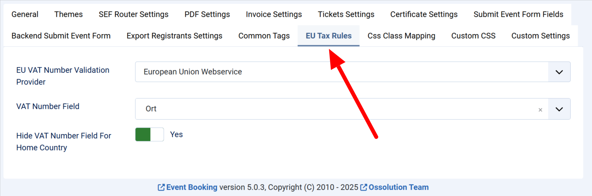

If you run international events from an EU country and need to apply EU VAT rules to registrations, follow these steps to configure Events Booking.

1. Go to **Events Booking** -> **Custom Fields**, create a Text custom field to allow registrants to enter their VAT Number.
2. Go to **Events Booking** -> **Configuration**, look at **EU Tax Rules** tab:

- Set **Default Country** config option to your country (must be an EU country)
- Set **EU VAT Number Validation Provider** config option to the provider you want. Suggest to use **vatcomply.com API** as it is more reliable.
- Set **VAT Number** config option to the custom field which you created above.
- Set **Hide VAT Number Field For Home Country** config option to Yes. Registrants from home country will be charged tax anyway, so it does not make sense to ask them to enter VAT Number

3. Open this URL to have necessary tax rules created (replace https://domain.com/administrator with administrator URL of your site)
https://domain.com/administrator/index.php?option=com_eventbooking&task=tool.build_eu_tax_rules

Now, when someone registers for your events, they will be charged tax follow **EU Tax Rules**:

- Registrants from none EU countries won't be charged tax
- Registrants from home country (your own country) will always being charged tax rate based on your country tax rate
- For registrants from other EU countries:

+ If they have a valid VAT Number, they won't be charged tax
+ If they do not have a valid VAT Number, they will be charged the tax rate of their own country

