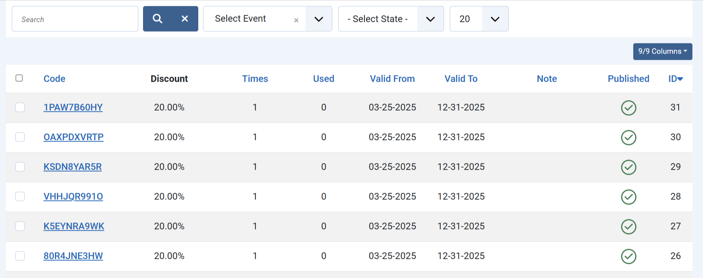
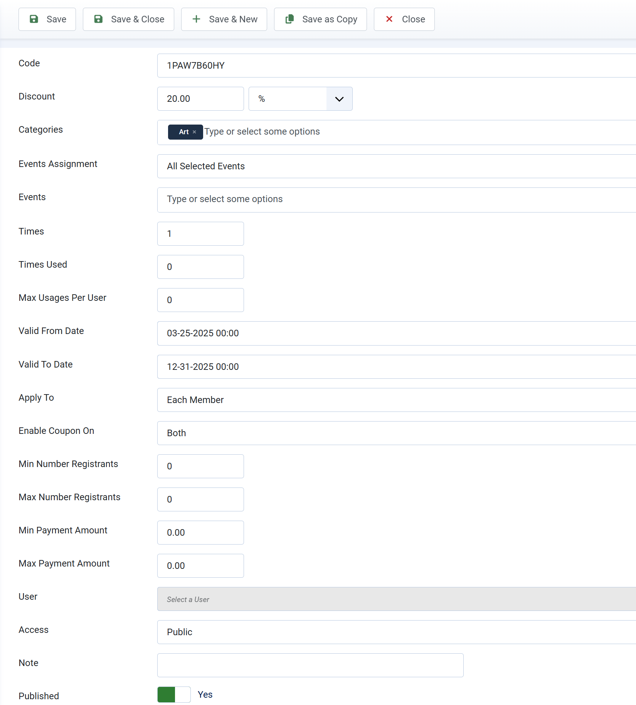
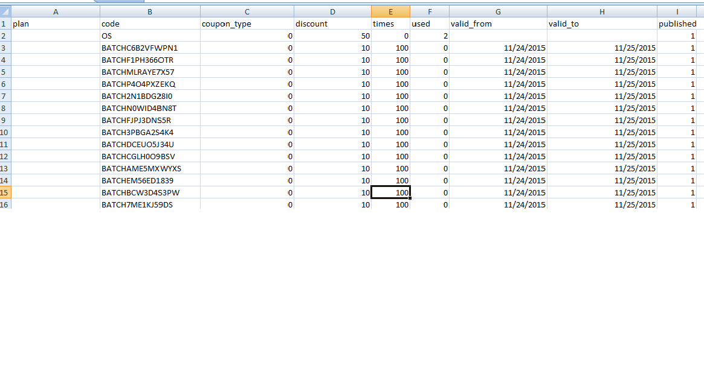
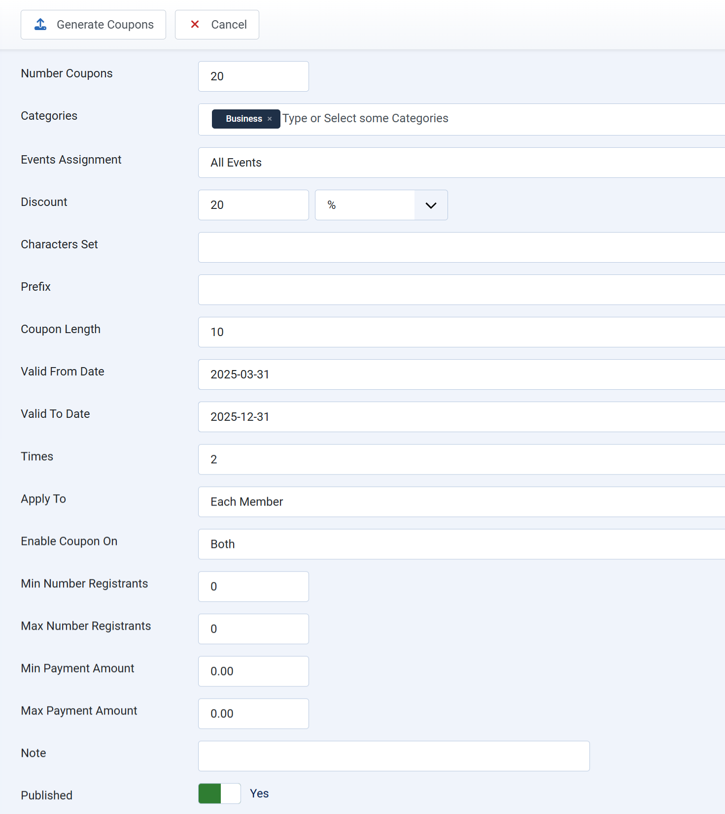

Use **Events Booking** to create coupon codes that give registrants a discount on event registrations.

To access to coupons management page, use one of these three options.
1. Go to **Components -> Events Booking -> Coupons**
2. Open Events Booking **Dashboard**, then click the **Coupons** icon.
3. On any pages in Events Booking, access to **Coupons** menu item

## Add New Coupon
Click **New** to create new coupon

1. **Code**: The code for this new coupon.
2. **Discount**: Enter the discount for this coupon. Discount can be set to a fixed amount (for example 10$) ro by percent (for example 10% of subscription fee).
3. **Categories**: Choose which event categories allow this coupon. Select **All Categories** to allow the coupon for events in any category.
4. **Events Assignment**: Choose how to assign the coupon to events.
- **All Events**: Allow the coupon for every event. Use a different option if **Categories** restricts the coupon to specific categories.
- **Selected Events**: The coupon can be used for all selected all selected events and the events which match the categories assignment in Categories parameter above
- **Exclude Selected Events**: The coupon can be used for all events which match the categories assignment in Categories parameter above except the selected events.
5. **Events**: Choose the events to use with the Coupon Assignment setting above.
6. **Times**: Enter the maximum number of times the coupon can be used. Leave this blank to allow unlimited use.
7. **Valid From Date**: Choose the first date the coupon can be used. It becomes available **from the selected date**.
8. **Valid To Date**: Choose the date when the coupon expires.
9. **Apply To**: Choose whether to apply the discount to **Each Member** or **Each Registration**.
10. **Enable Coupon On** : Control what type of registration the coupon can be used for: **Individual Registration**, **Group Registration** or **Both**.
11. **Min Number Registrants**: Enter the minimum group size required to use the coupon.
12. **Max Number Registrants**: Enter the maximum group size allowed to use the coupon.
13. **User**: Select a user to restrict the coupon to that user, or leave this blank to make it available to other users.
14. **Access** : Only users with this access level can used the coupon. Usually, this should be set to Public
15. **Note**: Put a note (for yourself) about this coupon
16. **Published**: Set to Yes to enable the coupon or No to disable it.

## Common Coupon Assignment Setup

**1. Coupons available for all events**
- **Categories**: Set to **All Categories**
- **Events** : Set to **All Events**

**2. Coupons available for all except some selected events**
- **Categories**: Set to **All Categories**
- **Events Assignment** : Set to **Exclude Selected Events**
- **Events** : Select the events which you want the coupon to be excluded.

**3. Coupons available for events from certain categories**
- **Categories**: Select the categories you want
- **Events Assignment**: Set to **All Selected Events**
- **Events**: Do not select any events.

**4. Coupons available for events from certain categories excluding some events**
- **Categories**: Select the categories you want
- **Events Assignment** : Set to **Exclude Selected Events**
- **Events** : Select the events which you want the coupon to be excluded.

**5. Coupons available for events**
- **Categories**: Do not select anything.
- **Events Assignment** : Set to **Selected Events**
- **Events**: Select the events that accept the coupon.

## Export Coupons

Export coupons to CSV for reporting or to import them into another system.

To export coupons, from any pages in **Events Booking**, access to **Coupons -> Export** sub-menu. A CSV file will be generated and downloaded to your computer. Below is the screenshow of a sample CSV file exported by Membership Pro

## Import Coupons

Import coupon codes from a CSV file, for example when migrating codes from another system.

### Prepare the csv file
To be imported into Events Booking, the CSV file contains coupon code need to be formatted in a required format. The easiest way is you the **Export Coupons** feature above to get a sample of the CSV file. Below are the meaning of the columns in CSV file:
1. **event**: Enter the event IDs. If this column is empty, the coupon applies to all events.
2. **code**: The coupon code
3. **coupon_type**: 0 mean discount type is percent. 1 mean discount type is fixed amount.
4. **discount**: The discount amount
5. **times**: Number of times the coupon code can be used. 0 means it can be used unlimited time
6. **valid_from**: The Valid From Date of the coupon. The date must be in YYYY-MM-DD format or you can leave it empty.
7. **valid_to**: The Valid To Date of the coupon. The date must be in YYYY-MM-DD format or you can leave it empty.
8. **published**: The coupon code is published or not

### Run the import

After preparing the CSV file, follow these steps to import the coupon codes.
1. Go to **Coupons -> Import**sub-menu item.
2. Click **Choose File** to select the CSV file.
3. Press **Import Coupons** button in the toolbar to process the import.

The imported coupon codes are now available in Events Booking.

## Batch Coupons

This is a very useful feature of Membership Pro. It allows you to create many coupons code at a time without having to enter these coupon codes manually.

From any page in Membership Pro, you can access to **Coupons -> Batch Coupons** sub menu item. The form below will be displayed to allow you to generate batch coupons

1. **Number Coupons**: Enter number of coupons you want the system to create. For example, 100, 500....
2. **Event**: Select the events that accept these coupon codes, or select **All Events**.
3. **Discount**: Enter the discount for the coupons. Discount can be set to a fixed amount (for example 10$) ro by percent (for example 10% of subscription fee).
4. **Characters set**: Enter the characters to use when generating the codes. Leave this blank to use **ABCDEFGHIJKLMNOPQRSTUVWXYZ0123456789**.
5. **Prefix**: Enter a fixed prefix for the coupon codes, or leave this blank.
6. **Coupon Length**: Enter the number of characters in each coupon code. For example, enter 10 to generate 10-character codes.
7. **Valid From Date**: The coupon codes become available **from the selected date**.
8. **Valid To Date**: Choose the date when the coupon codes expire.
9. **Times**: Enter how many times the coupon codes can be used. Leave this blank to allow unlimited use.

After completing the settings, click **Generate Coupons** in the toolbar to create the codes.

## Voucher Explanation
To let registrants use a coupon across multiple registrations, select **Voucher** as the Discount option. For example, a $100 voucher can be used until its balance reaches $0.

- You register for an event costs 20$, you will have 80$ left.

- You register for another event costs 40$, you have 40$ left.

- Then you register for another event cost 60$, you will have to pay 20$ because you only have 40$ left from the voucher.