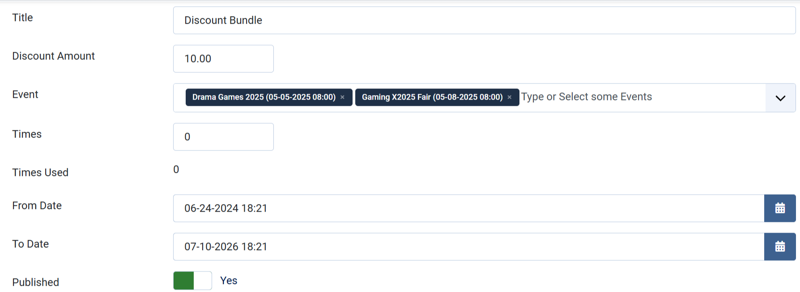
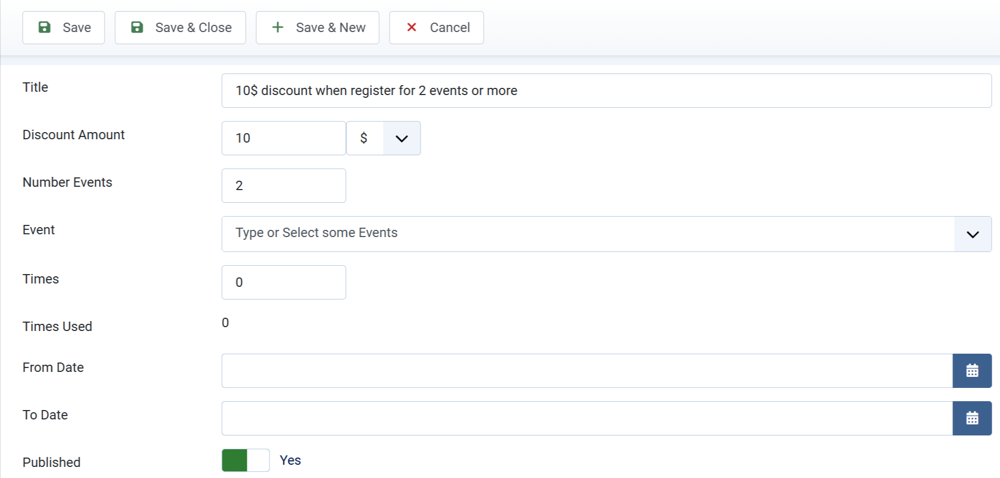

Use **Discount Bundle** to offer a discount when a user registers for all the events in a bundle.

Open **Discount Bundles Management** in either of these two ways:

1. Go to **Components -> Events Booking -> Discount Bundles**.
2. On any pages in Events Booking, access to **Setup -> Discount Bundles**.

## Add New Discount Bundle
From Discount Bundles Management screen, click New in the toolbar to add a new location. You will be presented with a screen below:

<table class="table table-stripped table-bordered table-considered">
<thead>
<tr><th width="15%">Property</th><th>Description</th></tr>
</thead>
<tbody>
<tr>
<td><strong>Title</strong></td>
<td>Title of the discount bundle. Choose a meaningfull title so that you can easily know what's this discount bundle used for.</td>
</tr>
<tr>
<td><strong>Discount</strong></td>
<td>Enter the discount registrants receive when they register for all the events in the bundle.</td>
</tr>
<tr>
<td><strong>Event</strong></td>
<td>Select the events to include in the bundle. Registrants must register for all of them to receive the discount.</td>
</tr>
<tr>
<td><strong>Times</strong></td>
<td>Enter the number of times the discount bundle can be used. Leave it blank for unlimited use.</td>
</tr>
<tr>
<tr>
<td><strong>From Date</strong></td>
<td>Set the date when the discount bundle becomes available.</td>
</tr>
 <tr>
<td><strong>To date</strong></td>
<td>Set the date when the discount bundle expires.</td>
</tr>   
</tbody>
</table>

## Some notes
Users will only receive discount if they register for all events that you set up for the discount bundle. So:
1. With Individual/Group registration, users must log in to receive the discount. They receive it when they register for the final event in the bundle.
2. With the shopping cart enabled, users can receive the discount without logging in if they register for all events in the bundle in one checkout. For logged-in users, Events Booking checks both previous registrations and events in the cart to determine eligibility.
3. In case multiple discount bundles meet for one registration, he will receive discount amount of all the matching discount bundles

## Discount By Number Of Items In Cart
One limitation with Discount Bundle is that you have to select the events in the bundle which users need to register to receive discount. However, in many cases, you just need to have a simple rule, for example: Users will receive discount if they register for certain number of events. For example, get 10$ discount if register for any of 2 events. 

This is supported in latest version of Events Booking (for shopping cart mode). In this case, you just need to create a discount bundle with Number Events parameter set to 2 (no need for selecting any events).

