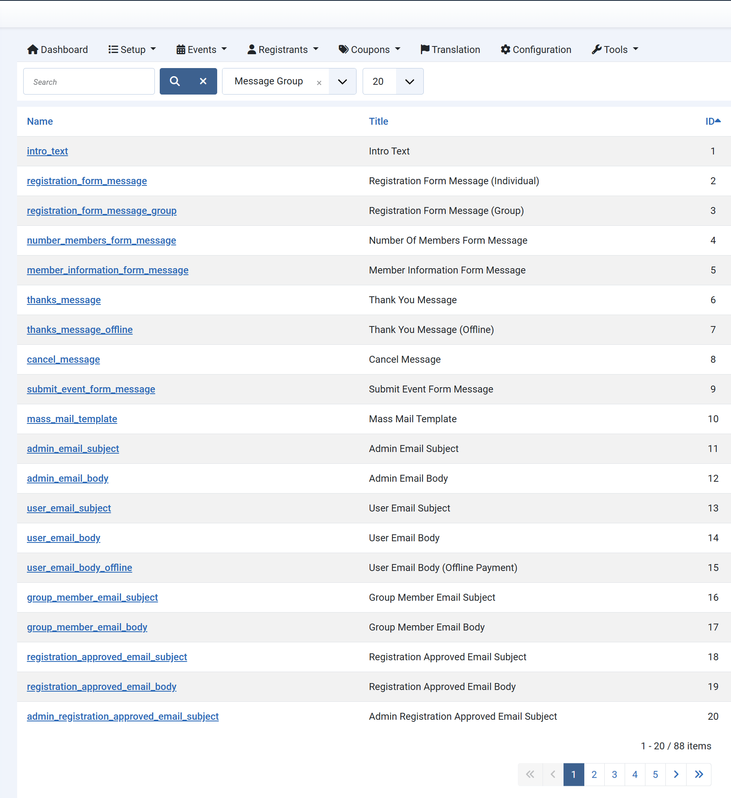

**Events Booking** creates default **English Messages** during installation. The extension uses them on the **registration form**, after **registration complete**, and in **emails**.

Review the default messages and adapt them to your site. Translate them if your site uses a language other than English.

Use the search box to find the message you want to edit. You can search by any of the following items.

- The message key/name
- The message title in English
- Or the content of the message

To find a specific message, enter a few words from it into the search box.

To see the messages and change it to suit your needs, there are 3 ways:
1. Go to **Components -> Events Booking -> Emails & Messages**
2. Access to Membership Pro Dashboard, then click on **Emails & Messages** icon.
3. From any Events Booking page, go to **Setup -> Emails & Messages**.

>>> To use the older **Emails & Messages** interface, go to Tools -> Legacy Emails & Messages. This opens the Events Booking 3.x interface with all messages on a single page.

## Registration Form Messages
1. **Registration Form Message (Individual)**: Appears above the individual registration form.
2. **Registration Form Message (Group)**: Appears above the group registration form.
3. **Number of members Form Message**: Appears above the form where the registrant enters the size of the group.
4. **Member Information Form Message**: Appears above the group member information form.
5. **Thank you message**: Appears on the thank-you page after registration is complete.
6. **Thank you message (offline payment)**: Appears on the thank-you page after registration with an offline payment method.
7. **Cancel message**: Appears when a registrant cancels their payment.
8. **Registration Cancel Message (Free Event)**: Appears when a registrant cancels a registration for a free event, if cancellations are enabled.
9. **Registration Cancel Message (Paid Event)**: Appears when a registrant cancels a registration for a paid event, if cancellations are enabled.

## Registration Email Messages

1. **Admin email subject**: Subject of the notification email sent to admin when someone registers for an event.
2. **Admin email body**: Message of the notification email sent to admin when someone registers for an event.
3. **User email subject**: Subject of the confirmation email sent to registrant after he sign up for an event.
4.  **User email body**: Message of the confirmation email sent to registrant after he sign up for an event.
5.  **User email body (offline payment)**: Message of the confirmation email sent to registrant after he register for an event using **offline payment** method.	
6.  **Group Member Email Subject**: Subject of the confirmation email sent to group members(s) in group registration
7.  **Group Member Email Body**: The confirmation email sent to group members. To send it, set **Send confirmation email to all group members** to **Yes**.
8.  **Reminder Email subject**: Subject of reminder email send to registrants before the event started to remind them about the event
9.  **Reminder email body**: Message of reminder email body send to registrants before the event started to remind them about the event
10.  **Registration cancel notification Email subject**: Subject of the notification email send to administrators when someone cancel their registration for the event
11.  **Registration cancel notification Email body**: Message of the notification email send to administrators when someone cancel their registration for the event
12.  **Registration approved subject**: Subject of the notification email sent to the registrant when admin approves their registration (change the status from Pending to Paid, usually when he uses offline payment method for the registration)
13.  **Registration approved body**: Message of the notification email sent to the registrant when admin approve their registration(change the status from Pending to Paid, usually when he uses offline payment method for the registration)

## Invitation Messages

1. **Invitation Form Message**: Appears above the form visitors use to invite friends to view the event by email.
2. **Invitation complete message**: Appears after a visitor sends an invitation.
3. **Invitation Email subject**: Subject of invitation email sent to users to invite them to attend the event.
4. **Invitation email body**: Message of invitation email sent to users to invite them to attend the event

## Waiting List Messages

1. **Waitinglist form message**: Appears above the waiting list form.
2. **Waiting list complete message**: Appears after a visitor submits the waiting list form.
3. **Waitinglist confirmation email subject**: Subject of the email sent to users after they completed waitinglist form.
4. **Waitinglist confirmation email body**: The email message sent to users after they completed waitinglist form
5. **Waitinglist notification email subject**: Subject of the email sent to the administrator when users completed waitinglist form
6. **Waitinglist notification email body**: The email message sent to administrator when users completed waitinglist form
7. **Registrant waitinglist notification email subject**: Subject of the email message sent to waiting list users when someone cancel registration so that they will know and register for the event (to replace the cancelled registrant)
8. **Registrant waitinglist notification email body**: The email message sent to waiting list users when someone cancel registration so that they will know and register for the event (to replace the cancelled registrant)
