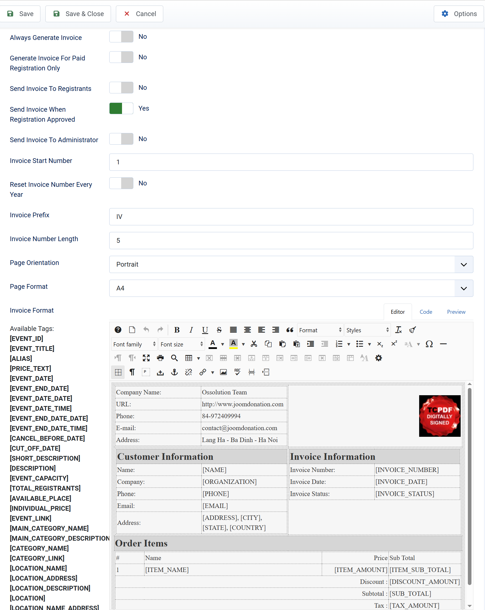

## Introduction
Enable the **PDF invoice feature** to generate a PDF invoice when someone registers for a paid event. You can make the **invoice PDF generated** available in the following ways.
1. The layout of the invoice PDF is configurable
2. The invoice PDF will be generated for each registration
2. The invoice PDF can be configured to send registrant's email
3. A copy of the invoice can be configured to send to admin's email
4. Admin can download invoices for the registrants by accessing to **Events Bookong => Registrants** section.
5. If admin wants to download all invoices, he can downdown it via FTP. All generated invoices are stored in **media/com_eventbooking/invoices** folder of the site
6. Registrants can also log in to the frontend and download invoices from the Events Booking - Registration History page.
7. Each event can have it own invoice format if needed. In case you need it, edit the event, look at **Advanced Settings** tab and change Invoice Layout from there, it will override the general invoice layout which you configured in Configuration.

## Configure invoice
To use this feature, please go to **Events Booking -> Configuration**, look at **Invoice Settings** tab, find the config option **Activate Invoice Feature**, set it to **Yes** and change the **Invoice Layout** to suit your needs if needed (at least you should change the invoice logo)

Use the following settings in **Invoice Settings** to control how Events Booking generates and sends invoices.

1. **Activate Invoice Feature**: Set to **Yes** to generate PDF invoices for **paid events** after registrants complete payment.
2. **Send invoice to registrants**: Set to **Yes** to attach the PDF invoice to the confirmation email. If you set it to **No**, create a menu item for the Events Booking registration history page so registrants can download invoices there. This setting **should be set to Yes** when you use invoices.
3. **Send copy of invoice to administrators**: Set to Yes to send administrators a copy of the PDF invoice.
4. **Invoice Start Number**: Enter the number to use for the first invoice. The default is 1.
5. **Invoice prefix**: Enter the prefix for invoice number. For example, you can enter **IV** and the invoice number in your system will have this format **IV**0001, **IV**0002, **IV**0003....
6. **Invoice Number Length**: Enter the length of the invoice number. For example, with a length of 4, invoice numbers look like IV0001 and IV0002.
7. **Invoice Format**: Events Booking creates a basic invoice layout during installation. Review the layout and replace the invoice logo.

## Supported tags
Below are list of all the tags which you can use to design your invoice

### Event Information tags
- [EVENT_TITLE]
- [EVENT_DATE]
- [EVENT_DATE_DATE] (event date without the time)
- [EVENT_DATE_TIME]
- [EVENT_END_DATE]
- [EVENT_END_DATE_DATE]
- [EVENT_END_DATE_TIME]
- [SHORT_DESCRIPTION]
- [DESCRIPTION]
- [EVENT_CAPACITY]
- [INDIVIDUAL_PRICE]
- [PRICE_TEXT]
- [LOCATION]
- [LOCATION_NAME]

### Registration information
- [ID] (registration record ID)
- [FIRST_NAME]
- [LAST_NAME]
- [NAME] (first_name and last_name combined)
- To insert a custom field, use [NAME_OF_FIELD_IN_UPPERCASE]. For example, use [REGISTRATION_TYPE] for a field named registration_type.
- [COUPONCODE]
- [USERNAME]
- [USER_ID]
- [NUMBER_REGISTRANTS]
- [GROUP_MEMBERS_NAMES]
- [INVOICE_NUMBER]
- [TOTAL_AMOUNT]
- [DISCOUNT_AMOUNT]
- [TAX_AMOUNT]
- [PAYMENT_PROCESSING_FEE]
- [AMOUNT] (This is the final payment amount users have to pay, amount after discount, tax...)
- [DEPOSIT_AMOUNT]
- [DUE_AMOUNT]
- [PAYMENT_METHOD]
- [PAYMENT_DATE]
- [TRANSACTION_ID]
- [REGISTRATION_STATUS]
- [TICKET_TYPES] (if you use the Ticket Types feature)

### Invoice information 
- [INVOICE_NUMBER]
- [INVOICE_DATE]
- [INVOICE_STATUS]
- [ITEM_NAME]

