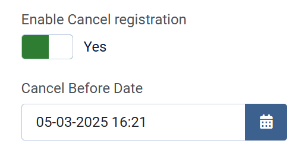
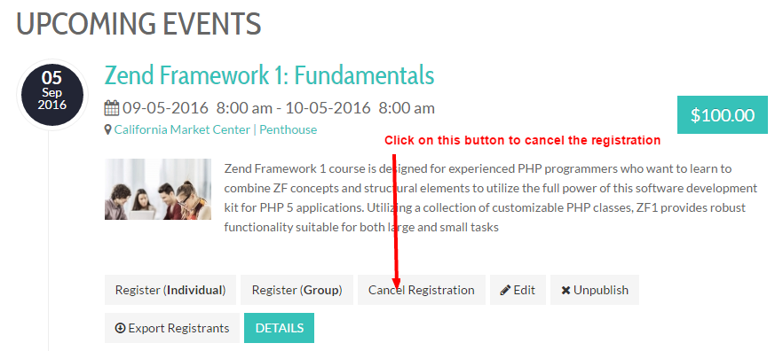

You can let registrants cancel their own registrations after signing up for an event.

## Setup event to allow cancel registration
1. Edit the event and set **Enable Cancel Registration** to **Yes**.
2. Set **Cancel Before Date** to the cancellation deadline. If you leave it blank, Events Booking uses the event date so registrants can cancel until the event starts.

## How registrants cancel their registration
When you enable cancellations for an event, registrants can cancel in either of these ways.
1. If the registrant has an account, they can log in, find the event in the events list or on the event details page, and click **Cancel Registration**. 
2. For registrants without an account, add **[CANCEL_REGISTRATION_LINK]** to User Emails Body and User Email Body (Offline Payment). Registrants can then cancel by clicking the link in their confirmation email.

## What happens when a registrant cancel the registration
1. Events Booking notifies administrators and sends a confirmation to the registrant. See [User Cancel Registration Email](/email-tags/user-cancel-registration-email) for the messages.
2. For a paid registration, the administrator must issue the refund manually.
3. If you use a waiting list, configure the notification email so Events Booking can tell people on the list when a place opens. See [Notify Waiting List Email](/email-tags/notify-waiting-list) for the message.
4. If you use a waiting list, you can enable **Events Booking - Move Registrants Plugin** to move the first person on the list into registration. The system does not process payment automatically, so the registrant pays manually.