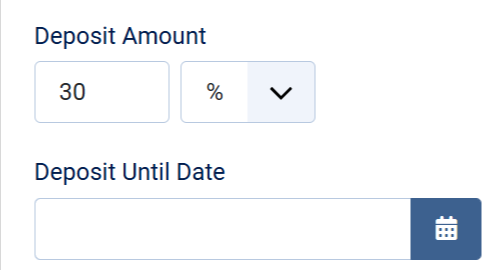
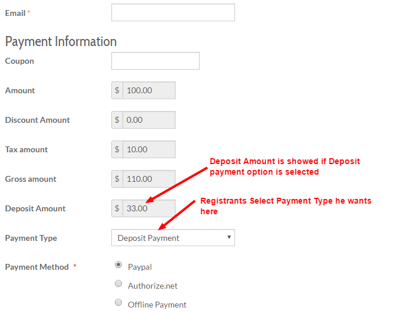
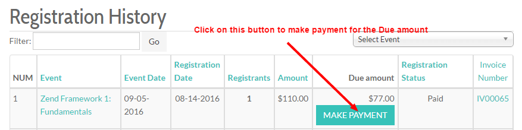

Events Booking lets you set a fixed or percentage-based deposit for an event. Registrants can choose **Deposit Amount** or **Full Amount** when they register. If they pay a deposit, they can pay the remaining balance in person at the event or online before it starts.

## Setup deposit payment for your events. 
1. Go to **Events Booking** -> **Configuration** and set **Activate Deposit Feature** to **Yes**.
2. Edit the event and set **Deposit Amount** . To offer a deposit only up to a certain date, set **Deposit Until Date**.
3. On the registration form, registrants choose **Full Payment** or **Deposit Payment** under **Payment Type**. If they select **Deposit Payment**, Events Booking calculates and displays the deposit .
4. Registrants complete payment as they would for any other registration.

## Notify registrants to pay remaining amount
To remind registrants to pay the remaining balance a set number of days before the event starts, create an [Events Booking - Deposit Payment Reminder](/scheduled-tasks/deposit-payment-reminder) scheduled task.

## Pay remaining amount
Registrants who choose **Deposit Payment** need to pay the remaining balance. They can pay in any of the following ways.
1. Registrants can pay in person at the event or by bank transfer. When you receive the payment, go to Events Booking -> Registrants, open the registration, and set **Payment Status** to **Full Payment**.
2. Registrants with an account can log in, open Registration History, and click **Make Payment** for their registration .
3. For registrants without an account, add **[DEPOSIT_PAYMENT_LINK]** to **User Email Body** and **User Email Body (Offline Payment)** in Events Booking -> Emails & Messages or the event’s Advanced Settings tab. Registrants can follow the link in their confirmation email to pay the balance.