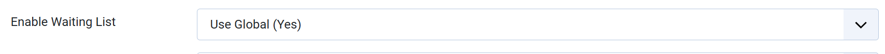

Enable the **Waiting List feature** so users can join a waiting list when an event reaches capacity. Events Booking saves their registration with **Waiting List** status and does not take payment. If a confirmed registrant cancels, the system can notify waiting list users so they can pay for an available place.

## Enable Waiting List
Go to **Events Booking** -> **Configuration** and set **Activate Waiting List Feature** to **Yes**. When you add or edit an event, open **Options** and choose one of the three values for **Enable Waiting List**.
- **Use Global**: Use **Activate Waiting List Feature** from the configuration.
- **Yes**: Enable the waiting list for this event regardless of **Activate Waiting List Feature**.
- **No**: Disable the waiting list for this event regardless of **Activate Waiting List Feature**.

## How to change a user from waiting list to registrants
When a registration is canceled and a place opens, use one of the options below to offer it to a person on the waiting list.

1. In **Events Booking** -> **Emails & Messages**, configure **Registrant waitinglist notification email subject** and **Registrant waitinglist notification email body**. When someone cancels, Events Booking emails everyone on the waiting list. They can log in, open their registration history, and click **Make Payment**. Places go to the users who pay first, until the event is full again. To turn off these notifications, clear **Registrant waitinglist notification email subject**.
2. Go to **Events Booking** -> **Registrants** and filter by waiting list status. Select the person you want to offer the place to and click **Request Payment** in the toolbar. The recipient can follow the link in the email to pay and become a registrant. Before sending payment requests, review **Payment request email subject** and **Request payment email body** under **Events Booking** -> **Emails & Messages**.
3. Go to **Events Booking** -> **Registrants** and filter by waiting list status. Contact the person you want to offer the place to. If they want to attend, ask them to pay, then change their registration status from **Waiting List** to **Paid**.