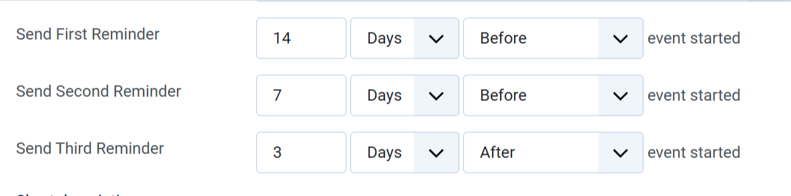
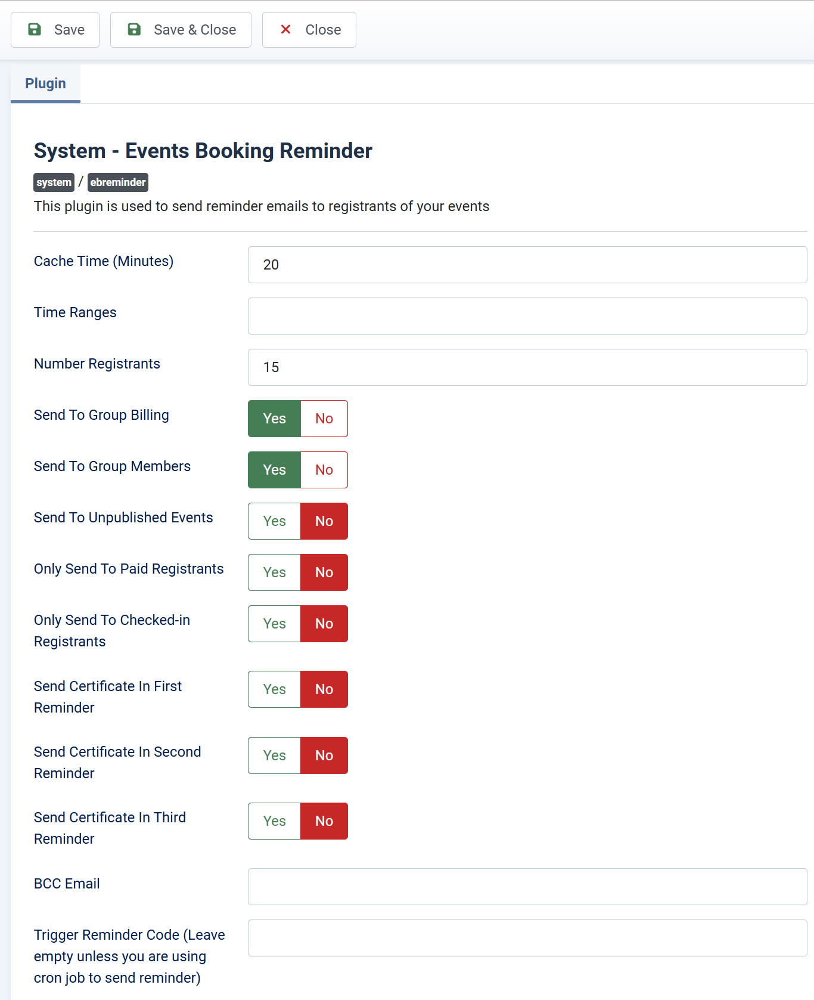
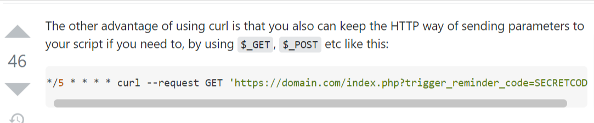

**Events Booking** can email registrants a reminder a set number of days before or after an event starts. Follow these steps to set up reminders.

## Configure events to allow sending reminder emails
You can configure up to three reminder emails per event. When you add or edit an event, use the following settings.

**Send First Reminder**
**Send Second Reminder**
**Send Third Reminder**

For each reminder, enter the number of days and choose whether to send it before or after the event starts. Leave the value blank or enter 0 to disable that reminder.

## Configure reminder email messages
Events Booking creates default reminder emails during installation. To edit them, go to **Events Booking** -> **Emails & Messages** and review the following subjects and messages.

*  **First Reminder Email Subject**
*  **First Reminder Email Body**
*  **Second Reminder Email Subject**
*  **Second Reminder Email Body**
*  **Third Reminder Email Subject**
*  **Third Reminder Email Body**

You can use the following tags in the email messages:
- [EVENT_DATE]
- [EVENT_TITLE]
- [FIRST_NAME]
- [LAST_NAME]
- [TRANSACTION_ID]
- [LOCATION_NAME]
- [LOCATION] (display name, address of location and allow clicking on to view that location on google map)
- [DOWNLOAD_CERTIFICATE_LINK] (if you are using certificate feature)
- [DOWNLOAD_TICKET_LINK] (if you are using ticket pdf feature)
- [REGISTRATION_DETAIL]

## Publish and configure Events Booking - Reminder plugin

Go to Extensions -> Plugins and publish **System - Events Booking Reminder**. The plugin checks for reminders to send every 20 minutes. Adjust the following settings as needed.

- **Number Registrants**: How many registrants the system should send reminder each time the plugin runs. You should not set it to a high value to avoid timeout during sending emails (or reach the mail limit your hosting allow to be sent each hour). Default value is 15, should be enough.
- **Send To Group Billing**: Set to Yes to email the person who made the group registration.
- **Send To Group Members**: Set to Yes to email individual group members.
- **Send To Unpublished Events**: Set to Yes to send reminders even if the event is unpublished. For example, you might automatically unpublish events when they reach capacity.
- **BCC Email**: Enter an address to receive a copy of each reminder email.

## Use Cron Job
By default, the system plugin checks for reminders when someone visits your site, including search engine bots. This can make delivery unreliable or cause duplicate emails on high-traffic sites. To trigger this process on a schedule, set up a cron job in your hosting account.

1. Go to **System** -> **Plugins** and open **System - Events Booking Reminder**. Enter a secret string in **Trigger Reminder Code**.

2. Set up a cron job that uses cURL to make a GET request to the URL below. See [https://stackoverflow.com/questions/11375260/cron-command-to-run-url-address-every-5-minutes](https://stackoverflow.com/questions/11375260/cron-command-to-run-url-address-every-5-minutes) for instructions.

**https://domain.com/index.php?trigger_reminder_code=SECRETCODE**

- Replace **https://domain.com/** with your site’s URL.
- Replace **SECRETCODE** with the value you entered in **Trigger Reminder Code**.

Events Booking now processes reminders only when the cron job requests the secret URL, so it can send them on a regular schedule.

## Control the time reminder emails sent
By default, reminders go out when a request to your site triggers the plugin or when the cron job runs. This can cause reminders to arrive at any time of day, including at midnight.

If you want the reminder emails sent at a certain time in the day already (in the Time Zone configured in **Website Time Zone** config option in **System -> Global Configuration** of your site), you can use **Time Ranges** parameter inside the plugin. For example, set it to** 5,14** will make the system only send email reminder from **5am to 2pm**. Set it to **8,10;14:18** will allow sending  reminders between **8 to 10 am and 2pm to 6pm**.

## Log reminder emails
If you want, you can config the system to log reminder emails so that you can monitor it (when it is sent, what's the actual email subject and email message...). To do that, go to Events Booking -> Configuration, look at Mails Settings section, change Log Emails Types settings to Yes.

Events Booking logs a copy of each reminder it sends. Go to Tools -> Emails Logs to view the entries.

## Want to Send More Reminder Emails

To configure up to six reminder emails per event, follow the instructions at [https://docs.joomdonation.com/eventsbooking/tools#support-up-to-6-reminders](https://docs.joomdonation.com/eventsbooking/tools#support-up-to-6-reminders).