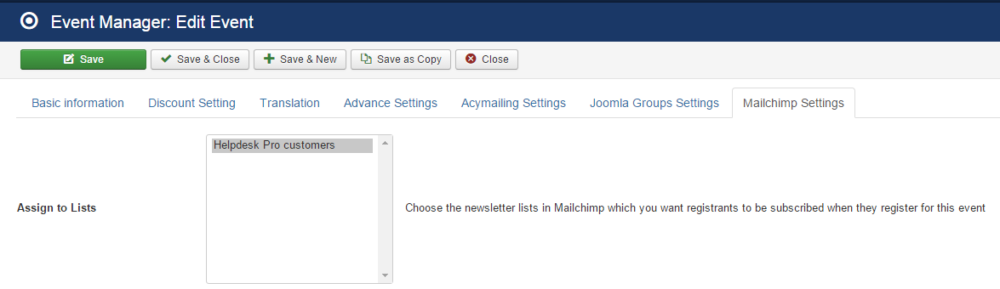

**Events Booking** provides plugins that add event registrants to mailing lists so you can send them newsletters.

**Events Booking** supports [**ACYMailing**](https://www.acyba.com/), a Joomla newsletter extension, and [Mailchimp](http://mailchimp.com/), an email marketing service.

## ACYMailing integration
The ACYMailing integration requires the **ACYMailing** extension.

1. Go to Extensions -> Plugins Manager, find and publish the plugin **Events Booking - Acymailing**
2. When you add or edit an event, open the **Acymailing Settings** tab. Under **Newsletter Lists**, choose the mailing lists the event’s registrants will join.

When users register for the event, Events Booking adds them to the selected mailing lists so you can send them newsletters through ACYMailing.

## Mailchim Integration

1. Go to Extensions -> Plugins Manager, find and publish the plugin **Events Booking - Mailchimp**
2. Get the **API Key** for your Mailchimp account by following the instructions at [http://kb.mailchimp.com/accounts/management/about-api-keys](http://kb.mailchimp.com/accounts/management/about-api-keys). Then **enter it into API key of the plugin parameter**.
3. When you add or edit an event, open **Mailchimp Settings**. Under **Assign to Lists**, choose the mailing lists the event’s registrants will join.

After that, when users sign up for this subscription plan, they will be assigned to the selected mailing lists and you can use **Mailchimp** to send newsletter to them in the future.

## Allow users to choose whether they want to join waiting list

By default, Events Booking adds registrants to the mailing lists you configure for each event. To let registrants choose whether to subscribe, as some countries require, follow these steps.

1. Go to Events Booking -> Custom Field and create a custom field for newsletter consent.
* Use a **Checkboxes** field with one option, **Yes**, and a title such as **Subscribe to our newsletter?**.
* Or use a Radio field with **Yes/No** options and a title such as **Subscribe to our newsletter?**.
2. Edit the event and open either the ACYMailing settings tab or the Mailchimp settings tab, depending on which integration you use. Set **Subscribe Newsletter Field** to the field you created.

Events Booking subscribes registrants to the selected mailing lists when they select the checkbox or choose Yes on the registration form.

