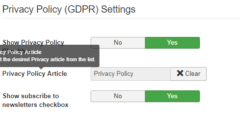
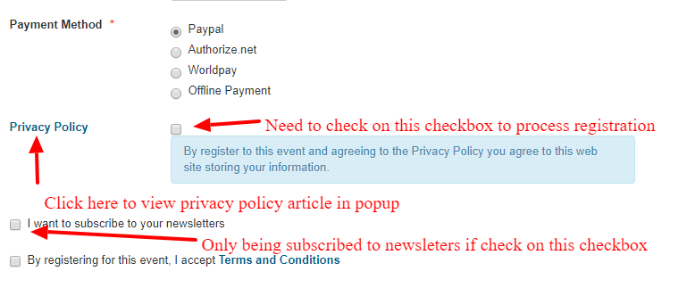

[GDPR](https://en.wikipedia.org/wiki/General_Data_Protection_Regulation) is now supported in Events Booking (from version 3.5.0). If you run a website require compatible with this rule, You can go to Events Booking -> Configuration, look at **Privacy Policy (GDPR) Settings** section, change the necessary settings to have Events Booking compatible with that requirement:

1. **Show Privacy Policy Checkbox**: Set to Yes
2. You can create a Privacy Policy Article and select that article for **Privacy Policy Article** setting
3. If you use ACYMailing or Mailchimp plugin to subscribe registrants to your newsletter, you need to set **Show subscribe to newsletters checkbox** config option to Yes

With that setup:

1. Registrants will have to check on **Privacy Policy** checkbox to register. They can also click on **Privacy Policy** to see the privacy policy article.
2. The default privacy short text is **By register to this event and agreeing to the Privacy Policy you agree to this web site storing your information.**. If you want to change it, you can go to Events Booking -> Translation, find the language item EB_AGREE_PRIVACY_POLICY_MESSAGE and change it.
3. Users will only be subscribed to your newsleters if they check on **I want to subscribe to your newsletters** checkbox.

Also, depends on your need, you might want to publish and use [**User - Events Booking plugin** ](http://eventbookingdoc.joomservices.com/miscellaneous-plugins/user-events-booking) so that when user account is deleted, the data (registration, events) associated with his account will be deleted, too