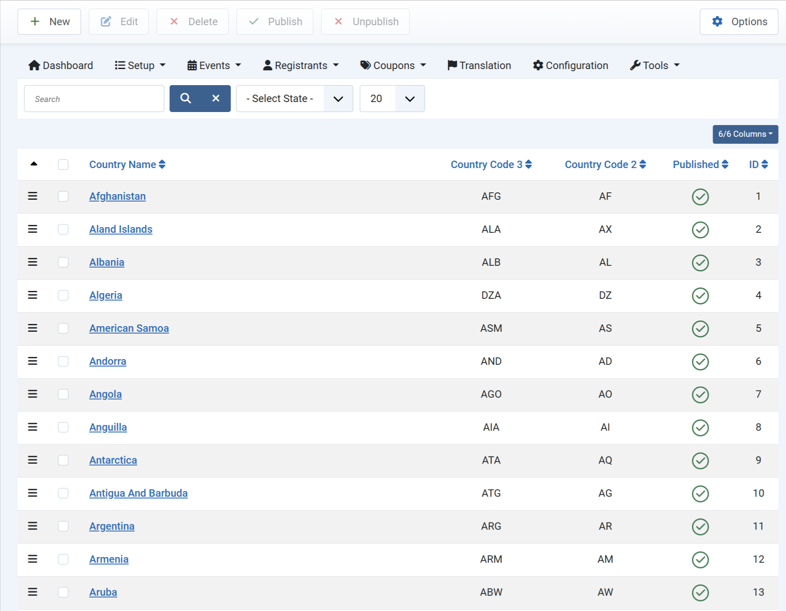
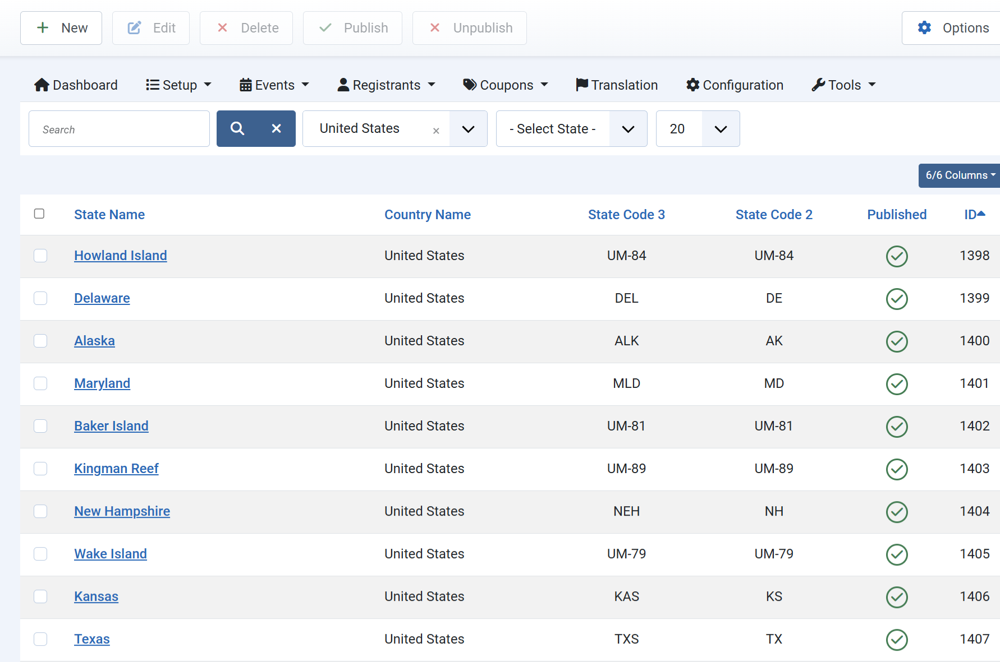

A typical Events Booking registration form includes two **special fields**.

1. A **country field** lets registrants select their country.
2. A **state field** lists the states in the selected country. The list updates when the registrant changes the country.

To add, edit, or remove entries, open Events Booking and go to **Setup -> Countries** or **Setup -> States**.

