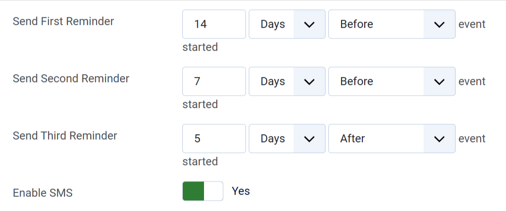
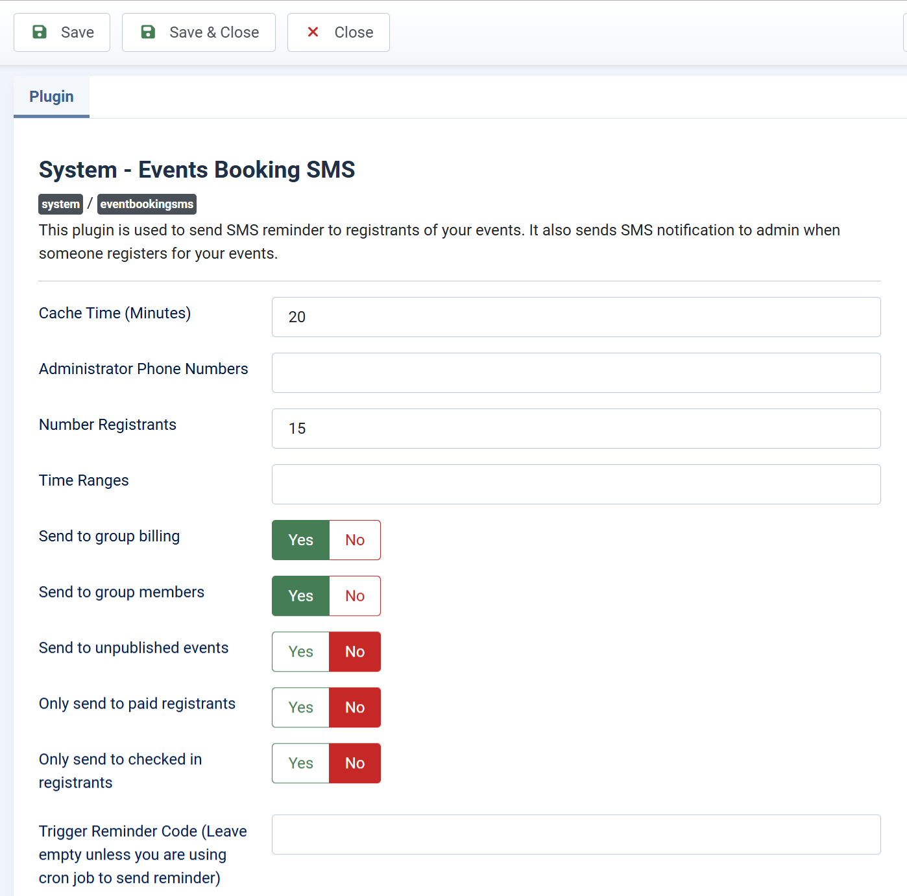

**Events Booking** can send **SMS Reminders** to registrants a set number of days before or after an event starts. It can also send administrators a text message when someone registers.

## Configure events to allow sending SMS Reminders
You can configure up to three SMS reminders per event. When adding or editing an event, use the following settings.

**Send First Reminder**
**Send Second Reminder**
**Send Third Reminder**
**Enable SMS**

For each reminder, enter the number of days and choose whether to send it before or after the event starts. Leave the value blank or enter 0 to disable that reminder.

- Set **Enable SMS** to **Yes** to send SMS reminders for this event.
- **Send First Reminder**, **Send Second Reminder**, and **Send Third Reminder** apply to both SMS and email reminders.

## Configure SMS Reminder Messages
Events Booking creates default SMS reminders during installation. To edit the messages, go to **Events Booking** -> **Setup** -> **Emails & Messages** and find the following items.

*  **New Registration SMS**
*  **First Reminder SMS**
*  **Second Reminder SMS**
*  **Third Reminder SMS**

You can use the following tags in the SMS messages.
- [EVENT_DATE]
- [EVENT_END_DATE]
- [EVENT_ID]
- [EVENT_TITLE]
- [LOCATION_NAME]
- [LOCATION_ADDRESS]
- [FIRST_NAME]
- [LAST_NAME]
- [ORGANIZATION]
- [ADDRESS]
- [ADDRESS2]
- [CITY]
- [STATE]
- [COUNTRY]
- [PHONE]
- [FAX]
- [EMAIL]
- [COMMENT]

## Publish and configure System - Events Booking SMS plugin

Go to Extensions -> Plugins and publish **System - Events Booking SMS**. The plugin checks for SMS reminders to send every 20 minutes. Adjust the following settings as needed.

- **Administrator Phone Numbers**: Enter the phone numbers that should receive an SMS when someone registers for an event. Separate multiple numbers with commas.
- **Number Registrants**: How many registrants the system should send reminder each time the plugin runs. You should not set it to a high value to avoid timeout during sending emails (or reach the mail limit your hosting allow to be sent each hour). Default value is 15, should be enough.
- **Time  Ranges**: The plugin checks for SMS reminders every 20 minutes, so messages could go out at any time of day. Set the time ranges during which it can send reminders.
- **Send To Group Billing**: Set to Yes to send a reminder to the person who made the group registration.
- **Send To Group Members**: Set to Yes to send reminders to individual group members.
- **Send To Unpublished Events**: Set to Yes to send SMS reminders even if the event is unpublished. For example, you might automatically unpublish events when they reach capacity.

## Publish And Configure SMS Plugin
To send SMS reminders, configure one of the supported SMS gateways.

- Clickatel [https://www.clickatell.com/](https://www.clickatell.com/)
- Clockwork [https://www.clockworksms.com/](https://www.clockworksms.com/)
- Textlocal [https://www.textlocal.com/](https://www.textlocal.com/)
- Nexmo (now Vonage) [https://www.vonage.com/](https://www.vonage.com/)
- Twilio [https://www.twilio.com//](https://www.twilio.com/)

Go to Extensions -> Plugins, open the plugin for your gateway, enter the required settings, and enable the plugin.

- **Events Booking SMS - Clickatell**
- **Events Booking SMS - Clockwork**
- **Events Booking SMS - Nexmo**
- **Events Booking SMS - Textlocal**
- **Events Booking SMS - Twilio**

The **Events Booking SMS - Nexmo** and **Events Booking SMS - Twilio** plugins are large, so they are available as separate downloads. To use either plugin, download it below and install it manually.

[plug_eventbookingsms_nexmo.zip](plug_eventbookingsms_nexmo.zip)

[plug_eventbookingsms_twilio.zip](plug_eventbookingsms_twilio.zip)

## Use Cronjob To Send SMS Reminders
By default, Events Booking uses a system plugin to trigger sending reminder emails. It's easy to setup (just need to publish the **Events Booking - Reminder** plugin), however, it also has some downside:

- A visit to your site triggers the reminder process.
- Reminders go out when someone visits your site. You cannot use this method to send reminders at a fixed time such as midnight every day.

To send reminders on a schedule, such as every day at 3 p.m., set up a cron job.

1. Go to Extensions -> Plugins and open **System - Events Booking SMS**.
2. Find the parameter **Trigger Reminder Code**, set it to a secret string you want, for example **runsmsreminder**.
3. Set up a cron job to request https://domain.com/index.php?trigger_reminder_code=runsmsreminder . Replace https://domain.com/ with your site’s URL and **runsmsreminder** with the value you entered in Trigger Reminder Code.

Your server now checks for reminders at the time you set in the cron job.
