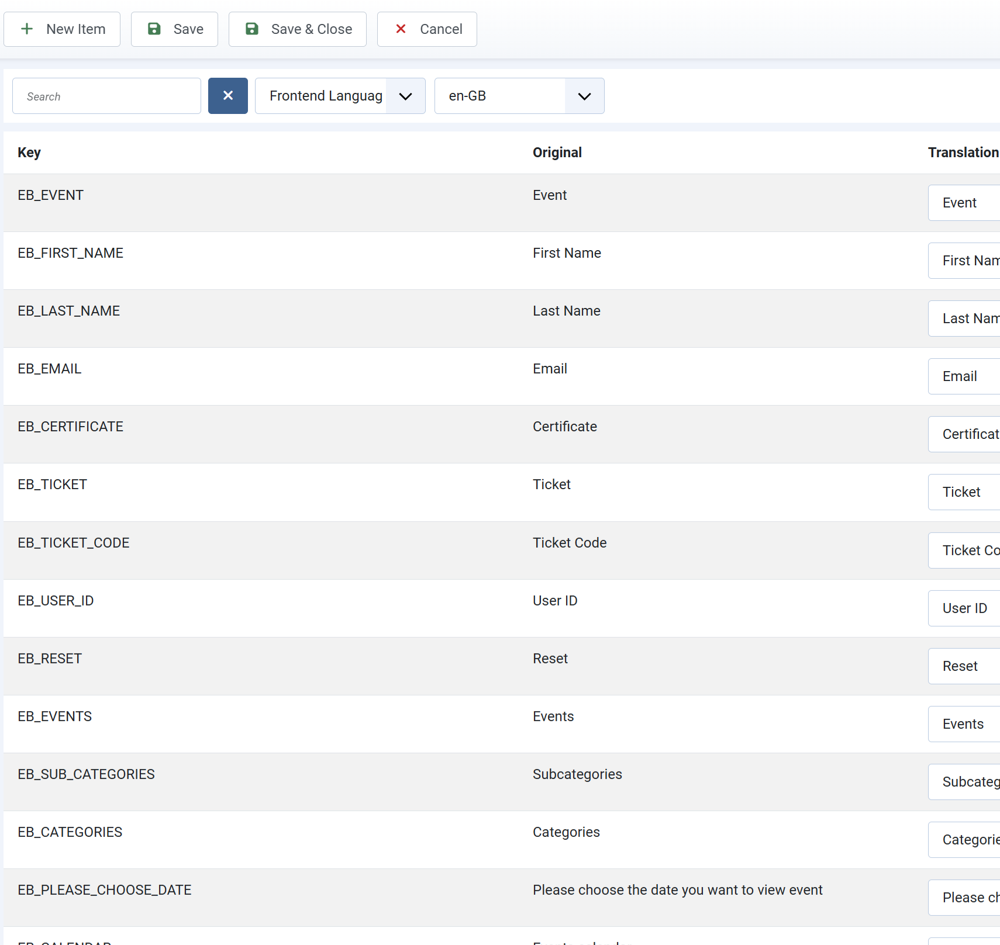

Use Translation in **Events Booking** to edit or add language items in the frontend and administrator area. You can translate the extension without editing the language files directly.

Open the translation management page in any of these three ways.

1. Go to **Components -> Events Booking -> Translation**.
2. Open Events Booking **Dashboard**, then click the **Translation** icon.
3. From any Events Booking page, open **Translation**.

## Update / Change existing language items
To update an existing language item, search for its key or text on the translation management page. Edit it and click Save in the toolbar.

## Add New Language Item
You may need to add a language item when you install a payment plugin that requires its own text.

To do that, please follow the steps below:
1. Press **New Item** Button in the toolbar
2. Enter the **language key** in **Key**.
3. Enter the **language string** for that **language key** in **Translation**.
4. Click **Save** in the toolbar

## Translate Language Files To New Language

If you use a none English language in Events Booking and there is not a language package for that language available yet, you will need to translate language files of Membership Pro from English to your language. To do that, on Translation Mangement Screen:

1. In **Select Language**, choose the language you want to translate into.
2. Select **Frontend Language** for the frontend file, **Backend Language** for the administrator area file, or **Common Language** for the file that both areas share.
3. Do the translation
4. Click **Save** in the toolbar

## Using Events Booking in none English language

Events Booking creates sample data, including email messages and custom fields, in **English** during installation. If you use another language, translate these items as well as the language files.

1. **Translate Custom Fields**: Go to **Events Booking -> Custom Fields**, edit the custom field, change the title (and description if available) to your language
2. **Translate Emails & Messages**: Go to **Events Booking -> Emails & Messages**, translate all existing messages to your language