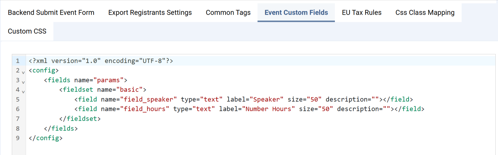
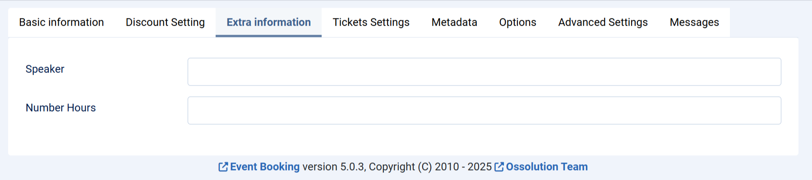

Use event custom fields to display information beyond the title, date, location, and description. For example, if an event has separate prices for adults and children, you can use fields to show those prices in the event list and on the event details page.

1. Go to **Events Booking** => **Configuration**: Set **Enable Event Custom Fields** config option to **Yes**
2.  Events Booking displays event custom fields on the event details page by default. To show them in event lists, set **Show event custom fields in category view** to **Yes**.
3. Go to **Events Booking -> Configuration**, look at **Event Custom Fields** tab, define custom fields you want (the custom fields need to be defined via an XML file in this case). If you do not see the tab, please go to **Extensions** -> **Plugins**, find and enable one of the two plugins **Editor - CodeMirror** or **Editor - None**. You can also open the file **components/com_eventbooking/fields.xml** and edit directly if you want. There are two custom fields defined by default : A textbox custom field and a textarea custom field. You can define similar custom fields in the fields. The list of supported custom field types can be found at http://docs.joomla.org/Standard_form_field_types . For your need, I believe you only need to use the following field types:
* **Text** ([http://docs.joomla.org/Text_form_field_type](http://docs.joomla.org/Text_form_field_type))
* **Textarea** ([http://docs.joomla.org/Textarea_form_field_type](http://docs.joomla.org/Textarea_form_field_type))
* **Checkboxes** ([http://docs.joomla.org/Checkboxes_form_field_type](http://docs.joomla.org/Checkboxes_form_field_type))
* **Radio** ([http://docs.joomla.org/Radio_form_field_type](http://docs.joomla.org/Radio_form_field_type))

4. When you add or edit an event, open the **Extra Information** tab and enter values for your custom fields. Visitors will see the values on the category page and event details page according to your settings.
5. To control who can see a custom field, use the **access** attribute. For example, **access="1"** makes it visible to everyone (**Public**), **access="2"** to users with **Registered** access, and **access="6"** to users with **Super Users** access.
5. To use a field in an email, invoice, or ticket without displaying it on the event page, set its **show** attribute to **show="false"** or **show="0"**.
6. On a multilingual site, use the **language** attribute to show the field for one language only. For example, **language="en-GB"** displays it in English only.

## Use Event Custom Fields In Email, Invoice, Ticket, Certificate
Beside being used to display more information about events, event custom fields can also be used in email messages, on PDF Io, too. Just use the syntax [NAME_OF_FIELD_IN_UPPERCASE]. For example, if you have a field with name **field_speaker**, you can use the tag **[FIELD_SPEAKER]** to insert value of that custom field into email message.