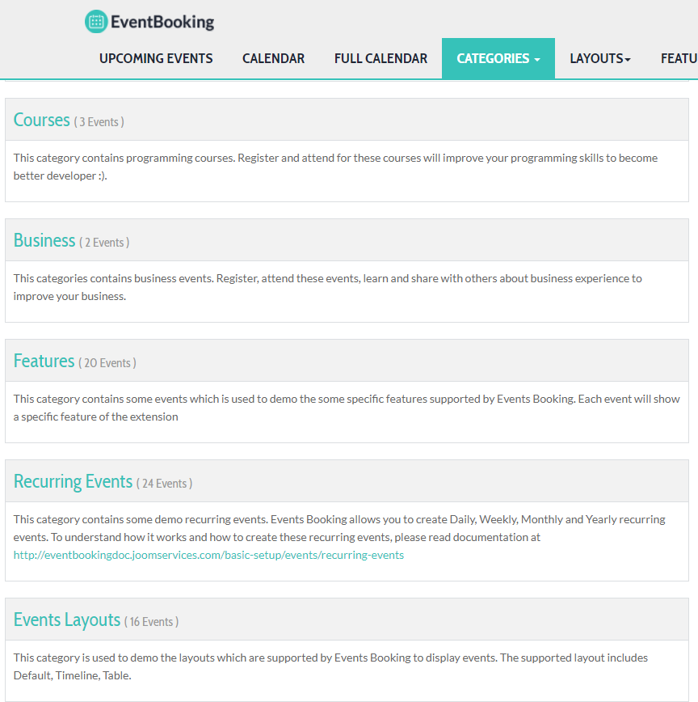
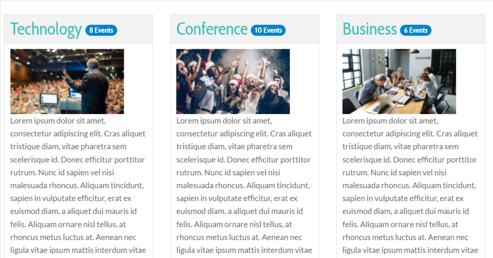
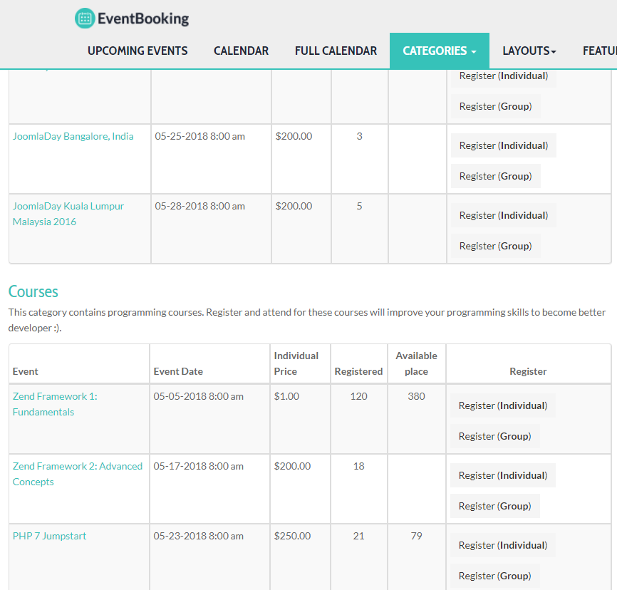

The Categories page lists the categories you set up in Events Booking. Visitors can open a category to see its events and any subcategories. You can use the following three menu item types to display categories.

## Categories - Default Layout

To use this layout, you need to create a menu item to link to **Categories - Default Layout** menu item type of **Events Booking**. The settings below are specific to Events Booking.

### Details tab
- **Category**: Select a category to display its subcategories. Leave it blank to display top-level categories.

### Options tab:
- **Categories**: Select the categories you want to display.
- **Exclude Categories**: Select the categories you want to hide.
- **Hide Children Categories**: Set to Yes to hide subcategories when visitors open a category from this page. They will see only events in the category they selected.
- **Intro Text**: Enter the text you want to display at the top of the page.

## Categories - Columns Layout

This layout displays categories in columns. To use it, create an Events Booking menu item of type **Categories - Columns Layout**. The settings below are specific to Events Booking.

### Details tab
- **Category**: Select a category to display its subcategories. Leave it blank to display top-level categories.

### Options tab:
- **Categories**: Select the categories you want to display.
- **Exclude Categories**: Select the categories you want to hide.
- **Number Columns**: Set how many categories to display per row.
- **Hide Children Categories**: Set to Yes to hide subcategories when visitors open a category from this page. They will see only events in the category they selected.
- **Intro Text**: Enter the text you want to display at the top of the page.

## Categories - Events List
This layout lists categories and displays each category’s events in Table Layout.

To use this layout, you need to create a menu item to link to **Categories - Events List** menu item type of **Events Booking**. The settings below are specific to Events Booking.

### Details tab

- **Category**: Select a category to display its subcategories. Leave it blank to display top-level categories.

### Options tab
- **Categories**: Select the categories you want to display.
- **Exclude Categories**: Select the categories you want to hide.
- **Number Events Per Category**: Set the number of events displayed under each category on this page (Default 20).
- **Hide Children Categories**: Set to Yes to hide subcategories when visitors open a category from this page. They will see only events in the category they selected.
- **Intro Text**: Enter the text you want to display at the top of the page.