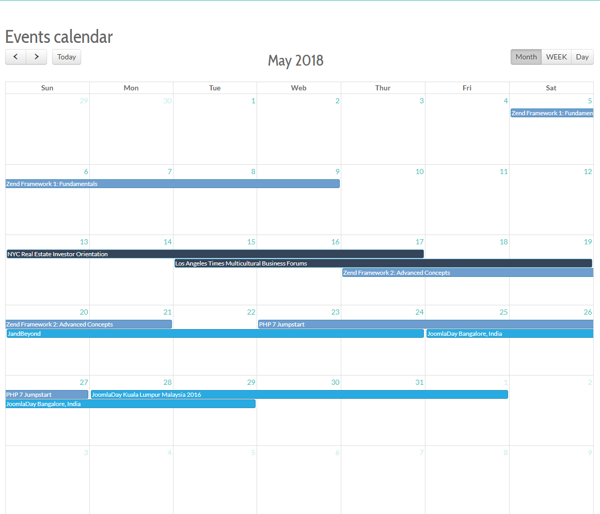

Full Calendar displays events using FullCalendar (https://fullcalendar.io). Visitors can browse events by month, week, or day.

Create an **Events Booking** menu item of type **Full Calendar**. The settings below are specific to Events Booking.

### Details tab
- **Category**: Select a category to display only events from that category.

### Options tab

- **Categories**: Select the categories whose events you want to display.
- **Exclude Categories**: Select the categories whose events you want to hide.
- **Location**: Select a location to display only events at that location.
- **Default Month**: Choose which month to show when the calendar opens. Select **Current Month** to show the current month.
- **Default Year**: Enter the year to show when the calendar opens, or leave it blank to show the current year.
- **Hide Past Events**: Select **Yes** to hide events dated before today or **No** to show both past and future events. Select **Use Global Configuration** to use the **Hide Past Events** setting in Events Booking configuration.
- **Hide Children Events**: Select **Yes** to hide child events created through additional dates or recurrence. The default is **No**, which displays both parent and child events.
- **Link Event To Registration Form**: Select Yes to open the event’s Registration Form when visitors click its title. Select No to open the event details page.
- **Hide Full Events**: If set to Yes, full events won't be displayed.
- **Override Menu Item ID**: By default, links to event details use the calendar’s menu item as the active menu item. Enter another menu item’s ID if you want those links to use that item, such as when the calendar is your homepage. Leave this setting blank to use the default.
- **Intro Text**: Enter the text you want to display at the top of the page.

### Calendar Display Options
- **Show Today Button**: Select Yes to display the Today button.
- **Show Month button**: Select Yes to let visitors switch to the monthly view.
- **Show Week button**: Select Yes to let visitors switch to the weekly view.
- **Show Day button**: Select Yes to let visitors switch to the daily view.
- **Default View**: Choose whether to open the calendar in Month, Week, or Day view.
- **Show Weekends**: Set to Yes to include **Saturday/Sunday columns** in any of the calendar views.
- **Hidden Days**: Choose which days of the week to hide.
- **Show None Current Dates**: Choose whether the current month’s view includes events from the previous and next months.
- **Slot Min Time**: Set the first time slot to display each day.
- **Slot Max Time**: Set the last time slot to display each day.
- **Time Format Month**: Set the event time format in the calendar. The default is the 12-hour format (h:mm a). Enter **HH:mm** for the 24-hour format. See [https://momentjs.com/docs/#/displaying/](https://momentjs.com/docs/#/displaying/) for supported format parameters.
- **Other parameters** control the calendar’s date and time formats. For supported parameters, see [https://momentjs.com/docs/#/displaying/](https://momentjs.com/docs/#/displaying/).