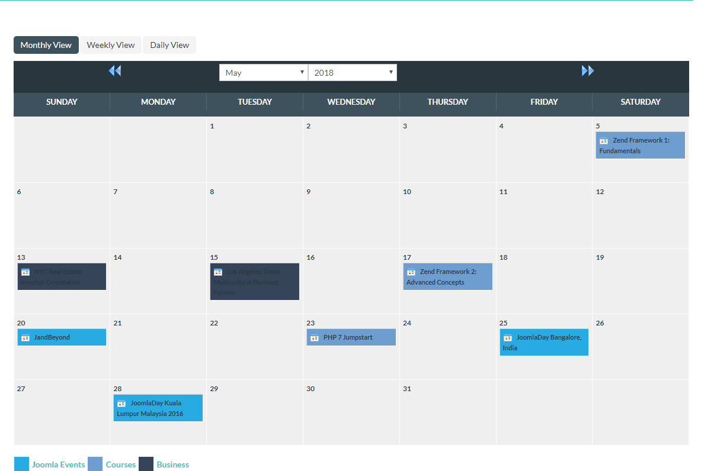
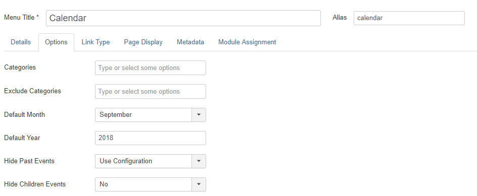

The Calendar menu item displays your events on a calendar. Visitors can browse by month, week, or day.

Create an **Events Booking** menu item of type **Monthly Calendar**. The settings below are specific to Events Booking.

### Details tab
- **Category**: Select a category to display only events from that category.

### Options tab

- **Categories**: Select the categories whose events you want to display.
- **Exclude Categories**: Select the categories whose events you want to hide.
- **Location**: Select a location to display only events at that location.
- **Default Month**: Choose which month to show when the calendar opens. Select **Current Month** to show the current month.
- **Default Year**: Enter the year to show when the calendar opens, or leave it blank to show the current year.
- **Hide Past Events**: Select **Yes** to hide events dated before today or **No** to show both past and future events. Select **Use Global Configuration** to use the **Hide Past Events** setting in Events Booking configuration.
- **Hide Children Events**: Select **Yes** to hide child events created through additional dates or recurrence. The default is **No**, which displays both parent and child events.
- **Link Event To Registration Form**: Select Yes to open the event’s Registration Form when visitors click its title. Select No to open the event details page.
- **Show Event Icon**: If set to Yes, there will be an icon displayed next to event title on the calendar.
- **Hide Full Events**: If set to Yes, full events won't be displayed in the calendar.
- **Override Menu Item ID**: By default, links to event details use the calendar’s menu item as the active menu item. Enter another menu item’s ID if you want those links to use that item, such as when the calendar is your homepage. Leave this setting blank to use the default.
- **Intro Text**: Enter the text you want to display at the top of the page.