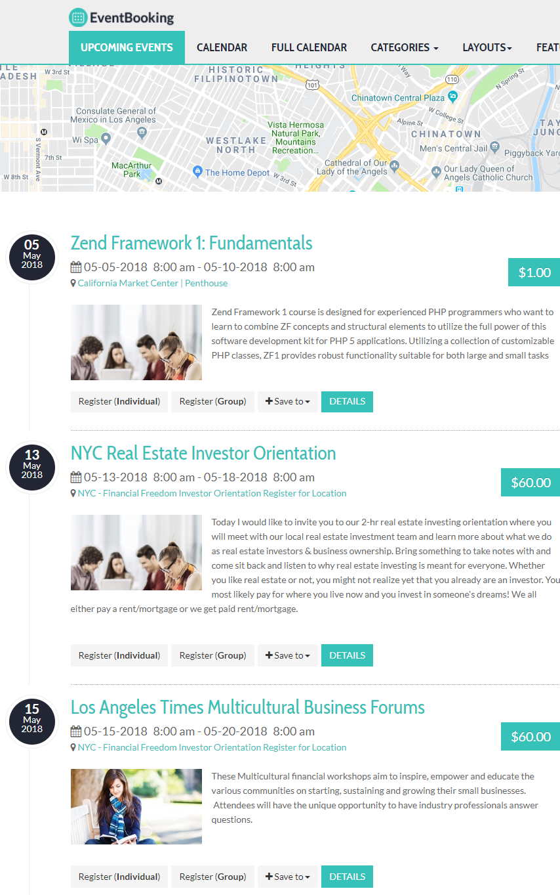
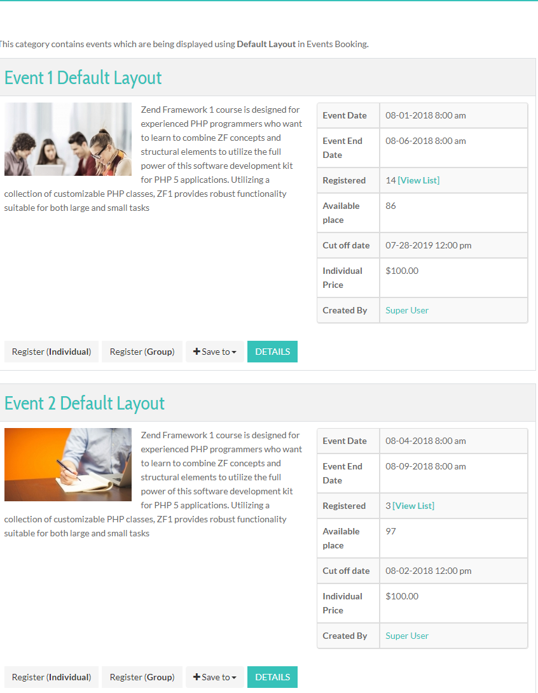
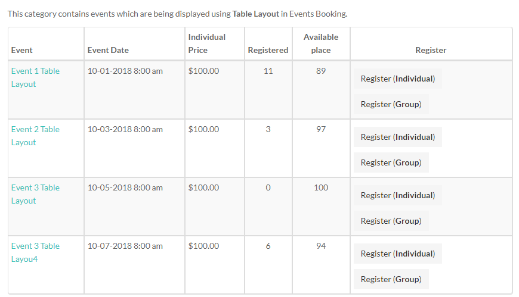
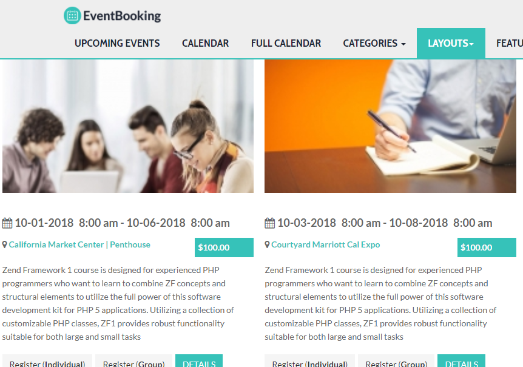
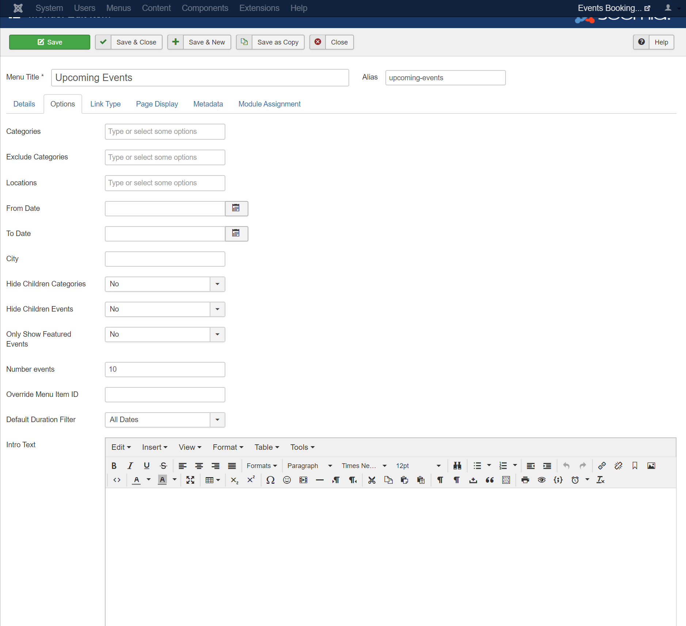

The **Upcoming Events** page lists upcoming events. Visitors can open an event to see its details or use the registration buttons to sign up. Choose one of the four menu item types below.

## Upcoming Events - Timeline Layout

To use this layout, you need to create a menu item to link to **Upcoming Events - Timeline Layout** menu item type of **Events Booking**. Personal, I think this is the nicest layout to display upcoming events. 

## Upcoming Events - Default Layout

To use this layout, you need to create a menu item to link to **Upcoming events - Default Layout** menu item type of **Events Booking**. 

## Upcoming Events - Table Layout

To use this layout, you need to create a menu item to link to **Upcoming events - Table Layout** menu item type of **Events Booking**. 

## Upcoming events - Columns Layout

To use this layout, you need to create a menu item to link to **Upcoming Events - Columns Layout** menu item type of **Events Booking**. 

## Menu parameters
All the menu options to display upcoming events have same set of parameters. The settings below are specific to Events Booking.

### Details tab
- **Category**: Select a category to display its subcategories. Leave it blank to display top-level categories.

### Options tab

- **Categories**: Select the categories whose events you want to display.
- **Exclude Categories**: Select the categories whose events you want to hide.
- **Locations**: Select the locations whose events you want to display.
- **Speakers**: Select the speakers whose events you want to display.
- **Default Duration Filter**: Choose the default duration filter (All Dates, Today, Tomorrow...) for events displayed from this menu item.
- **From Date**: Show only events whose **Event Date** is on or after the selected date.
- **To Date**: Show only events whose **Event Date** is on or before the selected date.
- **City**: If you enter a City here, only events from that City will be displayed.
- **Hide Children Categories**: Set to Yes to hide subcategories of the category selected in **Select Category** on the **Details** tab, or No to show them.
- **Hide Children Events**: Set to Yes to hide child events created through additional dates or recurrence. The default is No, which displays both parent and child events.
- **Only Show Featured Events**: Select Yes to show featured events only, or No to show both featured and non-featured events.
- **Duration Filter**: Choose the duration and only events within this seleceted duration will be displayed. Supported duration including: **Today**, **Tomorrow**, **This Week**, **Next Week**, **This Month**, **Next Month**.
- **Number Events**: Set how many events to display per page. Visitors can navigate to another page if more events match.
- **Override Menu Item ID**: By default, the current menu item will be used as default active menu to generate links to event detail page from the calendar. If you need to use different menu item (for example, when this menu item is a Homepage and you want to navigate to different page when users click on event on this calendar, enter the active menu item you want into this parameter). Usually, this should be empty.
- **Intro Text**: Enter the text to display at the top of the page. If you choose a category in **Select Category** on the Details tab, the page displays that category’s **Description** instead of **Intro Text**.

