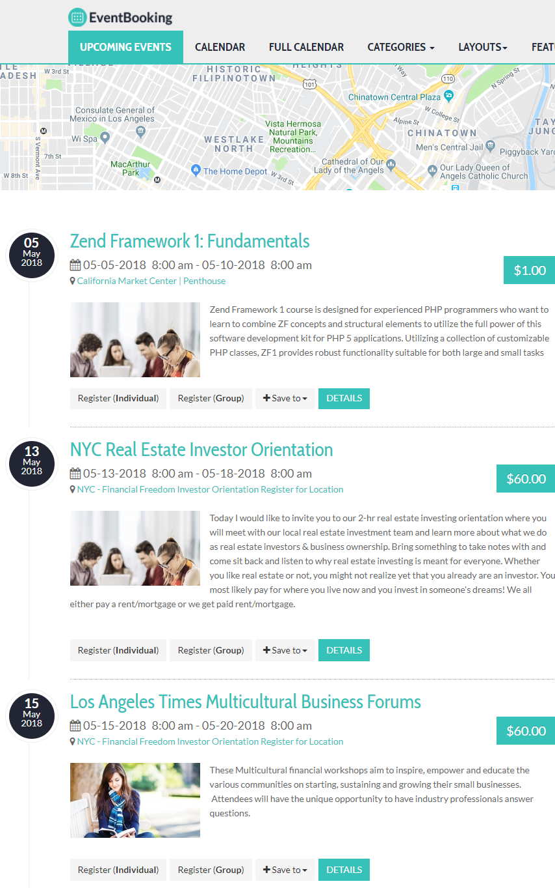
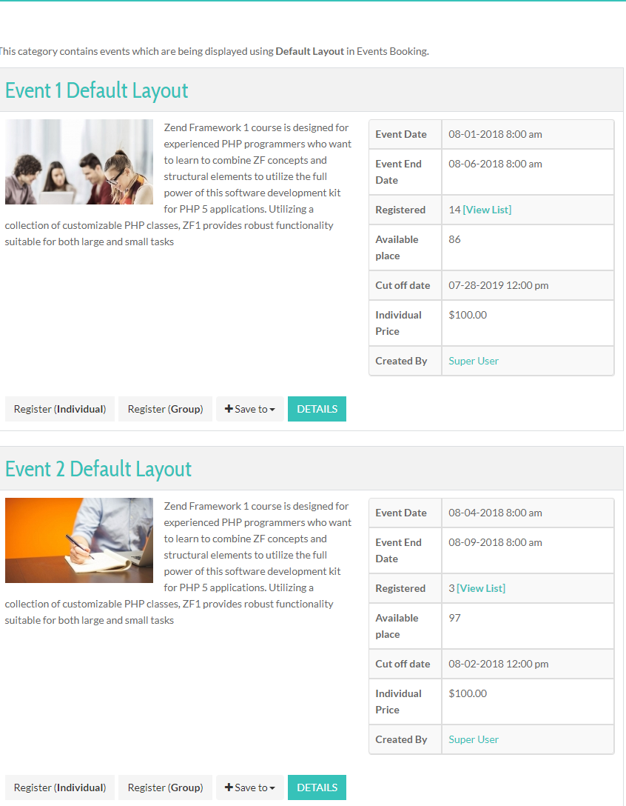
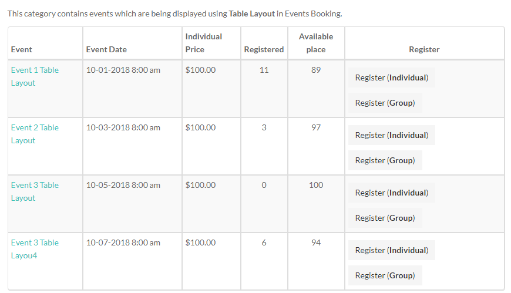
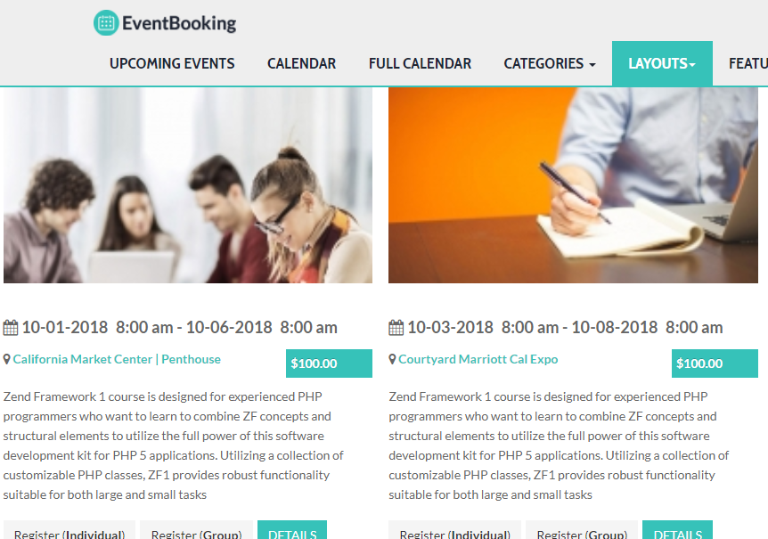
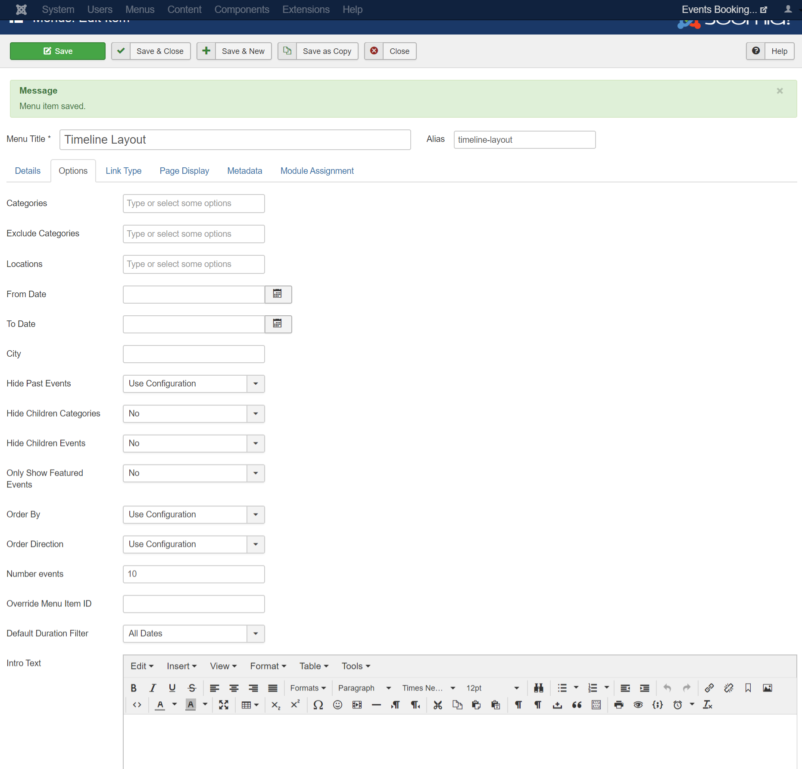

The **Category** page lists events in one category. Visitors can reach it from the Categories page, a menu item, or the Categories module. They can then open an event to see its details or use the registration buttons to sign up. Choose one of the four layouts below.

## Category - Timeline Layout

To use this layout, you need to create a menu item to link to **Category - Timeline Layout** menu item type of **Events Booking**. Personal, I think this is the nicest layout to display events from a category. 

## Category - Default Layout

To use this layout, you need to create a menu item to link to **Category - Default Layout** menu item type of **Events Booking**. 

## Category - Table Layout

To use this layout, you need to create a menu item to link to **Category - Table Layout** menu item type of **Events Booking**. 

## Category - Columns Layout

To use this layout, you need to create a menu item to link to **Category - Columns Layout** menu item type of **Events Booking**. 

## Menu parameters
All the menu options to display upcoming events have same set of parameters. The settings below are specific to Events Booking.

### Details tab
- **Category**: Select a category to display its subcategories. Leave it blank to display top-level categories.

### Options tab
- **Display Events Type**: Choose the event type which will be displayed on this menu item:

+ **Use Global**:  Depend on **Hide Past Events** config option. If the config option set to Yes, only upcoming events will be displayed. If set to No, all events will be displayed.
+ **All Events**: Will display both past and future events.
+ **Upcoming Events**: Only display upcoming events. Past Events won't be displayed.
+ **Past Events**: Only display past events (event date smaller than current date).
- **Categories**: Select the categories whose events you want to display.
- **Exclude Categories**: Select the categories whose events you want to hide.
- **Locations**: Select the locations whose events you want to display.
- **Speakers**: Select the speakers whose events you want to display.
- **From Date**: Show only events whose **Event Date** is on or after the selected date.
- **To Date**: Show only events whose **Event Date** is on or before the selected date.
- **City**: If you enter a city here, events that belong to that City will be displayed.
- **Hide Past Events**: If set to **Yes**, past events (event date smaller than current date) won't be displayed in the calendar. If set to **No**, both past and future events will be displayed. Set it to Use **Global Configuration** to use the value of Hide Past Events which you set in Events Booking configuration.
- **Hide Children Categories**: Set to Yes to hide subcategories of the category selected in **Select Category** on the **Details** tab, or No to show them.
- **Hide Children Events**: Set to Yes to hide child events created through additional dates or recurrence. The default is No, which displays both parent and child events.
- **Only Show Featured Events**: Select Yes to show featured events only, or No to show both featured and non-featured events.
- **Number Events**: Set how many events to display per page. Visitors can navigate to another page if more events match.
- **Default Duration Filter**: Choose the duration and only events within this selected duration will be displayed. Supported duration including: **Today**, **Tomorrow**, **This Week**, **Next Week**, **This Month**, **Next Month**.
- **Order By**: Choose the ordering of events displayed on this page. Supported options: **Use Configuration**, **Event Title**, **Event Date**, **Ordering**.
- **Order Direction**: Choose the order direction for events displayed on this page. Supported options: **Use Configuration**, **ASC**, **DESC**.
- **Override Menu Item ID**: By default, the current menu item will be used as default active menu to generate links to event detail page from the calendar. If you need to use different menu item (for example, when this menu item is a Homepage and you want to navigate to different page when users click on event on this calendar, enter the active menu item you want into this parameter). Usually, this should be empty.
- **Intro Text**: Enter the text to display at the top of the page. If you choose a category in **Select Category** on the Details tab, the page displays that category’s **Description** instead of **Intro Text**.

