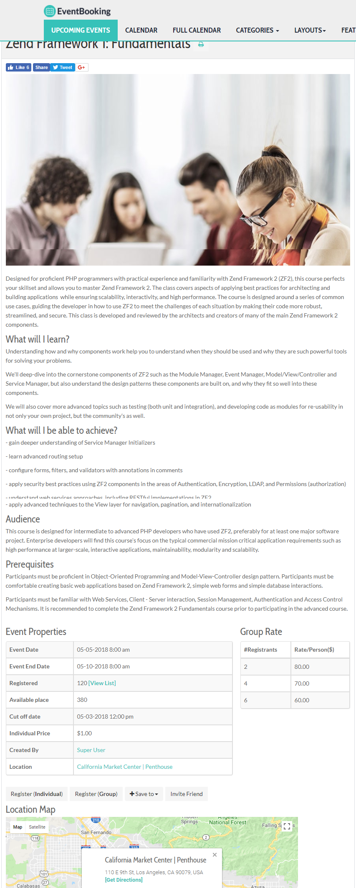

The **Event Detail** page displays information about a single event, including its dates and pricing. Visitors can reach it from the upcoming events page, a category page, the upcoming events module, or a menu item. They can use the registration buttons on the page to sign up.

To use this layout, you can create a menu item to link to **Event Detail** menu option of **Events Booking**. The settings below are specific to Events Booking.

- **Event**: Choose the event you want to display when users click on this menu item.
